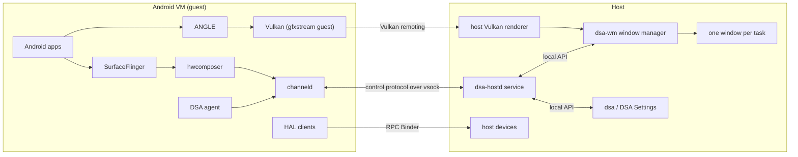

<div align="center">


# Desktop Subsystem for Android™

**Android-Apps als echte Desktop-Fenster, auf einem Open-Source-Stack.**

[](https://github.com/thisisthepy/desktop-subsystem-for-android/actions/workflows/test.yml)
[](https://github.com/thisisthepy/desktop-subsystem-for-android/actions/workflows/test-installer.yml)
[](https://github.com/thisisthepy/desktop-subsystem-for-android/actions/workflows/test-image.yml)
[](https://github.com/thisisthepy/desktop-subsystem-for-android/actions/workflows/test-kernel.yml)
[](https://github.com/thisisthepy/desktop-subsystem-for-android/releases/latest)
[](https://github.com/thisisthepy/desktop-subsystem-for-android/blob/main/LICENSE)

[English](../../README.md) · [한국어](README_ko.md) · [日本語](README_ja.md) · [简体中文](README_zh-CN.md) · [繁體中文](README_zh-TW.md) · [Español](README_es.md) · [Français](README_fr.md) · **Deutsch** · [Português (Brasil)](README_pt-BR.md) · [Русский](README_ru.md) · [Italiano](README_it.md) · [Tiếng Việt](README_vi.md) · [Bahasa Indonesia](README_id.md) · [Türkçe](README_tr.md)

</div>

> DSA ist ein unabhängiges Open-Source-Projekt. Es steht in keiner Verbindung zu Microsoft
> oder Google und wird von ihnen weder unterstützt noch gesponsert. Android ist eine Marke von
> Google LLC. Windows ist eine Marke der Microsoft-Unternehmensgruppe.

## Was DSA ist

DSA führt Android in einer eigenen schlanken VM aus und zeigt jeden Android-Task in einem
nativen Desktop-Fenster. Jede App hat eine eigene Schaltfläche in der Taskleiste, einen Eintrag
im Startmenü, eigene Benachrichtigungen und einen Eintrag in der Liste der installierten Apps,
so wie beim Windows Subsystem for Android (WSA), das Microsoft am 5. März 2025 eingestellt hat.
Jeder Teil von DSA ist Open Source, daher kann jeder es weiterführen.

**Status.** DSA läuft unter Windows 11 auf x64- und ARM64-PCs. Releases unter 1.0 sind
Vorabversionen. Ab 1.0 gibt es Releases in einem stabilen und einem Vorabversionskanal (siehe
[Updates und Release-Kanäle](#updates-und-release-kanäle)). Die Funktionen werden in der CI
getestet, und mit jedem Release werden sie weiter von Hand auf echter Hardware geprüft. Bitte
melden Sie daher, was Ihnen auffällt. Linux und macOS sind in Arbeit und noch nicht
veröffentlicht (siehe [Unterstützte Plattformen](#unterstützte-plattformen)).

## Funktionen

**Fenster und Eingabe**

- Ein natives Fenster pro Android-Task, das als die App selbst erscheint, mit dem eigenen
  Programmnamen und Symbol der App in der Taskleiste, bei Alt+Tab und im Task-Manager. Kein
  Emulatorrahmen, der den ganzen Bildschirm zeigt.
- Eine Titelleiste, die zur App gehört: Die Farben der App reichen bis an den oberen
  Fensterrand, die Titelleistenschaltflächen von Windows 11 liegen darüber, und Symbol und Name
  der App stehen links. Das Symbol wird zu einem Zurück-Pfeil, wenn die App zurückgehen kann.
  Andocklayouts, Ziehen, Doppelklick zum Maximieren und das Fenstermenü (Alt+Leertaste)
  funktionieren wie in jeder Windows-App.
- Das Fenstermenü ergänzt **Full screen** (Vollbild), **New window** (neues Fenster, für Apps,
  die mehrere erlauben), **Screenshot**, **Aspect ratio** (Seitenverhältnis), **Open by
  default** (standardmäßig öffnen) und **App info** (App-Info).
- Größenänderung in Echtzeit, ohne die App neu zu erstellen, und Maximieren, das den
  Arbeitsbereich des Monitors ausfüllt.
- Fordert eine App Vollbild an, etwa über die Vollbild-Schaltfläche eines Videoplayers, füllt
  sie den Bildschirm. Die Titelleiste erscheint, wenn der Mauszeiger den oberen Rand berührt.
  Apps, die nur ihre Leisten ausblenden, etwa ein Feed mit kurzen Videos, bleiben in ihrem
  Fenster. Beides lässt sich in DSA Settings wählen, für alle Apps oder für jede App einzeln,
  und F11 schaltet immer in den Vollbildmodus und zurück.
- Scharfe Darstellung auf jedem Monitor. Verschieben Sie eine App auf einen Monitor mit
  anderer Skalierung, zeichnet sie sich in der neuen Skalierung neu, sobald ihr Fenster dort
  ankommt, oder DSA skaliert stattdessen ihr Fenster, je nachdem, was Sie für die App wählen.
  Standardmäßig zeichnet sich eine App neu, die angibt, eine Änderung der Skalierung selbst zu
  verarbeiten, und DSA skaliert jede andere. Apps, die bekanntermaßen fehlerhaft werden, wenn
  sich ihre Skalierung zur Laufzeit ändert, etwa YouTube, skaliert standardmäßig DSA.
- Text in Apps folgt der Windows-Einstellung für die Textgröße.
- Maus (mit Hover), Toucheingabe mit bis zu zehn Fingern, Stift (Druck, Radierer,
  Zylindertaste) und die Tastatur mit jedem Layout.
- Texteingabe über das Windows Text Services Framework (TSF): Ihre Windows-Eingabemethode,
  einschließlich Koreanisch, setzt Zeichen direkt im Android-Editor zusammen, mit dem
  Kandidatenfenster neben dem Cursor. Rekonvertierung, die Bildschirmtastatur, die
  Spracheingabe (Win+H), Handschrift und das Emoji-Panel arbeiten mit dem Text des Editors
  selbst. Es gibt keine Android-Tastatur-App.
- Dateien lassen sich zwischen dem Explorer und App-Fenstern ziehen, in beide Richtungen.
- Die Touchgesten von Windows 11 mit drei und vier Fingern sind ausgeschaltet, solange ein
  DSA-Fenster im Vordergrund ist (standardmäßig aktiviert), damit die App sie erhält.
- Der Barrierefreiheitsbaum jeder App wird für Windows UI Automation bereitgestellt, für
  Bildschirmleseprogramme und Automatisierungswerkzeuge (siehe [UI Automation](#ui-automation)
  und [Barrierefreiheit](#barrierefreiheit)).

**Integration in die Shell**

- Einträge im Startmenü und in der Windows-Suche für jede Android-App, auch während Android
  gestoppt ist. Apps erscheinen unter Einstellungen > Apps > Installierte Apps und lassen sich
  dort deinstallieren.
- Desktopverknüpfungen sowie die eigenen Verknüpfungen der App (etwa ein neuer Chat in einem
  Messenger) in ihrer Sprungliste in der Taskleiste und im Startmenü. Wird eine App umbenannt,
  folgen ihr Startmenüeintrag, ihre Desktopverknüpfungen und ihre Anheftung an die Taskleiste
  dem neuen Namen.
- Android-Benachrichtigungen erscheinen als Windows-Benachrichtigungen unter Name und Symbol
  der jeweiligen App. Ein Klick darauf öffnet die App, und wer eine verwirft, verwirft sie auch
  in Android.
- Apps, die im Hintergrund laufen, erscheinen als Symbole im Infobereich, mit Medientasten und
  den Windows-Mediensteuerelementen für Apps, die Medien abspielen.
- Android-Widgets auf dem Desktop, jedes in einem eigenen Fenster.
- Die Zwischenablage für Text wird in beide Richtungen geteilt, Weblinks öffnen sich im
  Windows-Browser, Windows-Dateien lassen sich in Android-Apps öffnen und mit ihnen teilen, und
  Ihre Windows-Ordner werden mit Android geteilt.
- Die Dateien von Android im Explorer, unter **Android** im Navigationsbereich.
- APK-Installation per Doppelklick, über das Kontextmenü, durch Ablegen der Datei auf einem
  Fenster oder mit `dsa install`, mit einem Fenster, das zeigt, was die APK ist, bevor Android
  startet.
- „Share on PC“ im Teilen-Menü von Android: Text, Links und Dateien gehen an das
  Windows-Teilen-Fenster, einschließlich der Freigabe in der Nähe.

**Medien und Geräte**

- Audio über die Standardgeräte von Windows für Wiedergabe und Aufnahme, mit einer Zeile für
  jede App im Lautstärkemixer.
- Video wird auf der GPU des Hosts über Media Foundation dekodiert: H.264, HEVC, VP9 und AV1,
  bis 4096x2304. Dekodierte Bilder erreichen Android über einen Speicherbereich, den Host und VM
  gemeinsam nutzen, statt über den Videokanal kopiert zu werden. Formate, die die GPU nicht
  dekodiert, werden in Android per Software dekodiert.
- GPU-Rendering auf dem Host: Vulkan-Remoting über gfxstream und darauf OpenGL ES über ANGLE.
- Kamera, Mikrofon, Standort, Sensoren (Beschleunigungsmesser, Gyroskop, Ausrichtung, Licht)
  und Energie, jeweils hinter den Windows-Datenschutzeinstellungen und den Android-Berechtigungen.
- Die Netzwerkortung von Android beantwortet der Host, mit oder ohne Google Play. Ohne Google
  Play werden Adressabfragen (`Geocoder`) auf dem Computer aus Daten zu Verwaltungsgrenzen
  beantwortet, die mit DSA geliefert werden: Aus einer Position werden Land, Bundesland oder
  Provinz und Stadt, in Korea auch Bezirk und Stadtviertel. Es sind weder ein Server noch ein
  Schlüssel beteiligt, und die Position bleibt auf dem Computer. Straßenadressen und die
  Umwandlung einer Adresse in eine Position werden nicht angeboten. Mit Google Play antwortet
  der Geocoder von Google.

**System**

- Doze von Android als Ruhezustand: 30 Sekunden nachdem das letzte Android-Fenster geschlossen
  oder minimiert wurde, wechselt Android in Doze. Benachrichtigungen kommen weiter an, während
  die CPU ruht, und ungenutzter Speicher geht an Windows zurück, während Android läuft. Wer eine
  App öffnet, weckt Android sofort, ohne auf einen Systemstart zu warten. Das Einfrieren von
  Android ist eine Option und standardmäßig ausgeschaltet.
- Jeder Windows-Benutzer erhält ein eigenes Android und einen eigenen Datenträger in seinem
  eigenen Profil.
- Root-Zugriff wie mit `sudo`, standardmäßig ausgeschaltet. Ein Administrator schaltet ihn ein.
  Danach lässt sich für jede App, und im Entwicklermodus für `adb shell`, festlegen, dass sie
  fragt. Eine Anfrage zeigt die Administratorabfrage von Windows (Benutzerkontensteuerung, UAC)
  unter dem eigenen Namen und Symbol der App, und eine Zustimmung gilt 15 Minuten. Apps, die
  nicht zugelassen sind, sehen `su` überhaupt nicht. Jede Anfrage wird protokolliert.
- Sicherung der App-Daten in Ihren Benutzerordner, verschlüsselt, standardmäßig ausgeschaltet.
- DSA Settings: Apps und ihre Fenster, Hintergrund-Apps, Widgets, Anzeige und GPU, Speicher,
  Netzwerk, Geräteidentität, Updates, Add-ons, Root-Zugriff, Entwicklermodus mit adb, das
  Live-Protokoll von Android und Diagnosedaten. Alles darin gibt es auch als `dsa`-Befehl.

**Add-ons Ihrer Wahl**

DSA liefert keine Google-Software mit. Jedes dieser Add-ons wird nur auf Ihren Wunsch von seiner
Quelle heruntergeladen, nachdem DSA Ihnen die Quelle und die Bedingungen gezeigt hat, und landet
auf einem Add-on-Datenträger neben Android. Das Systemabbild wird nie verändert, und jedes
Add-on lässt sich in DSA Settings oder über die Befehlszeile wieder entfernen.

- **Google Play.** `dsa gapps install` oder **Advanced** > **Google Play** in DSA Settings lädt
  das öffentliche Paket LiteGapps Core (Google Play-Dienste, Play Store und
  Kontosynchronisierung) für Ihre Android-Version herunter. Dieses Android ist nicht von Google
  zertifiziert, daher fordert Google Sie unter Umständen auf, das Gerät zu registrieren. DSA
  Settings zeigt die Android-ID und die Seite dafür. Google Play hindert Android nie am Start.
  Für die Apps von Google gelten die Bedingungen von Google.
- **Widevine L3.** `dsa drm widevine install` oder **Advanced** > **Protected content** übernimmt
  das Widevine-Modul von Google unverändert aus dem Android-Emulator-Abbild von Google für Ihre
  Android-Version (etwa 2 GB Download; nur Widevine wird behalten). Streaming-Apps können dann
  geschützte Videos abspielen. Mit Sicherheitsstufe L3 senden Streamingdienste höchstens
  Standardauflösung. Für hohe Auflösung sehen Sie daher in einem Windows-Browser oder einer
  Windows-App.
- **ARM-Übersetzung.** Auf x64-PCs laufen Apps, die nur für ARM gebaut sind, über einen
  Übersetzer. Der Open-Source-Übersetzer Digitalis gehört zum x64-Abbild und wird ab dem ersten
  Start verwendet. Sie können ihn durch den Übersetzer von Google
  (`dsa arm-translation fetch google`) oder ein eigenes Paket ersetzen. Nur 64-Bit-ARM-Apps
  (`arm64-v8a`) laufen. Auf ARM64-PCs führt Android ARM-Apps selbst aus.

**Nicht enthalten:** Google Play-Dienste, ein App-Store oder eine andere Binärdatei von Google
(ihre Lizenzen machen sie zur Entscheidung des Benutzers) sowie die WSA-Binärdateien von
Microsoft.

## UI Automation

DSA stellt die Benutzeroberfläche in jedem Android-App-Fenster für Windows UI Automation (UIA,
Benutzeroberflächenautomatisierung) bereit, dieselbe Schnittstelle, die Windows-Apps nutzen.
Bildschirmleseprogramme, Testwerkzeuge und andere UIA-Clients sehen die Schaltflächen, Listen und
Textfelder einer Android-App als Elemente ihres Fensters statt als ein einziges Bild.

**So funktioniert es.** Fragt ein UIA-Client ein DSA-App-Fenster zum ersten Mal nach seinem
Baum, bittet das Fenster den DSA-Agenten in Android, diesen Task zu beobachten. Der Agent liest
die Barrierefreiheitsknoten von Android nur für diesen Task und sendet sie an den Host: zuerst
den ganzen Baum, dann die Änderungen. Der Host hält den Baum im Fensterprozess, sodass jedes
Lesen einer Eigenschaft und jeder Navigationsaufruf lokal beantwortet wird, ohne Umweg über die
VM. Hat 30 Sekunden lang kein UIA-Client zugehört, endet die Beobachtung, und Android liest
keine Knoten mehr. Wer keinen UIA-Client verwendet, zahlt dafür nichts.

**Was jedes Element enthält.**

- **Control type** (Steuerelementtyp), aus der Android-View-Klasse und ihrem Zustand:
  Schaltfläche, Kontrollkästchen, Optionsfeld, Bearbeitungsfeld, Schieberegler,
  Fortschrittsanzeige, Kombinationsfeld, Liste, Listenelement, Registerkarte, Menü, Bild, Text,
  Dokument (für eine `WebView`), Symbolleiste und Gruppe. Ein Android-Schalter ist eine
  Schaltfläche mit dem Toggle-Muster, und eine Überschrift ist Text.
- **Name**: die Inhaltsbeschreibung, sonst der Text, sonst der Hinweis eines leeren
  Bearbeitungsfelds. Ein anklickbares Element ohne eigenen Namen übernimmt die Namen seiner
  Kinder.
- **AutomationId**: die Ressourcen-ID der Android-View, etwa `com.example:id/send`.
- **ClassName**: die Android-View-Klasse. **FrameworkId** ist `Android`.
- **HelpText** (der Hinweis), **ItemStatus** (die Zustandsbeschreibung von Android),
  **IsEnabled**, **IsKeyboardFocusable**, **HasKeyboardFocus**, **IsPassword** und ein
  **BoundingRectangle** in Bildschirmkoordinaten.
- Elemente, die Android als für den Benutzer nicht sichtbar meldet, fehlen im Baum.
- Passwortfelder verlassen Android nie als Text: Jedes Zeichen kommt als Punkt an.

**Muster und was sie in Android bewirken.**

| UIA-Muster | Android-Aktion |
|---|---|
| Invoke | `ACTION_CLICK` |
| Value (`SetValue`) | `ACTION_SET_TEXT`, das den ganzen Text des Felds ersetzt |
| Toggle | `ACTION_CLICK` |
| SelectionItem (`Select`) | `ACTION_SELECT`, oder `ACTION_CLICK`, wenn der Knoten keine Auswahlaktion hat |
| Scroll | `ACTION_SCROLL_FORWARD` und `ACTION_SCROLL_BACKWARD`, seitenweise; kein Bildlaufprozentsatz |
| `SetFocus` | `ACTION_FOCUS`, oder `ACTION_ACCESSIBILITY_FOCUS`, wenn der Knoten keinen Eingabefokus annehmen kann |

Diese Aktionen gehen direkt an den Knoten. Sie bewegen weder die Maus noch erzeugen sie
Toucheingaben.

**Ereignisse.** Das Fenster löst Fokusänderungen aus (solange es im Vordergrund ist),
Strukturänderungen, wenn Kinder erscheinen oder verschwinden, und Eigenschaftsänderungen für
Name, Wert, Umschaltzustand, Auswahl, Aktivierungszustand und das umgebende Rechteck. Ereignisse
werden nur ausgelöst, solange ein Client zuhört.

**Texteingabe.** `SetValue` setzt den Text eines Felds in einem Schritt. Tippen,
Zeichenzusammensetzung und Eingabemethoden laufen dagegen über TSF und die `InputConnection` der
App, wie bei einem Menschen an der Tastatur.

**Das Fenster selbst.** Der Name des Fensters ist der Name der App. Die
Titelleistenschaltflächen (Minimieren, Maximieren oder Wiederherstellen, Schließen) und der
Zurück-Pfeil in der Titelleiste sind benannte Schaltflächen im Baum.

**Verwendung aus anderen Werkzeugen.** Jeder UIA-Client funktioniert, etwa Inspect und
Accessibility Insights for Windows, oder Bibliotheken wie FlaUI. Suchen Sie das Fenster der App
über seinen Namen und dann seine Elemente über AutomationId, Name oder Steuerelementtyp. Für
Skripte, die auf einen Punkt statt auf ein Element drücken müssen, drückt
`dsa tap <package> <x> <y>` innerhalb des Tasks der App.

**Noch nicht vorhanden.** Es gibt kein Text-Muster, kein RangeValue- oder
ExpandCollapse-Muster, kein langes Drücken über UIA, keine Überschriftenebene und keine
Benachrichtigungs- oder Live-Region-Ereignisse. Der Barrierefreiheitsfokus von Android wird
nicht exportiert, nur der Eingabefokus. Verbesserungen werden in Issue
[#744](https://github.com/thisisthepy/desktop-subsystem-for-android/issues/744) verfolgt
(offen).

## Barrierefreiheit

**Bildschirmleseprogramme.** NVDA und die Sprachausgabe (Narrator) lesen Android-Apps über den
oben beschriebenen UI-Automation-Baum: Steuerelemente haben Namen und Rollen, der Fokus folgt
der Tastatur, und Schaltflächen, Schalter, Listen und Textfelder lassen sich ohne Maus bedienen.
JAWS nutzt denselben Baum. Das Projekt hat es noch nicht geprüft, daher sind Berichte
willkommen.

**Woran gearbeitet wird.** Diese Punkte stammen aus dem Bericht eines Benutzers von
Bildschirmleseprogrammen, Issue
[#744](https://github.com/thisisthepy/desktop-subsystem-for-android/issues/744). Jeder ist offen
und wird dort verfolgt:

- **Schnellerer Fokus.** Derzeit wartet eine Fokusänderung in Android, bevor sie Windows
  erreicht, etwa 250 bis 450 ms nach einem Tastendruck, und eine gehaltene Pfeiltaste bewegt
  sich mit etwa vier Schritten pro Sekunde. Geplant ist, Fokusänderungen sofort zu senden, nur
  den Task zu lesen, aus dem ein Ereignis kam, und die kurzen Zeiten auf Phasen zu beschränken,
  in denen ein UIA-Client zuhört.
- **Barrierefreiheitsfokus.** Derzeit wird nur der Eingabefokus exportiert, daher lösen
  Bewegungen des Barrierefreiheitsfokus von Android kein Fokusereignis aus.
- **Text-Muster.** Bearbeitungsfelder haben noch kein Text-Muster, mit dem NVDA Text nach
  Zeichen, Wort und Zeile liest und prüft. Ihr Wert lässt sich lesen und setzen.

**Die eigenen Fenster von DSA.**

- **DSA Settings** funktioniert mit der Tastatur und mit Bildschirmleseprogrammen: Navigation,
  Zeilen und Steuerelemente sind UIA-Elemente mit Namen.
- **Der APK Installer** benennt jedes seiner Elemente, und sein Link **More** (mehr) klappt
  über UIA auf und zu.
- **Widgets auf dem Desktop** nehmen den Tastaturfokus an. Eingabetaste, Leertaste, die
  Menütaste und Umschalt+F10 öffnen das Menü des Widgets.
- **Menüs** von Widgets und Symbolen im Infobereich sind UIA-Menüs mit Tastaturnavigation, und
  **Bestätigungsdialoge** haben Zugriffstasten und eine Standardschaltfläche.
- **Die Root-Abfrage** ist die Administratorabfrage von Windows selbst (UAC).
- Die Titelleistenschaltflächen verwenden in einem Kontrastdesign die Systemfarben.

Unter Linux exportiert der Host denselben Baum an AT-SPI, mit Text nach Zeichen, Wort und Zeile,
für Orca. Linux ist noch nicht veröffentlicht. Der macOS-Host exportiert noch keine App-Bäume.

**Ein Problem melden.** Eröffnen Sie ein
[Issue](https://github.com/thisisthepy/desktop-subsystem-for-android/issues/new) mit dem
Bildschirmleseprogramm und seiner Version, der App, dem, was Sie getan haben, was Sie gehört
haben und was Sie erwartet haben. Ein Diagnosepaket aus `dsa logs collect -o diag.zip` hilft.
Auch der [DSA-Discord](https://discord.gg/MtpQnR4eQQ) steht für Fragen offen.

## Unterstützte Plattformen

| Host | Status |
|---|---|
| Windows 11, x64 | Veröffentlicht als `DSA-v<version>-win-x64-setup.exe` |
| Windows 11, ARM64 | Veröffentlicht als `DSA-v<version>-win-arm64-setup.exe`. Android ist ebenfalls ARM64, daher laufen ARM-Apps ohne Übersetzung |
| Linux (x64, ARM64) | In Arbeit, nicht veröffentlicht. Der KVM-Host, der Wayland-Compositor und die Pakete `.deb` und `.rpm` werden in der CI gebaut und ausgeführt |
| macOS (Apple silicon) | In Arbeit, nicht veröffentlicht. Der Host auf dem Virtualization Framework von Apple und sein App-Bundle werden in der CI gebaut |

### Android-Versionen

DSA unterstützt die zwei neuesten Android-Hauptversionen: derzeit Android 16 und Android 17.
Eine Version verliert die Unterstützung, sobald die zweite neuere Hauptversion erscheint.
Android 16 wird also unterstützt, bis Android 18 veröffentlicht ist. Der Abbild-Updater bringt
jeden Benutzer auf eine unterstützte Version und wechselt nie von sich aus zu einer niedrigeren
Hauptversion. Sie können jede der beiden unterstützten Versionen in DSA Settings oder mit
`dsa android use` wählen. Der Wechsel zur älteren Version löscht die Android-Daten, weil Android
keine Daten lesen kann, die eine neuere Version geschrieben hat.

<p align="center">
  
</p>

Daten nach dem heutigen Tag sind voraussichtliche Termine, keine Releases.

## Installation

**Sie benötigen** Windows 11 auf einem x64- oder ARM64-PC, mit aktiviertem Windows-Feature
**VM-Plattform** (Virtual Machine Platform). Das Setup prüft dies und bricht mit einer Anleitung
ab, wenn es ausgeschaltet ist.

1. Aktivieren Sie die **VM-Plattform**: Einstellungen > System > Optionale Features > Weitere
   Windows-Features, oder führen Sie
   `dism /online /enable-feature /featurename:VirtualMachinePlatform /all` in einem Terminal
   als Administrator aus. Starten Sie neu.
2. Laden Sie `DSA-v<version>-win-x64-setup.exe` herunter, auf einem ARM64-PC
   `DSA-v<version>-win-arm64-setup.exe`, und zwar vom
   [neuesten Release](https://github.com/thisisthepy/desktop-subsystem-for-android/releases/latest),
   und prüfen Sie die Datei anhand von `SHA256SUMS.txt`.
3. Führen Sie sie aus. Das Setup installiert den Dienst `DsaHost`, den Befehl `dsa`, DSA
   Settings, den APK Installer und das erste Android-Abbild (heruntergeladen, wenn das Setup
   keines mitbringt). Android startet bei Ihrer Anmeldung, sodass die erste App, die Sie öffnen,
   nicht auf einen Systemstart wartet.

Kein Kernel zum Bauen und keine Änderung an Ihrer WSL-Einrichtung: DSA bringt einen eigenen
Kernel und eine eigene VM mit. Die Deinstallation entfernt alles, was DSA geschrieben hat, außer
dem Android-Datenträger jedes Benutzers.

## Updates und Release-Kanäle

DSA aktualisiert sich selbst und das Android-Abbild. Beide sind signiert, und nichts wird
angewendet, dessen Signatur, Größe oder Hash nicht übereinstimmt.

- **DSA selbst.** Der Dienst prüft eine signierte Liste von Releases und installiert eine neuere
  Version, wenn bei keinem Benutzer Android läuft. Andernfalls wartet er, und `dsa update`
  installiert sofort. Sie werden vorher und nachher informiert. Ein Update bringt DSA nie auf
  eine niedrigere Version.
- **Kanäle.** Ab 1.0 gibt es zwei: **stable** (stabil) und **pre-release** (Vorabversion) für
  Versionen, die noch fertiggestellt werden. Der Vorabversionskanal nimmt die jeweils neuere der
  beiden. Ihr Kanal richtet sich zunächst nach dem verwendeten Installationsprogramm, und
  Upgrades behalten ihn bei. Ändern Sie ihn mit **Get pre-release versions** (Vorabversionen
  erhalten) auf der Seite **Updates** von DSA Settings oder mit
  `dsa settings set prerelease-updates on|off` (Administratoren). Wer die Vorabversionen
  verlässt, wird nie zurückgestuft: DSA wartet auf ein neueres stabiles Release. Jedes Release
  vor 1.0 ist eine Vorabversion.
- **Android-Abbild.** Abbild-Updates hängen nicht vom Kanal ab. Ein Abbild, das nicht startet,
  wird durch das letzte funktionierende ersetzt, und `dsa status` meldet das. Mit **Restart
  Android into updates by itself** (Android für Updates selbst neu starten) startet Android in
  ein heruntergeladenes Update neu, wenn kein App-Fenster geöffnet ist.
- **Updates ausschalten.** Administratoren können **Update DSA automatically** (DSA automatisch
  aktualisieren) und **Update the Android image automatically** (Android-Abbild automatisch
  aktualisieren) auf der Seite **Updates** ausschalten.

Stabile Releases entstehen nur aus `main`, nach einer Prüfung. Builds von `develop` sind
Vorabversionen oder Test-Builds für Mitwirkende.

## Schnellstart

Öffnen Sie eine Android-App aus dem Startmenü, oder verwenden Sie den Befehl `dsa`:

```
dsa status                          # Zustand von Android und ausstehende Updates
dsa install app.apk                 # eine APK oder ein Split-APK-Bundle (.xapk, .apks, .apkm) installieren
dsa apps list                       # die installierten Apps
dsa launch com.android.settings     # eine App in einem eigenen Fenster öffnen
dsa settings set clipboard off      # eine Einstellung ändern (DSA Settings hat dieselben Schalter)
dsa logcat -d -b all *:W            # das Protokoll von Android, ab Warnungen
dsa logs collect -o diag.zip        # alles, was ein Problembericht braucht, als eine ZIP-Datei
```

`dsa` ohne Argumente listet jeden Befehl auf. Das Protokoll von Android bleibt im Speicher und
fließt nur zum Host, solange etwas es liest. Hängen Sie `diag.zip` an einen Problembericht an.

## Einschränkungen

Derzeit gilt:

- Nur Windows ist veröffentlicht. Linux und macOS sind in Arbeit.
- DSA Settings gibt es nur auf Englisch und Koreanisch.
- Nur 64-Bit-Apps laufen: `arm64-v8a` und auf x64 `x86_64`. 32-Bit-Apps laufen nicht.
- Widevine ist L3, daher laufen geschützte Streams höchstens in Standardauflösung.
- Google Play ist auf DSA nicht von Google zertifiziert. Google fordert Sie unter Umständen auf,
  das Gerät zu registrieren.
- Die Zwischenablage teilt nur Text.
- Die Skalierungsoption **System (forced)** ist noch nicht verfügbar und verhält sich wie
  **System**.
- Der UI-Automation-Export hat die unter [UI Automation](#ui-automation) aufgeführten Lücken.
- Adressabfragen ohne Google Play liefern das Gebiet (vom Land bis zur Stadt, in Korea bis zum
  Bezirk), keine Straßenadressen.

## Benutzerhandbücher

Schritt-für-Schritt-Anleitungen behandeln Installation, Apps und Fenster, APKs, Dateien,
Android-Versionen, Einstellungen, Speicher, Entwicklermodus, Fehlerbehebung und Deinstallation:
[docs/guides](../guides/de/README.md). Die [Einführungsseite](../guides/intro/index.html)
erklärt das Projekt für Neueinsteiger.

## Architektur



- **Gast.** Ein mit der Plattform signierter Agent schaltet die Anzeige in den Freiform-Modus
  und meldet Tasks, Apps, Benachrichtigungen und Barrierefreiheitsbäume. Der hwcomposer übergibt
  die Ebenen jedes Tasks als eigene Anzeige an den Host. Die HAL-Clients erreichen die Geräte des
  Hosts über RPC Binder. Es gibt keinen Launcher, keine Statusleiste und keine Tastatur-App: Der
  Host ist die Shell.
- **Protokoll.** Eine Definition, `dsa/protocol/control.proto`, mit generierten Codecs für Rust,
  Java und C++. Jede Verbindung prüft die Protokollversion, den Schema-Hash und ein Geheimnis,
  das für jeden Systemstart neu erzeugt wird.
- **Host.** `dsa/host/core/` ist plattformneutral: Sitzungen, die App-Registrierung und die
  Lebenszyklusrichtlinie. Jedes Betriebssystem ergänzt die VM, den Transport und das
  Fenstersystem unter `dsa/host/platform/<os>/`. Unter Windows wird die VM über das Host Compute
  System erstellt, und Frames gelangen von der GPU über Direct3D 11 und DirectComposition zu
  jedem Fenster, nie über die CPU.

## Aus dem Quellcode bauen

Die Rust-Crates bilden einen Workspace in `dsa/`:

```
cd dsa
cargo test --workspace
cargo build -p dsa-host-windows --release
```

Andere Teile haben einen eigenen Build, der jeweils daneben beschrieben ist:

- das Installationsprogramm: `dsa/host/platform/windows/installer/README.md`
- der Windows-Host: `dsa/host/platform/windows/README.md`
- der Gast-Kernel: `dsa/kernel/`
- das Android-Abbild und die Gast-Komponenten: `dsa/guest/`
- der Grafikpfad: `dsa/graphics/`

Upstream-Projekte (AOSP, gfxstream, der Kernel) werden nicht eingebunden: Skripte holen eine
festgelegte Revision und wenden die hier gepflegten Patches an. Python-Werkzeuge laufen mit
`uv run`.

## Aufbau des Repositorys

| Pfad | Inhalt |
|---|---|
| `dsa/protocol/` | Das Steuerprotokoll zwischen Gast und Host und seine Codegeneratoren |
| `dsa/host/core/` | Der plattformneutrale Host |
| `dsa/host/cli/` | Der Befehl `dsa` |
| `dsa/host/platform/windows/` | Der Windows-Host, Fenstermanager, Installationsprogramm und DSA Settings |
| `dsa/host/platform/linux/`, `macos/`, `unix/` | Die Hosts für Linux und macOS und ihre gemeinsamen Teile |
| `dsa/graphics/` | Vulkan-Remoting, ausgehend von gfxstream |
| `dsa/guest/` | Der Agent, hwcomposer, HAL-Dienste und die Abbildkonfiguration |
| `dsa/kernel/` | Die Konfiguration und der Build des Gast-Kernels |
| `scripts/tests/` | Prüfungen des Repositorys |
| `.github/` | CI-Workflows, Release-Skripte und die Assets der README |

## Mitwirken

DSA ist jung und wird noch stabilisiert, daher hilft jeder Bericht, ob Sie eine Lösung parat
haben oder nicht.

<p>
  <a href="https://github.com/thisisthepy/desktop-subsystem-for-android/issues/new"></a>
  <a href="https://discord.gg/MtpQnR4eQQ"></a>
</p>

- **Einen Fehler gefunden oder eine Idee?** [Eröffnen Sie ein Issue](https://github.com/thisisthepy/desktop-subsystem-for-android/issues/new).
  Beschreiben Sie, was Sie getan haben und was passiert ist, mit Ihrem Windows-Build (`winver`)
  und den Versionen von DSA und Android (`dsa status`). Ein Diagnosepaket aus
  `dsa logs collect -o diag.zip` macht es viel leichter, einen Fehler aufzuspüren.
- **Möchten Sie zuerst fragen oder es einfach besprechen?** Kommen Sie in den
  [DSA-Discord](https://discord.gg/MtpQnR4eQQ). Fragen, was Sie zum Laufen bringen möchten, und
  frühes Feedback sind dort willkommen.
- **Möchten Sie eine Änderung einsenden?** Die Arbeit findet auf dem Branch `develop` statt;
  `main` wird daraus veröffentlicht. Öffnen Sie Pull Requests gegen `develop`, mit einer
  logischen Änderung pro Commit und einem Test für jede Verhaltensänderung. Generierter
  Protokollcode wird nie von Hand bearbeitet. Bitte verwenden Sie in Texten keine Geviertstriche
  (em dashes): Eine Prüfung des Repositorys weist sie zurück.

## Lizenz

[Apache-2.0](https://github.com/thisisthepy/desktop-subsystem-for-android/blob/main/LICENSE).
Jede mitgelieferte Drittanbieterkomponente behält ihre eigene Lizenz, die im
Installationsprogramm aufgeführt ist.

## Marken

Android ist eine Marke von Google LLC. Windows ist eine Marke der Microsoft-Unternehmensgruppe.
DSA steht in keiner Verbindung zu Microsoft oder Google und wird von ihnen weder unterstützt noch
gesponsert.

## Star-Verlauf

<a href="https://www.star-history.com/#thisisthepy/desktop-subsystem-for-android&Date">
  <picture>
    <source media="(prefers-color-scheme: dark)" srcset="https://api.star-history.com/svg?repos=thisisthepy/desktop-subsystem-for-android&type=Date&theme=dark" />
    <source media="(prefers-color-scheme: light)" srcset="https://api.star-history.com/svg?repos=thisisthepy/desktop-subsystem-for-android&type=Date" />
    
  </picture>
</a>
