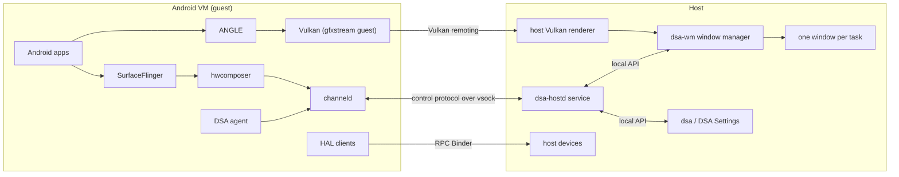

<div align="center">


# Desktop Subsystem for Android™

**Aplicaciones de Android como ventanas de escritorio reales, sobre una base de código abierto.**

[](https://github.com/thisisthepy/desktop-subsystem-for-android/actions/workflows/test.yml)
[](https://github.com/thisisthepy/desktop-subsystem-for-android/actions/workflows/test-installer.yml)
[](https://github.com/thisisthepy/desktop-subsystem-for-android/actions/workflows/test-image.yml)
[](https://github.com/thisisthepy/desktop-subsystem-for-android/actions/workflows/test-kernel.yml)
[](https://github.com/thisisthepy/desktop-subsystem-for-android/releases/latest)
[](https://github.com/thisisthepy/desktop-subsystem-for-android/blob/main/LICENSE)

[English](../../README.md) · [한국어](README_ko.md) · [日本語](README_ja.md) · [简体中文](README_zh-CN.md) · [繁體中文](README_zh-TW.md) · **Español** · [Français](README_fr.md) · [Deutsch](README_de.md) · [Português (Brasil)](README_pt-BR.md) · [Русский](README_ru.md) · [Italiano](README_it.md) · [Tiếng Việt](README_vi.md) · [Bahasa Indonesia](README_id.md) · [Türkçe](README_tr.md)

</div>

> DSA es un proyecto independiente de código abierto. No está afiliado a Microsoft ni a
> Google, ni cuenta con su respaldo o patrocinio. Android es una marca comercial de Google
> LLC. Windows es una marca comercial del grupo de empresas Microsoft.

## Qué es

DSA ejecuta Android en una máquina virtual ligera propia y muestra cada tarea de Android en
una ventana nativa del escritorio. Cada aplicación tiene su propio botón en la barra de
tareas, su entrada en el menú Inicio, sus notificaciones y su entrada en la lista de
aplicaciones instaladas, como ocurría con el Subsistema de Windows para Android (WSA), que
Microsoft retiró el 5 de marzo de 2025. Todas las partes de DSA son de código abierto, de
modo que cualquiera puede continuarlo.

**Estado.** DSA funciona en Windows 11, en equipos x64 y ARM64. Las versiones anteriores a
la 1.0 son versiones preliminares; a partir de la 1.0, las versiones se publican en un canal
estable y en un canal de versiones preliminares (consulte
[Actualizaciones y canales de publicación](#actualizaciones-y-canales-de-publicación)). Las
funciones se prueban en CI, y la comprobación manual en hardware real continúa con cada
versión, así que le agradecemos que informe de lo que encuentre. Linux y macOS están en
desarrollo y no se han publicado (consulte [Plataformas compatibles](#plataformas-compatibles)).

## Funciones

**Ventanas y entrada**

- Una ventana nativa por cada tarea de Android, dibujada como la propia aplicación, con el
  nombre de programa y el icono de la aplicación en la barra de tareas, en Alt+Tab y en el
  Administrador de tareas. No hay ningún marco de emulador que muestre la pantalla completa.
- Una barra de título que forma parte de la aplicación: los colores de la aplicación llegan
  hasta el borde superior de la ventana, los botones de título de Windows 11 se sitúan
  encima y el icono y el nombre de la aplicación aparecen a la izquierda. El icono se
  convierte en una flecha de retroceso cuando la aplicación puede volver atrás. Los diseños
  de ajuste, el arrastre, el doble clic para maximizar y el menú de la ventana (Alt+Espacio)
  funcionan como en cualquier aplicación de Windows.
- El menú de la ventana añade **Full screen**, **New window** (para las aplicaciones que
  permiten varias), **Screenshot**, **Aspect ratio**, **Open by default** y **App info**.
- Cambio de tamaño en vivo sin volver a crear la aplicación, y una maximización que ocupa el
  área de trabajo del monitor.
- La petición de pantalla completa de una aplicación, como el botón de pantalla completa de
  un reproductor de vídeo, ocupa toda la pantalla; la barra de título aparece cuando el
  puntero toca el borde superior. Las aplicaciones que solo ocultan sus barras, como un
  feed de vídeos cortos, se quedan en su ventana. Ambos comportamientos se eligen en DSA
  Settings, para todas las aplicaciones o para cada una, y F11 siempre alterna la pantalla
  completa.
- Imagen nítida en todos los monitores. Una aplicación se abre con la escala del monitor en
  el que se abre y, cuando la mueve a un monitor con otra escala, se vuelve a dibujar con la
  nueva escala en cuanto la suelta, o bien DSA escala su ventana, según lo que usted elija
  para cada aplicación. Las aplicaciones que se sabe que fallan cuando su escala cambia
  mientras se ejecutan, como YouTube, las escala DSA de forma predeterminada.
- El texto de las aplicaciones sigue la configuración de tamaño del texto de Windows.
- Ratón (con desplazamiento del puntero por encima), entrada táctil con hasta diez dedos,
  lápiz (presión, borrador, botón lateral) y teclado con cualquier distribución.
- Entrada de texto a través del marco de servicios de texto de Windows (TSF): su método de
  entrada de Windows, incluido el coreano, compone el texto directamente en el editor de
  Android, con la ventana de candidatos junto al cursor. La reconversión, el teclado táctil,
  la escritura por voz (Win+H), la escritura a mano y el panel de emojis funcionan sobre el
  propio texto del editor. No hay ninguna aplicación de teclado de Android.
- Archivos arrastrados entre el Explorador de archivos y las ventanas de las aplicaciones,
  en ambos sentidos.
- Los gestos táctiles de tres y cuatro dedos de Windows 11 se desactivan mientras una
  ventana de DSA está en primer plano (activado de forma predeterminada), para que la
  aplicación los reciba.
- El árbol de accesibilidad de cada aplicación se expone a UI Automation de Windows, para
  lectores de pantalla y herramientas de automatización (consulte
  [UI Automation](#ui-automation) y [Accesibilidad](#accesibilidad)).

**Integración con el shell**

- Entradas en el menú Inicio y en la búsqueda de Windows para cada aplicación de Android,
  incluso mientras Android está detenido; las aplicaciones aparecen en Configuración >
  Aplicaciones > Aplicaciones instaladas, desde donde se pueden desinstalar.
- Accesos directos en el escritorio, y los accesos directos propios de la aplicación (como
  el chat nuevo de una aplicación de mensajería) en su lista de accesos directos de la barra
  de tareas y del menú Inicio. Cuando una aplicación cambia de nombre, su entrada del menú
  Inicio, sus accesos directos del escritorio y su anclaje en la barra de tareas adoptan el
  nuevo nombre.
- Las notificaciones de Android aparecen como notificaciones de Windows con el nombre y el
  icono de cada aplicación; al seleccionar una se abre la aplicación, y al descartarla se
  descarta también en Android.
- Las aplicaciones que se ejecutan en segundo plano aparecen como iconos del área de
  notificación, con las teclas multimedia y los controles multimedia de Windows para las
  aplicaciones que reproducen contenido.
- Widgets de Android colocados en el escritorio, cada uno en su propia ventana.
- Portapapeles de texto compartido en ambos sentidos, enlaces web abiertos en el navegador
  de Windows, archivos de Windows abiertos en aplicaciones de Android y compartidos con
  ellas, y sus carpetas de Windows compartidas con Android.
- Los archivos de Android en el Explorador de archivos, en **Android** dentro del panel de
  navegación.
- Instalación de APK con doble clic, desde el menú contextual, soltando el archivo sobre una
  ventana o con `dsa install`, con una ventana que muestra qué es el APK antes de que se
  inicie Android.
- "Share on PC" en la hoja para compartir de Android: el texto, los enlaces y los archivos
  van a la ventana de compartir de Windows, incluido Uso compartido en proximidad.

**Multimedia y dispositivos**

- Audio a través de los dispositivos de salida y de entrada predeterminados de Windows, con
  una línea por aplicación en el mezclador de volumen.
- Vídeo descodificado en la GPU del host mediante Media Foundation: H.264, HEVC, VP9 y AV1,
  hasta 4096x2304. Las imágenes descodificadas llegan a Android a través de una región de
  memoria que comparten el host y la máquina virtual, en lugar de copiarse por el canal de
  vídeo. Los formatos que la GPU no descodifica se descodifican en Android por software.
- Renderizado por GPU en el host: Vulkan remoto a través de gfxstream, y OpenGL ES a través
  de ANGLE sobre él.
- Cámara, micrófono, ubicación, sensores (acelerómetro, giroscopio, orientación, luz) y
  energía, cada uno protegido tanto por la configuración de privacidad de Windows como por
  los permisos de Android.
- La ubicación de red de Android la responde el host, con o sin Google Play. Sin Google
  Play, las búsquedas de direcciones (`Geocoder`) se responden en el equipo a partir de
  datos de límites administrativos que incluye DSA: una posición se convierte en su país,
  su provincia y su ciudad, y en Corea en su distrito y su barrio. No interviene ningún
  servidor ni ninguna clave, y la posición no sale del equipo. No se ofrecen direcciones de
  calle ni la conversión de una dirección en una posición. Con Google Play, responde el
  geocodificador de Google.

**Sistema**

- Doze de Android como estado inactivo: 30 segundos después de que se cierre o minimice la
  última ventana de Android, Android entra en Doze, las notificaciones siguen llegando
  mientras la CPU descansa y la memoria inactiva vuelve a Windows mientras Android se
  ejecuta. Al abrir una aplicación, Android despierta al instante, sin esperar a un
  arranque. Congelar Android es una opción, desactivada de forma predeterminada.
- Cada usuario de Windows tiene su propio Android y su propio disco de datos, en su propio
  perfil.
- Acceso root similar a `sudo`, desactivado de forma predeterminada. Un administrador lo
  activa; después, cada aplicación, y `adb shell` en el modo de desarrollador, se puede
  configurar para que pregunte. Una solicitud muestra el aviso de administrador de Windows
  (UAC) con el nombre y el icono de la propia aplicación, y una aprobación dura 15 minutos.
  Las aplicaciones que no tienen permiso no pueden ver `su` en absoluto. Cada solicitud
  queda registrada.
- Copia de seguridad cifrada de los datos de las aplicaciones en su carpeta de usuario,
  desactivada de forma predeterminada.
- DSA Settings: las aplicaciones y sus ventanas, las aplicaciones en segundo plano, los
  widgets, la pantalla y la GPU, la memoria, la red, la identidad del dispositivo, las
  actualizaciones, los complementos, el acceso root, el modo de desarrollador con adb, el
  registro en vivo de Android y los diagnósticos. Todo lo que contiene también está
  disponible como comando `dsa`.

**Complementos que usted elige**

DSA no incluye software de Google. Cada uno de estos complementos se descarga de su origen
solo cuando usted lo solicita, después de que DSA le muestre el origen y las condiciones, y
se guarda en un disco de complementos junto a Android. La imagen del sistema nunca se
modifica, y cada complemento se puede volver a quitar desde DSA Settings o desde la línea de
comandos.

- **Google Play.** `dsa gapps install`, o **Advanced** > **Google Play** en DSA Settings,
  descarga el paquete público LiteGapps Core (servicios de Google Play, Play Store y
  sincronización de cuentas) para su versión de Android. Este Android no está certificado
  por Google, por lo que Google puede pedirle que registre el dispositivo; DSA Settings
  muestra el ID de Android y la página donde hacerlo. Google Play nunca impide que Android
  se inicie. Las aplicaciones de Google se rigen por las condiciones de Google.
- **Widevine L3.** `dsa drm widevine install`, o **Advanced** > **Protected content**, toma
  el módulo Widevine de Google, sin modificar, de la imagen del emulador de Android de Google
  para su versión de Android (unos 2 GB de descarga; solo se conserva Widevine). Así, las
  aplicaciones de streaming pueden reproducir vídeo protegido. Con el nivel de seguridad L3,
  los servicios de streaming envían como máximo definición estándar, así que vea el
  contenido en alta definición en un navegador o una aplicación de Windows.
- **Traducción ARM.** En equipos x64, las aplicaciones compiladas solo para ARM se ejecutan
  a través de un traductor. El traductor de código abierto Digitalis viene con la imagen
  x64 y se usa desde el primer inicio. Puede sustituirlo por el traductor de Google
  (`dsa arm-translation fetch google`) o por un paquete propio. Solo se ejecutan las
  aplicaciones ARM de 64 bits (`arm64-v8a`). En equipos ARM64, Android ejecuta las
  aplicaciones ARM por sí mismo.

**No se incluyen:** los servicios de Google Play, una tienda de aplicaciones ni ningún otro
binario de Google (sus licencias hacen que sean una elección del usuario), ni ninguno de los
binarios de WSA de Microsoft.

## UI Automation

DSA expone la interfaz de usuario de cada ventana de aplicación de Android a UI Automation
(UIA, automatización de la interfaz de usuario) de Windows, la misma interfaz que usan las
aplicaciones de Windows. Los lectores de pantalla, las herramientas de prueba y otros
clientes de UIA ven los botones, las listas y los campos de texto de una aplicación de
Android como elementos de su ventana, en lugar de una sola imagen.

**Cómo funciona.** Cuando un cliente de UIA pide por primera vez a una ventana de aplicación
de DSA su árbol, la ventana pide al agente de DSA en Android que observe esa tarea. El
agente lee los nodos de accesibilidad de Android solo de esa tarea y los envía al host:
primero el árbol completo y después los cambios. El host mantiene el árbol en el proceso de
la ventana, de modo que cada lectura de una propiedad y cada llamada de navegación se
responden localmente, sin un viaje de ida y vuelta a la máquina virtual. Cuando ningún
cliente de UIA ha escuchado durante 30 segundos, la observación se detiene y Android deja de
leer nodos. Los usuarios que no usan ningún cliente de UIA no pagan nada por ello.

**Qué contiene cada elemento.**

- **Control type** (tipo de control), a partir de la clase de vista de Android y de su
  estado: botón, casilla, botón de opción, edición, control deslizante, barra de progreso,
  cuadro combinado, lista, elemento de lista, pestaña, menú, imagen, texto, documento (para
  un `WebView`), barra de herramientas y grupo. Un interruptor de Android es un botón con el
  patrón Toggle, y un encabezado es texto.
- **Name**: la descripción del contenido; si no la hay, el texto; si no lo hay, la pista de
  un campo de edición vacío. Un elemento en el que se puede hacer clic y que no tiene nombre
  propio toma los nombres de sus hijos.
- **AutomationId**: el ID de recurso de la vista de Android, como `com.example:id/send`.
- **ClassName**: la clase de vista de Android. **FrameworkId** es `Android`.
- **HelpText** (la pista), **ItemStatus** (la descripción de estado de Android),
  **IsEnabled**, **IsKeyboardFocusable**, **HasKeyboardFocus**, **IsPassword** y un
  **BoundingRectangle** en coordenadas de pantalla.
- Los elementos que Android indica como no visibles para el usuario se omiten del árbol.
- Los campos de contraseña nunca salen de Android como texto: cada carácter llega como un
  punto.

**Los patrones y lo que hacen en Android.**

| Patrón de UIA | Acción de Android |
|---|---|
| Invoke | `ACTION_CLICK` |
| Value (`SetValue`) | `ACTION_SET_TEXT`, que sustituye todo el texto del campo |
| Toggle | `ACTION_CLICK` |
| SelectionItem (`Select`) | `ACTION_SELECT`, o `ACTION_CLICK` cuando el nodo no tiene acción de selección |
| Scroll | `ACTION_SCROLL_FORWARD` y `ACTION_SCROLL_BACKWARD`, por página; sin porcentaje de desplazamiento |
| `SetFocus` | `ACTION_FOCUS`, o `ACTION_ACCESSIBILITY_FOCUS` cuando el nodo no puede recibir el foco de entrada |

Estas acciones van directamente al nodo. No mueven el ratón ni inyectan toques.

**Eventos.** La ventana genera eventos de cambio de foco (mientras está en primer plano), de
cambio de estructura cuando aparecen o desaparecen hijos, y de cambio de propiedad para el
nombre, el valor, el estado de alternancia, la selección, el estado habilitado y el
rectángulo delimitador. Los eventos solo se generan mientras un cliente escucha.

**Entrada de texto.** `SetValue` establece el texto de un campo en un solo paso. La
escritura, la composición y los métodos de entrada pasan en cambio por TSF y por el
`InputConnection` de la aplicación, igual que para una persona que usa el teclado.

**La propia ventana.** El nombre de la ventana es el nombre de la aplicación. Los botones de
título (minimizar, maximizar o restaurar, cerrar) y la flecha de retroceso de la barra de
título son botones con nombre en el árbol.

**Uso desde otras herramientas.** Funciona cualquier cliente de UIA, como Inspect y
Accessibility Insights for Windows, o bibliotecas como FlaUI. Busque la ventana de la
aplicación por su nombre y, después, sus elementos por AutomationId, nombre o tipo de
control. Para los scripts que necesitan pulsar un punto en lugar de un elemento,
`dsa tap <package> <x> <y>` pulsa dentro de la tarea de la aplicación.

**Lo que aún falta.** No hay patrón Text, ni patrones RangeValue o ExpandCollapse, ni
pulsación larga a través de UIA, ni nivel de encabezado, ni eventos de notificación o de
región activa. El foco de accesibilidad de Android no se exporta; solo se exporta el foco de
entrada. Las mejoras se siguen en la incidencia
[#744](https://github.com/thisisthepy/desktop-subsystem-for-android/issues/744) (abierta).

## Accesibilidad

**Lectores de pantalla.** NVDA y Narrador (Narrator) leen las aplicaciones de Android a
través del árbol de UI Automation descrito arriba: los controles tienen nombres y roles, el
foco sigue al teclado, y los botones, los interruptores, las listas y los campos de texto se
pueden usar sin ratón. JAWS usa el mismo árbol; el proyecto aún no lo ha comprobado, así que
los informes son bienvenidos.

**Qué se está mejorando.** Estos puntos proceden del informe de un usuario de lector de
pantalla, la incidencia
[#744](https://github.com/thisisthepy/desktop-subsystem-for-android/issues/744). Todos están
abiertos y se siguen allí:

- **Foco más rápido.** Hoy, un cambio de foco espera en Android antes de llegar a Windows,
  entre 250 y 450 ms después de pulsar una tecla, y al mantener pulsada una tecla de flecha
  se avanza a unos cuatro pasos por segundo. El plan es enviar los cambios de foco al
  instante, leer solo la tarea de la que procede un evento y reservar los tiempos cortos
  para cuando un cliente de UIA escucha.
- **Foco de accesibilidad.** Hoy solo se exporta el foco de entrada, de modo que los
  movimientos del foco de accesibilidad de Android no generan ningún evento de foco.
- **Patrón Text.** Los campos de edición aún no tienen patrón Text, que NVDA usa para leer y
  revisar el texto por carácter, palabra y línea. Su valor se puede leer y establecer.

**Las ventanas propias de DSA.**

- **DSA Settings** funciona con el teclado y con lectores de pantalla: su navegación, sus
  filas y sus controles son elementos de UIA con nombre.
- **El APK Installer** asigna un nombre a cada uno de sus elementos, y su enlace **More** se
  expande y se contrae a través de UIA.
- **Los widgets del escritorio** reciben el foco del teclado. Entrar, Espacio, la tecla de
  menú y Mayús+F10 abren el menú del widget.
- **Los menús** de los widgets y de los iconos del área de notificación son menús de UIA con
  navegación por teclado, y **los cuadros de diálogo de confirmación** tienen teclas de
  acceso y un botón predeterminado.
- **El aviso de root** es el propio aviso de administrador de Windows (UAC).
- Los botones de título usan los colores del sistema en un tema de contraste alto.

En Linux, el host exporta el mismo árbol a AT-SPI, con texto por carácter, palabra y línea,
para Orca; Linux aún no se ha publicado. El host de macOS todavía no exporta los árboles de
las aplicaciones.

**Informar de un problema.** Abra una
[incidencia](https://github.com/thisisthepy/desktop-subsystem-for-android/issues/new) con el
lector de pantalla y su versión, la aplicación, lo que hizo, lo que oyó y lo que esperaba.
Un paquete de diagnóstico de `dsa logs collect -o diag.zip` ayuda. El
[Discord de DSA](https://discord.gg/MtpQnR4eQQ) también está abierto a preguntas.

## Plataformas compatibles

| Host | Estado |
|---|---|
| Windows 11, x64 | Publicado como `DSA-v<version>-win-x64-setup.exe` |
| Windows 11, ARM64 | Publicado como `DSA-v<version>-win-arm64-setup.exe`. Android también es ARM64, así que las aplicaciones ARM se ejecutan sin traducción |
| Linux (x64, ARM64) | En desarrollo, sin publicar. El host KVM, el compositor Wayland y los paquetes `.deb` y `.rpm` se compilan y se ejecutan en CI |
| macOS (Apple silicon) | En desarrollo, sin publicar. El host sobre el framework Virtualization de Apple y su paquete de aplicación se compilan en CI |

### Versiones de Android

DSA es compatible con las dos versiones principales más recientes de Android: hoy, Android
16 y Android 17. Una versión deja de ser compatible cuando se publica la segunda versión
principal más reciente, así que Android 16 es compatible hasta que se publique Android 18. El
actualizador de imágenes lleva a cada usuario a una versión compatible y nunca baja por sí
solo a una versión principal inferior. Puede elegir cualquiera de las versiones compatibles
en DSA Settings o con `dsa android use`; pasar a la más antigua borra los datos de Android,
porque Android no puede leer los datos que escribió una versión más reciente.

<p align="center">
  
</p>

Las fechas posteriores a hoy son fechas previstas, no versiones publicadas.

## Instalación

**Necesita** Windows 11 en un equipo x64 o ARM64, con la característica de Windows
**Plataforma de máquina virtual** activada. El programa de instalación lo comprueba y se
detiene con instrucciones si está desactivada.

1. Active **Plataforma de máquina virtual**: Configuración > Sistema > Características
   opcionales > Más características de Windows, o
   `dism /online /enable-feature /featurename:VirtualMachinePlatform /all` en un terminal de
   administrador. Reinicie.
2. Descargue `DSA-v<version>-win-x64-setup.exe`, o `DSA-v<version>-win-arm64-setup.exe` en un
   equipo ARM64, desde la [última versión](https://github.com/thisisthepy/desktop-subsystem-for-android/releases/latest)
   y compruébelo con `SHA256SUMS.txt`.
3. Ejecútelo. El programa de instalación instala el servicio `DsaHost`, el comando `dsa`,
   DSA Settings, el APK Installer y la primera imagen de Android (que se descarga cuando el
   programa de instalación no la incluye). Android se inicia cuando usted inicia sesión, así
   que la primera aplicación que abra no espera a un arranque.

No hay que compilar ningún kernel ni cambiar su configuración de WSL: DSA incluye su propio
kernel y su propia máquina virtual. La desinstalación quita todo lo que DSA escribió excepto
el disco de Android de cada usuario.

## Actualizaciones y canales de publicación

DSA se actualiza a sí mismo y actualiza la imagen de Android. Ambos están firmados, y no se
aplica nada cuya firma, tamaño o hash no coincida.

- **DSA en sí.** El servicio consulta una lista firmada de versiones e instala una versión
  más reciente cuando no se está ejecutando el Android de ningún usuario; si no, espera, y
  `dsa update` la instala al instante. Se le avisa antes y después. Una actualización nunca
  lleva DSA a una versión inferior.
- **Canales.** A partir de la 1.0 hay dos: **stable** (estable) y **pre-release**
  (preliminar), para versiones que aún se están terminando. El canal de versiones
  preliminares toma la más reciente de las dos. Su canal depende del instalador que usó, y
  las actualizaciones lo conservan. Cámbielo con **Get pre-release versions** (obtener
  versiones preliminares) en la página **Updates** (actualizaciones) de DSA Settings, o con
  `dsa settings set prerelease-updates on|off` (administradores). Dejar las versiones
  preliminares nunca hace retroceder DSA: espera a una versión estable más reciente. Todas
  las versiones anteriores a la 1.0 son preliminares.
- **Imagen de Android.** Las actualizaciones de imagen no dependen del canal. Una imagen que
  no arranca se sustituye por la última que funcionó, y `dsa status` lo indica. Con
  **Restart Android into updates by itself**, Android se reinicia con una actualización
  descargada cuando no hay ninguna ventana de aplicación abierta.
- **Desactivar las actualizaciones.** Los administradores pueden desactivar **Update DSA
  automatically** y **Update the Android image automatically** en la página **Updates**.

Las versiones estables solo se generan desde `main`, después de una revisión. Las
compilaciones de `develop` son versiones preliminares o compilaciones de prueba para
colaboradores.

## Inicio rápido

Abra una aplicación de Android desde el menú Inicio o use el comando `dsa`:

```
dsa status                          # estado de Android y cualquier actualización pendiente
dsa install app.apk                 # instala un APK o un paquete de APK divididos (.xapk, .apks, .apkm)
dsa apps list                       # las aplicaciones instaladas
dsa launch com.android.settings     # abre una aplicación en su propia ventana
dsa settings set clipboard off      # cambia una opción (DSA Settings tiene los mismos interruptores)
dsa logcat -d -b all *:W            # registro de Android, advertencias o superior
dsa logs collect -o diag.zip        # todo lo que necesita un informe de problemas, en un zip
```

`dsa` sin argumentos muestra todos los comandos. El registro de Android permanece en memoria
y solo pasa al host mientras algo lo lee. Adjunte `diag.zip` a un informe de problemas.

## Limitaciones

Esto es así hoy:

- Solo se ha publicado Windows. Linux y macOS están en desarrollo.
- DSA Settings solo se muestra en inglés y en coreano.
- Solo se ejecutan aplicaciones de 64 bits: `arm64-v8a` y, en x64, `x86_64`. Las aplicaciones
  de 32 bits no se ejecutan.
- Widevine es L3, así que los streams protegidos se reproducen como máximo en definición
  estándar.
- Google Play no está certificado por Google en DSA; Google puede pedirle que registre el
  dispositivo.
- El portapapeles solo comparte texto.
- La opción de escala **System (forced)** aún no está disponible y funciona como **System**.
- La exportación a UI Automation tiene las carencias indicadas en
  [UI Automation](#ui-automation).
- Las búsquedas de direcciones sin Google Play dan la zona (del país a la ciudad, o al
  distrito en Corea), no direcciones de calle.

## Guías del usuario

Las guías paso a paso tratan la instalación, las aplicaciones y las ventanas, los APK, los
archivos, las versiones de Android, la configuración, la memoria, el modo de desarrollador,
la solución de problemas y la desinstalación:
[docs/guides](../guides/es/README.md). La [página de introducción](../guides/intro/index.html)
explica el proyecto a quienes llegan por primera vez.

## Arquitectura



- **Invitado.** Un agente firmado con la clave de la plataforma pone la pantalla en modo de
  formato libre e informa de las tareas, las aplicaciones, las notificaciones y los árboles
  de accesibilidad. El hwcomposer entrega las capas de cada tarea al host como una pantalla
  propia. Los clientes HAL llegan a los dispositivos del host mediante RPC Binder. No hay
  lanzador, barra de estado ni aplicación de teclado: el host es el shell.
- **Protocolo.** Una sola definición, `dsa/protocol/control.proto`, con códecs generados para
  Rust, Java y C++. Cada conexión comprueba la versión del protocolo, el hash del esquema y
  un secreto propio de cada arranque.
- **Host.** `dsa/host/core/` es independiente de la plataforma: las sesiones, el registro de
  aplicaciones y la política de ciclo de vida. Cada sistema operativo añade la máquina
  virtual, el transporte y el sistema de ventanas en `dsa/host/platform/<os>/`. En Windows,
  la máquina virtual se crea a través de Host Compute System, y los fotogramas van de la GPU
  a cada ventana a través de Direct3D 11 y DirectComposition, nunca a través de la CPU.

## Compilar desde el código fuente

Los crates de Rust forman un único workspace en `dsa/`:

```
cd dsa
cargo test --workspace
cargo build -p dsa-host-windows --release
```

Las demás partes tienen su propia compilación, descrita junto a ellas:

- el instalador: `dsa/host/platform/windows/installer/README.md`
- el host de Windows: `dsa/host/platform/windows/README.md`
- el kernel del invitado: `dsa/kernel/`
- la imagen de Android y los componentes del invitado: `dsa/guest/`
- la ruta de gráficos: `dsa/graphics/`

Los proyectos upstream (AOSP, gfxstream, el kernel) no se incluyen en el repositorio: unos
scripts descargan una revisión fijada y aplican los parches que se mantienen aquí. Las
herramientas de Python se ejecutan con `uv run`.

## Estructura del repositorio

| Ruta | Qué contiene |
|---|---|
| `dsa/protocol/` | El protocolo de control entre invitado y host, y sus generadores de código |
| `dsa/host/core/` | El host independiente de la plataforma |
| `dsa/host/cli/` | El comando `dsa` |
| `dsa/host/platform/windows/` | El host de Windows, el gestor de ventanas, el instalador y DSA Settings |
| `dsa/host/platform/linux/`, `macos/`, `unix/` | Los hosts de Linux y macOS, y lo que comparten |
| `dsa/graphics/` | Vulkan remoto, a partir de gfxstream |
| `dsa/guest/` | El agente, el hwcomposer, los servicios HAL y la configuración de la imagen |
| `dsa/kernel/` | La configuración y la compilación del kernel del invitado |
| `scripts/tests/` | Comprobaciones del repositorio |
| `.github/` | Flujos de trabajo de CI, scripts de publicación y los recursos del README |

## Cómo contribuir

DSA es joven y aún se está estabilizando, así que cada informe ayuda, tenga o no una
corrección preparada.

<p>
  <a href="https://github.com/thisisthepy/desktop-subsystem-for-android/issues/new"></a>
  <a href="https://discord.gg/MtpQnR4eQQ"></a>
</p>

- **¿Ha encontrado un error o tiene una idea?** [Abra una incidencia](https://github.com/thisisthepy/desktop-subsystem-for-android/issues/new).
  Indique lo que hizo y lo que ocurrió, con su compilación de Windows (`winver`) y las
  versiones de DSA y de Android (`dsa status`). Un paquete de diagnóstico de
  `dsa logs collect -o diag.zip` hace que un error sea mucho más fácil de localizar.
- **¿Prefiere preguntar antes o simplemente comentarlo?** Venga al
  [Discord de DSA](https://discord.gg/MtpQnR4eQQ). Allí son bienvenidas las preguntas, lo que
  intenta ejecutar y las primeras impresiones.
- **¿Va a enviar un cambio?** El trabajo se hace en la rama `develop`; `main` se publica a
  partir de ella. Abra las pull requests contra `develop`, con un cambio lógico por commit y
  una prueba para cada cambio de comportamiento. El código de protocolo generado nunca se
  edita a mano. Por favor, no use rayas (em dash) en el texto: una comprobación del
  repositorio las rechaza.

## Licencia

[Apache-2.0](https://github.com/thisisthepy/desktop-subsystem-for-android/blob/main/LICENSE).
Cada componente de terceros incluido conserva su propia licencia, que se indica en el
instalador.

## Marcas comerciales

Android es una marca comercial de Google LLC. Windows es una marca comercial del grupo de
empresas Microsoft. DSA no está afiliado a Microsoft ni a Google, ni cuenta con su respaldo
o patrocinio.

## Historial de estrellas

<a href="https://www.star-history.com/#thisisthepy/desktop-subsystem-for-android&Date">
  <picture>
    <source media="(prefers-color-scheme: dark)" srcset="https://api.star-history.com/svg?repos=thisisthepy/desktop-subsystem-for-android&type=Date&theme=dark" />
    <source media="(prefers-color-scheme: light)" srcset="https://api.star-history.com/svg?repos=thisisthepy/desktop-subsystem-for-android&type=Date" />
    
  </picture>
</a>
