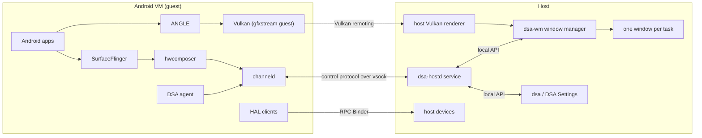

<div align="center">


# Desktop Subsystem for Android™

**Les applications Android dans de vraies fenêtres de bureau, sur une pile open source.**

[](https://github.com/thisisthepy/desktop-subsystem-for-android/actions/workflows/test.yml)
[](https://github.com/thisisthepy/desktop-subsystem-for-android/actions/workflows/test-installer.yml)
[](https://github.com/thisisthepy/desktop-subsystem-for-android/actions/workflows/test-image.yml)
[](https://github.com/thisisthepy/desktop-subsystem-for-android/actions/workflows/test-kernel.yml)
[](https://github.com/thisisthepy/desktop-subsystem-for-android/releases/latest)
[](https://github.com/thisisthepy/desktop-subsystem-for-android/blob/main/LICENSE)

[English](../../README.md) · [한국어](README_ko.md) · [日本語](README_ja.md) · [简体中文](README_zh-CN.md) · [繁體中文](README_zh-TW.md) · [Español](README_es.md) · **Français** · [Deutsch](README_de.md) · [Português (Brasil)](README_pt-BR.md) · [Русский](README_ru.md) · [Italiano](README_it.md) · [Tiếng Việt](README_vi.md) · [Bahasa Indonesia](README_id.md) · [Türkçe](README_tr.md)

</div>

> DSA est un projet open source indépendant. Il n'est ni affilié à Microsoft ou à Google, ni
> approuvé ou parrainé par eux. Android est une marque de Google LLC. Windows est une marque
> du groupe de sociétés Microsoft.

## Présentation

DSA exécute Android dans sa propre machine virtuelle légère et affiche chaque tâche Android
dans une fenêtre de bureau native. Chaque application a son propre bouton dans la barre des
tâches, son entrée dans le menu Démarrer, ses notifications et son entrée dans la liste des
applications installées, comme avec le Windows Subsystem for Android (WSA), auquel Microsoft a
mis fin le 5 mars 2025. Toutes les parties de DSA sont open source, donc chacun peut le
poursuivre.

**État.** DSA fonctionne sous Windows 11, sur les PC x64 et ARM64. Les versions antérieures à
1.0 sont des préversions ; à partir de 1.0, les versions sont publiées sur un canal stable et
sur un canal de préversion (voir
[Mises à jour et canaux de publication](#mises-à-jour-et-canaux-de-publication)). Les
fonctionnalités sont testées en CI, et leur vérification à la main sur du vrai matériel se
poursuit à chaque version : signalez-nous ce que vous constatez. Linux et macOS sont en cours
de développement et ne sont pas publiés (voir
[Plateformes prises en charge](#plateformes-prises-en-charge)).

## Fonctionnalités

**Fenêtres et saisie**

- Une fenêtre native par tâche Android, affichée comme l'application elle-même, avec le nom
  de programme et l'icône de l'application dans la barre des tâches, Alt+Tab et le
  Gestionnaire des tâches. Aucun cadre d'émulateur montrant tout l'écran.
- Une barre de titre qui fait partie de l'application : ses couleurs montent jusqu'en haut de
  la fenêtre, les boutons de légende de Windows 11 se placent par-dessus, et l'icône et le nom
  de l'application sont à gauche. L'icône devient une flèche de retour quand l'application
  peut revenir en arrière. Les dispositions d'ancrage, le glisser-déplacer, le double-clic
  pour agrandir et le menu de la fenêtre (Alt+Espace) fonctionnent comme dans toute
  application Windows.
- Le menu de la fenêtre ajoute **Full screen** (plein écran), **New window** (nouvelle
  fenêtre, pour les applications qui en permettent plusieurs), **Screenshot** (capture
  d'écran), **Aspect ratio** (format d'image), **Open by default** (ouvrir par défaut) et
  **App info** (infos sur l'application).
- Redimensionnement en direct sans recréer l'application, et agrandissement qui remplit la
  zone de travail de l'écran.
- Une demande de plein écran d'une application, comme le bouton plein écran d'un lecteur
  vidéo, remplit l'écran ; la barre de titre apparaît quand le pointeur touche le bord
  supérieur. Les applications qui masquent seulement leurs barres, comme un flux de vidéos
  courtes, restent dans leur fenêtre. Les deux comportements se choisissent dans DSA
  Settings, pour toutes les applications ou pour chacune, et F11 bascule toujours en plein
  écran.
- Un affichage net sur chaque écran. Une application s'ouvre à l'échelle de l'écran sur
  lequel elle s'ouvre. Quand vous la déplacez vers un écran d'une autre échelle, elle se
  redessine à la nouvelle échelle une fois que vous la relâchez, ou bien DSA met sa fenêtre à
  l'échelle, selon votre choix pour chaque application. Les applications connues pour se
  dérégler quand leur échelle change en cours d'exécution, comme YouTube, sont mises à
  l'échelle par DSA par défaut.
- Le texte des applications suit le réglage de taille du texte de Windows.
- Souris (avec survol), tactile jusqu'à dix doigts, stylet (pression, gomme, bouton latéral)
  et clavier avec toutes les dispositions.
- Saisie de texte via l'infrastructure des services de texte de Windows (TSF) : votre méthode
  de saisie Windows, coréen compris, compose directement dans l'éditeur Android, avec la
  fenêtre des candidats à côté du curseur. La reconversion, le clavier tactile, la saisie
  vocale (Win+H), l'écriture manuscrite et le panneau des emoji agissent sur le texte même de
  l'éditeur. Il n'y a aucune application de clavier Android.
- Glisser-déposer de fichiers entre l'Explorateur de fichiers et les fenêtres des
  applications, dans les deux sens.
- Les gestes tactiles à trois et quatre doigts de Windows 11 sont désactivés tant qu'une
  fenêtre DSA est au premier plan (activé par défaut), afin que l'application les reçoive.
- L'arbre d'accessibilité de chaque application est exposé à Windows UI Automation, pour les
  lecteurs d'écran et les outils d'automatisation (voir [UI Automation](#ui-automation) et
  [Accessibilité](#accessibilité)).

**Intégration au shell**

- Des entrées dans le menu Démarrer et dans la recherche Windows pour chaque application
  Android, même quand Android est arrêté ; les applications figurent dans Paramètres >
  Applications > Applications installées, d'où l'on peut les désinstaller.
- Des raccourcis sur le bureau, et les raccourcis propres à l'application (comme une nouvelle
  conversation dans une messagerie) dans sa liste de raccourcis de la barre des tâches et du
  menu Démarrer. Quand une application change de nom, son entrée du menu Démarrer, ses
  raccourcis sur le bureau et son épinglage dans la barre des tâches suivent le nouveau nom.
- Les notifications Android deviennent des notifications Windows sous le nom et l'icône de
  chaque application ; en sélectionner une ouvre l'application, en fermer une la ferme dans
  Android.
- Les applications qui tournent en arrière-plan apparaissent sous forme d'icônes dans la zone
  de notification, avec les touches multimédias et les contrôles multimédias de Windows pour
  les applications qui lisent du contenu.
- Des widgets Android posés sur le bureau, chacun dans sa propre fenêtre.
- Le presse-papiers texte partagé dans les deux sens, les liens web ouverts dans le
  navigateur de Windows, les fichiers Windows ouverts dans les applications Android et
  partagés vers elles, et vos dossiers Windows partagés avec Android.
- Les fichiers d'Android dans l'Explorateur de fichiers, sous **Android** dans le volet de
  navigation.
- Installation d'APK par double-clic, depuis le menu contextuel, en déposant le fichier sur
  une fenêtre ou avec `dsa install`, avec une fenêtre qui montre ce qu'est l'APK avant le
  démarrage d'Android.
- « Share on PC » dans la feuille de partage d'Android : le texte, les liens et les fichiers
  vont vers la fenêtre de partage de Windows, Partage de proximité compris.

**Multimédia et périphériques**

- Le son passe par les périphériques de sortie et d'entrée par défaut de Windows, avec une
  ligne par application dans le mélangeur de volume.
- La vidéo est décodée sur le GPU de l'hôte via Media Foundation : H.264, HEVC, VP9 et AV1,
  jusqu'à 4096x2304. Les images décodées parviennent à Android par une zone de mémoire que
  l'hôte et la VM partagent, plutôt que d'être copiées sur le canal vidéo. Les formats que le
  GPU ne décode pas sont décodés par logiciel dans Android.
- Rendu GPU sur l'hôte : Vulkan déporté via gfxstream, et OpenGL ES via ANGLE par-dessus.
- Caméra, microphone, localisation, capteurs (accéléromètre, gyroscope, orientation, lumière)
  et alimentation, chacun soumis à la fois aux paramètres de confidentialité de Windows et aux
  autorisations d'Android.
- La localisation réseau d'Android est fournie par l'hôte, avec ou sans Google Play. Sans
  Google Play, les recherches d'adresses (`Geocoder`) sont résolues sur l'ordinateur à partir
  des données de limites administratives fournies avec DSA : une position donne son pays, sa
  province et sa ville, et en Corée son arrondissement et son quartier. Aucun serveur ni
  aucune clé n'intervient, et la position reste sur l'ordinateur. Les adresses postales, et la
  conversion d'une adresse en position, ne sont pas proposées. Avec Google Play, c'est le
  géocodeur de Google qui répond.

**Système**

- Le mode Doze d'Android comme état de repos : 30 secondes après la fermeture ou la réduction
  de la dernière fenêtre Android, Android passe en Doze, les notifications continuent
  d'arriver pendant que le processeur se repose, et la mémoire inutilisée retourne à Windows
  pendant qu'Android tourne. Ouvrir une application le réveille aussitôt, sans démarrage à
  attendre. Le gel d'Android est une option, désactivée par défaut.
- Chaque utilisateur Windows a son propre Android et son propre disque de données, dans son
  propre profil.
- Un accès root à la manière de `sudo`, désactivé par défaut. Un administrateur l'active ;
  ensuite chaque application, et `adb shell` en mode développeur, peut être réglée pour
  demander. Une demande affiche l'invite d'administrateur de Windows (Contrôle de compte
  d'utilisateur, UAC) sous le nom et l'icône de l'application, et une approbation dure 15
  minutes. Les applications non autorisées ne voient pas du tout `su`. Chaque demande est
  journalisée.
- Sauvegarde chiffrée des données des applications dans votre dossier utilisateur,
  désactivée par défaut.
- DSA Settings : les applications et leurs fenêtres, les applications en arrière-plan, les
  widgets, l'affichage et le GPU, la mémoire, le réseau, l'identité de l'appareil, les mises à
  jour, les modules complémentaires, l'accès root, le mode développeur avec adb, le journal en
  direct d'Android et les diagnostics. Tout ce qu'il contient existe aussi sous forme de
  commande `dsa`.

**Modules complémentaires à votre choix**

DSA ne fournit aucun logiciel Google. Chacun des éléments ci-dessous est téléchargé depuis sa
source uniquement quand vous le demandez, après que DSA vous a montré la source et les
conditions, et il est placé sur un disque de modules à côté d'Android. L'image système n'est
jamais modifiée, et chaque module peut être retiré depuis DSA Settings ou la ligne de
commande.

- **Google Play.** `dsa gapps install`, ou **Advanced** (Avancé) > **Google Play** dans DSA
  Settings, télécharge le paquet public LiteGapps Core (services Google Play, Play Store et
  synchronisation du compte) pour votre version d'Android. Cet Android n'est pas certifié par
  Google, donc Google peut vous demander d'enregistrer l'appareil ; DSA Settings affiche
  l'identifiant Android et la page où le faire. Google Play n'empêche jamais Android de
  démarrer. Les applications de Google sont soumises aux conditions de Google.
- **Widevine L3.** `dsa drm widevine install`, ou **Advanced** > **Protected content**
  (contenu protégé), récupère le module Widevine de Google, sans modification, dans l'image
  de l'émulateur Android de Google pour votre version d'Android (environ 2 Go à télécharger ;
  seul Widevine est conservé). Les applications de streaming peuvent alors lire les vidéos
  protégées. Au niveau de sécurité L3, les services de streaming envoient au mieux de la
  définition standard ; pour la haute définition, regardez dans un navigateur ou une
  application Windows.
- **Traduction ARM.** Sur les PC x64, les applications conçues uniquement pour ARM passent
  par un traducteur. Le traducteur open source Digitalis est fourni avec l'image x64 et sert
  dès le premier démarrage. Vous pouvez le remplacer par le traducteur de Google
  (`dsa arm-translation fetch google`) ou par un paquet de votre choix. Seules les
  applications ARM 64 bits (`arm64-v8a`) fonctionnent. Sur les PC ARM64, Android exécute
  lui-même les applications ARM.

**Non fournis :** les services Google Play, une boutique d'applications ou tout autre binaire
Google (leurs licences en font un choix de l'utilisateur), ni aucun des binaires WSA de
Microsoft.

## UI Automation

DSA expose l'interface utilisateur de chaque fenêtre d'application Android à Windows UI
Automation (UIA), la même interface que celle des applications Windows. Les lecteurs d'écran,
les outils de test et les autres clients UIA voient les boutons, les listes et les champs de
texte d'une application Android comme des éléments de sa fenêtre, et non comme une seule
image.

**Fonctionnement.** Quand un client UIA demande pour la première fois son arbre à une fenêtre
d'application DSA, la fenêtre demande à l'agent de DSA dans Android de surveiller cette
tâche. L'agent lit les nœuds d'accessibilité d'Android pour cette tâche seulement et les
envoie à l'hôte : d'abord l'arbre entier, puis les modifications. L'hôte garde l'arbre dans le
processus de la fenêtre, donc chaque lecture de propriété et chaque appel de navigation
reçoit une réponse locale, sans aller-retour vers la VM. Quand aucun client UIA n'a écouté
pendant 30 secondes, la surveillance s'arrête, et Android cesse de lire les nœuds. Les
utilisateurs qui n'utilisent aucun client UIA n'en paient pas le coût.

**Ce que contient chaque élément.**

- **Control type** (type de contrôle), d'après la classe de la vue Android et son état :
  bouton, case à cocher, case d'option, zone d'édition, curseur, barre de progression, zone
  de liste déroulante, liste, élément de liste, onglet, menu, image, texte, document (pour une
  `WebView`), barre d'outils et groupe. Un interrupteur Android est un bouton avec le motif
  Toggle, et un titre est du texte.
- **Name** : la description du contenu, sinon le texte, sinon l'indication d'un champ
  d'édition vide. Un élément cliquable sans nom propre prend les noms de ses enfants.
- **AutomationId** : l'identifiant de ressource de la vue Android, comme
  `com.example:id/send`.
- **ClassName** : la classe de la vue Android. **FrameworkId** vaut `Android`.
- **HelpText** (l'indication), **ItemStatus** (la description d'état d'Android),
  **IsEnabled**, **IsKeyboardFocusable**, **HasKeyboardFocus**, **IsPassword** et un
  **BoundingRectangle** en coordonnées d'écran.
- Les éléments qu'Android signale comme invisibles pour l'utilisateur sont exclus de l'arbre.
- Les champs de mot de passe ne quittent jamais Android sous forme de texte : chaque caractère
  arrive sous forme de puce.

**Les motifs et leur effet dans Android.**

| Motif UIA | Action Android |
|---|---|
| Invoke | `ACTION_CLICK` |
| Value (`SetValue`) | `ACTION_SET_TEXT`, qui remplace tout le texte du champ |
| Toggle | `ACTION_CLICK` |
| SelectionItem (`Select`) | `ACTION_SELECT`, ou `ACTION_CLICK` quand le nœud n'a pas d'action de sélection |
| Scroll | `ACTION_SCROLL_FORWARD` et `ACTION_SCROLL_BACKWARD`, par page ; pas de pourcentage de défilement |
| `SetFocus` | `ACTION_FOCUS`, ou `ACTION_ACCESSIBILITY_FOCUS` quand le nœud ne peut pas prendre le focus de saisie |

Ces actions vont directement au nœud. Elles ne déplacent pas la souris et n'injectent pas de
touchers.

**Événements.** La fenêtre déclenche le changement de focus (tant qu'elle est au premier
plan), le changement de structure quand des enfants apparaissent ou disparaissent, et le
changement de propriété pour le nom, la valeur, l'état de bascule, la sélection, l'état
activé et le rectangle englobant. Les événements ne sont déclenchés que tant qu'un client
écoute.

**Saisie de texte.** `SetValue` définit le texte d'un champ en une seule étape. La frappe, la
composition et les méthodes de saisie passent plutôt par TSF et l'`InputConnection` de
l'application, comme pour une personne au clavier.

**La fenêtre elle-même.** Le nom de la fenêtre est le nom de l'application. Les boutons de
légende (réduire, agrandir ou restaurer, fermer) et la flèche de retour de la barre de titre
sont des boutons nommés dans l'arbre.

**Utilisation depuis d'autres outils.** Tout client UIA fonctionne, comme Inspect et
Accessibility Insights for Windows, ou des bibliothèques comme FlaUI. Trouvez la fenêtre de
l'application par son nom, puis ses éléments par AutomationId, nom ou type de contrôle. Pour
les scripts qui doivent appuyer sur un point plutôt que sur un élément,
`dsa tap <package> <x> <y>` appuie dans la tâche de l'application.

**Pas encore disponible.** Il n'y a pas de motif Text, pas de motif RangeValue ni
ExpandCollapse, pas d'appui long via UIA, pas de niveau de titre, et pas d'événements de
notification ni de région dynamique. Le focus d'accessibilité d'Android n'est pas exporté ;
seul le focus de saisie l'est. Les améliorations sont suivies dans le ticket
[#744](https://github.com/thisisthepy/desktop-subsystem-for-android/issues/744) (ouvert).

## Accessibilité

**Lecteurs d'écran.** NVDA et le Narrateur (Narrator) lisent les applications Android grâce à
l'arbre UI Automation décrit ci-dessus : les contrôles ont des noms et des rôles, le focus
suit le clavier, et les boutons, interrupteurs, listes et champs de texte s'utilisent sans
souris. JAWS utilise le même arbre ; le projet ne l'a pas encore vérifié, vos retours sont
donc les bienvenus.

**Ce qui est en cours d'amélioration.** Ces points viennent du signalement d'un utilisateur
de lecteur d'écran, le ticket
[#744](https://github.com/thisisthepy/desktop-subsystem-for-android/issues/744). Chacun est
ouvert et suivi là-bas :

- **Un focus plus rapide.** Aujourd'hui, un changement de focus attend dans Android avant
  d'atteindre Windows, environ 250 à 450 ms après l'appui sur une touche, et maintenir une
  touche fléchée avance d'environ quatre pas par seconde. Le projet prévoit d'envoyer les
  changements de focus immédiatement, de lire uniquement la tâche d'où vient un événement, et
  de réserver les délais courts aux moments où un client UIA écoute.
- **Le focus d'accessibilité.** Seul le focus de saisie est exporté aujourd'hui, donc les
  déplacements du focus d'accessibilité d'Android ne déclenchent aucun événement de focus.
- **Le motif Text.** Les champs d'édition n'ont pas encore de motif Text, que NVDA utilise
  pour lire et parcourir le texte par caractère, mot et ligne. Leur valeur peut être lue et
  définie.

**Les fenêtres de DSA.**

- **DSA Settings** fonctionne au clavier et avec les lecteurs d'écran : sa navigation, ses
  lignes et ses contrôles sont des éléments UIA nommés.
- **L'APK Installer** nomme chacun de ses éléments, et son lien **More** se développe et se
  réduit via UIA.
- **Les widgets sur le bureau** prennent le focus clavier. Entrée, Espace, la touche Menu et
  Maj+F10 ouvrent le menu du widget.
- **Les menus** des widgets et des icônes de la zone de notification sont des menus UIA
  navigables au clavier, et **les boîtes de dialogue de confirmation** ont des touches d'accès
  et un bouton par défaut.
- **L'invite root** est l'invite d'administrateur de Windows elle-même (UAC).
- Les boutons de légende utilisent les couleurs système dans un thème à contraste élevé.

Sous Linux, l'hôte exporte le même arbre vers AT-SPI, avec le texte par caractère, mot et
ligne, pour Orca ; Linux n'est pas encore publié. L'hôte macOS n'exporte pas encore les arbres
des applications.

**Signaler un problème.** Ouvrez un
[ticket](https://github.com/thisisthepy/desktop-subsystem-for-android/issues/new) en indiquant
le lecteur d'écran et sa version, l'application, ce que vous avez fait, ce que vous avez
entendu et ce que vous attendiez. Un paquet de diagnostic obtenu avec
`dsa logs collect -o diag.zip` aide. Le [Discord de DSA](https://discord.gg/MtpQnR4eQQ) est
aussi ouvert aux questions.

## Plateformes prises en charge

| Hôte | État |
|---|---|
| Windows 11, x64 | Publié sous le nom `DSA-v<version>-win-x64-setup.exe` |
| Windows 11, ARM64 | Publié sous le nom `DSA-v<version>-win-arm64-setup.exe`. Android est lui aussi en ARM64, donc les applications ARM fonctionnent sans traduction |
| Linux (x64, ARM64) | En cours, non publié. L'hôte KVM, le compositeur Wayland et les paquets `.deb` et `.rpm` sont compilés et exécutés en CI |
| macOS (Apple silicon) | En cours, non publié. L'hôte basé sur le framework Virtualization d'Apple et son bundle d'application sont compilés en CI |

### Versions d'Android

DSA prend en charge les deux versions majeures d'Android les plus récentes : aujourd'hui
Android 16 et Android 17. Une version n'est plus prise en charge quand la deuxième version
majeure plus récente sort ; Android 16 est donc pris en charge jusqu'à la sortie d'Android 18.
Le programme de mise à jour de l'image fait passer chaque utilisateur à une version prise en
charge et ne descend jamais de lui-même vers une version majeure inférieure. Vous pouvez
choisir l'une ou l'autre des versions prises en charge dans DSA Settings ou avec
`dsa android use` ; passer à la plus ancienne efface les données Android, car Android ne peut
pas lire les données écrites par une version plus récente.

<p align="center">
  
</p>

Les dates postérieures à aujourd'hui sont des dates prévues, pas des versions publiées.

## Installation

**Il vous faut** Windows 11 sur un PC x64 ou ARM64, avec la fonctionnalité Windows
**Plateforme de machine virtuelle** activée. Le programme d'installation la vérifie et
s'arrête avec des instructions si elle est désactivée.

1. Activez la **Plateforme de machine virtuelle** : Paramètres > Système > Fonctionnalités
   facultatives > Plus de fonctionnalités Windows, ou
   `dism /online /enable-feature /featurename:VirtualMachinePlatform /all` dans un terminal
   administrateur. Redémarrez.
2. Téléchargez `DSA-v<version>-win-x64-setup.exe`, ou `DSA-v<version>-win-arm64-setup.exe` sur
   un PC ARM64, depuis la [dernière version](https://github.com/thisisthepy/desktop-subsystem-for-android/releases/latest)
   et vérifiez-le avec `SHA256SUMS.txt`.
3. Exécutez-le. Le programme d'installation installe le service `DsaHost`, la commande `dsa`,
   DSA Settings, l'APK Installer et la première image Android (téléchargée si le programme
   d'installation n'en contient pas). Android démarre à l'ouverture de votre session, donc la
   première application que vous ouvrez n'attend pas de démarrage.

Aucun noyau à compiler et aucune modification de votre configuration WSL : DSA fournit son
propre noyau et sa propre VM. La désinstallation supprime tout ce que DSA a écrit, sauf le
disque Android de chaque utilisateur.

## Mises à jour et canaux de publication

DSA se met à jour lui-même, ainsi que l'image Android. Les deux sont signés, et rien n'est
appliqué si la signature, la taille ou le hachage ne correspond pas.

- **DSA lui-même.** Le service consulte une liste signée de versions et installe une version
  plus récente quand l'Android d'aucun utilisateur ne tourne ; sinon il attend, et
  `dsa update` installe immédiatement. Vous êtes prévenu avant et après. Une mise à jour ne
  fait jamais passer DSA à une version inférieure.
- **Canaux.** À partir de 1.0, il y en a deux : **stable**, et **préversion** pour les versions
  encore en cours de finition. Le canal de préversion prend la plus récente des deux. Votre
  canal dépend du programme d'installation utilisé, et les mises à niveau le conservent.
  Changez-le avec **Get pre-release versions** (obtenir les préversions) sur la page
  **Updates** (mises à jour) de DSA Settings, ou avec
  `dsa settings set prerelease-updates on|off` (administrateurs). Quitter les préversions ne
  fait jamais revenir DSA en arrière : il attend une version stable plus récente. Toutes les
  versions antérieures à 1.0 sont des préversions.
- **Image Android.** Les mises à jour de l'image ne dépendent pas du canal. Une image qui ne
  parvient pas à démarrer est remplacée par la dernière image valide, et `dsa status` le
  signale. Avec **Restart Android into updates by itself** (redémarrer Android de lui-même
  pour appliquer les mises à jour), Android redémarre sur une mise à jour téléchargée quand
  aucune fenêtre d'application n'est ouverte.
- **Désactiver les mises à jour.** Les administrateurs peuvent désactiver **Update DSA
  automatically** et **Update the Android image automatically** sur la page **Updates**.

Les versions stables sont produites uniquement depuis `main`, après relecture. Les builds de
`develop` sont des préversions ou des builds de test pour les contributeurs.

## Démarrage rapide

Ouvrez une application Android depuis le menu Démarrer, ou utilisez la commande `dsa` :

```
dsa status                          # l'état d'Android et toute mise à jour en attente
dsa install app.apk                 # installe un APK, ou un paquet d'APK divisés (.xapk, .apks, .apkm)
dsa apps list                       # les applications installées
dsa launch com.android.settings     # ouvre une application dans sa propre fenêtre
dsa settings set clipboard off      # modifie un réglage (DSA Settings a les mêmes interrupteurs)
dsa logcat -d -b all *:W            # le journal d'Android, avertissements et plus graves
dsa logs collect -o diag.zip        # tout ce qu'un signalement de problème demande, en un seul zip
```

`dsa` sans argument liste toutes les commandes. Le journal d'Android reste en mémoire et ne
parvient à l'hôte que tant que quelque chose le lit. Joignez `diag.zip` à un signalement de
problème.

## Limites

Voici ce qui est vrai aujourd'hui :

- Seul Windows est publié. Linux et macOS sont en cours.
- DSA Settings s'affiche uniquement en anglais et en coréen.
- Seules les applications 64 bits fonctionnent : `arm64-v8a` et, sur x64, `x86_64`. Les
  applications 32 bits ne fonctionnent pas.
- Widevine est en L3, donc les flux protégés sont lus au mieux en définition standard.
- Google Play n'est pas certifié par Google sur DSA ; Google peut vous demander d'enregistrer
  l'appareil.
- Le presse-papiers ne partage que du texte.
- Le choix de mise à l'échelle **System (forced)** n'est pas encore disponible et fonctionne
  comme **System**.
- L'export UI Automation présente les lacunes listées sous [UI Automation](#ui-automation).
- Sans Google Play, les recherches d'adresses donnent la zone (du pays jusqu'à la ville, ou
  jusqu'à l'arrondissement en Corée), pas l'adresse postale.

## Guides de l'utilisateur

Des guides pas à pas couvrent l'installation, les applications et les fenêtres, les APK, les
fichiers, les versions d'Android, les réglages, la mémoire, le mode développeur, le dépannage
et la désinstallation : [docs/guides](../guides/fr/README.md). La
[page de présentation](../guides/intro/index.html) explique le projet aux nouveaux venus.

## Architecture



- **Invité.** Un agent signé avec la clé de la plateforme passe l'affichage en mode fenêtres
  libres (freeform) et signale les tâches, les applications, les notifications et les arbres
  d'accessibilité. Le hwcomposer transmet les couches de chaque tâche à l'hôte comme un
  écran à part. Les clients HAL atteignent les périphériques de l'hôte via RPC Binder. Il n'y
  a ni lanceur, ni barre d'état, ni application de clavier : l'hôte fait office de shell.
- **Protocole.** Une seule définition, `dsa/protocol/control.proto`, avec des codecs générés
  pour Rust, Java et C++. Chaque connexion vérifie la version du protocole, le hachage du
  schéma et un secret propre à chaque démarrage.
- **Hôte.** `dsa/host/core/` est indépendant de la plateforme : les sessions, le registre des
  applications et la politique de cycle de vie. Chaque système d'exploitation ajoute la VM, le
  transport et le système de fenêtres sous `dsa/host/platform/<os>/`. Sous Windows, la VM est
  créée via le Host Compute System, et les images vont du GPU à chaque fenêtre via Direct3D 11
  et DirectComposition, sans jamais passer par le processeur.

## Compilation depuis les sources

Les crates Rust forment un seul espace de travail dans `dsa/` :

```
cd dsa
cargo test --workspace
cargo build -p dsa-host-windows --release
```

Les autres parties ont leur propre build, décrit à côté d'elles :

- le programme d'installation : `dsa/host/platform/windows/installer/README.md`
- l'hôte Windows : `dsa/host/platform/windows/README.md`
- le noyau invité : `dsa/kernel/`
- l'image Android et les composants invités : `dsa/guest/`
- le chemin graphique : `dsa/graphics/`

Les projets amont (AOSP, gfxstream, le noyau) ne sont pas intégrés au dépôt : des scripts
récupèrent une révision figée et appliquent les correctifs conservés ici. Les outils Python
s'exécutent avec `uv run`.

## Organisation du dépôt

| Chemin | Contenu |
|---|---|
| `dsa/protocol/` | Le protocole de contrôle invité-hôte et ses générateurs de code |
| `dsa/host/core/` | L'hôte indépendant de la plateforme |
| `dsa/host/cli/` | La commande `dsa` |
| `dsa/host/platform/windows/` | L'hôte Windows, le gestionnaire de fenêtres, le programme d'installation et DSA Settings |
| `dsa/host/platform/linux/`, `macos/`, `unix/` | Les hôtes Linux et macOS et ce qu'ils partagent |
| `dsa/graphics/` | Le déport de Vulkan, à partir de gfxstream |
| `dsa/guest/` | L'agent, le hwcomposer, les services HAL et la configuration de l'image |
| `dsa/kernel/` | La configuration et le build du noyau invité |
| `scripts/tests/` | Les vérifications du dépôt |
| `.github/` | Les workflows de CI, les scripts de publication et les ressources du README |

## Contribuer

DSA est jeune et encore en cours de stabilisation, donc chaque signalement aide, que vous
ayez un correctif en main ou non.

<p>
  <a href="https://github.com/thisisthepy/desktop-subsystem-for-android/issues/new"></a>
  <a href="https://discord.gg/MtpQnR4eQQ"></a>
</p>

- **Vous avez trouvé un bogue ou vous avez une idée ?** [Ouvrez un ticket](https://github.com/thisisthepy/desktop-subsystem-for-android/issues/new).
  Dites ce que vous avez fait et ce qui s'est passé, avec votre build de Windows (`winver`) et
  les versions de DSA et d'Android (`dsa status`). Un paquet de diagnostic obtenu avec
  `dsa logs collect -o diag.zip` rend un bogue beaucoup plus facile à localiser.
- **Vous voulez d'abord poser une question ou simplement en discuter ?** Rejoignez le
  [Discord de DSA](https://discord.gg/MtpQnR4eQQ). Les questions, ce que vous essayez de faire
  fonctionner et les premiers retours y sont tous les bienvenus.
- **Vous envoyez une modification ?** Le travail se fait sur la branche `develop` ; `main` est
  publiée à partir d'elle. Ouvrez les pull requests vers `develop`, avec une modification
  logique par commit et un test pour chaque changement de comportement. Le code de protocole
  généré n'est jamais modifié à la main. Merci de ne pas utiliser de tirets cadratins dans le
  texte : une vérification du dépôt les refuse.

## Licence

[Apache-2.0](https://github.com/thisisthepy/desktop-subsystem-for-android/blob/main/LICENSE).
Chaque composant tiers fourni conserve sa propre licence, listée dans le programme
d'installation.

## Marques

Android est une marque de Google LLC. Windows est une marque du groupe de sociétés Microsoft.
DSA n'est ni affilié à Microsoft ou à Google, ni approuvé ou parrainé par eux.

## Historique des étoiles

<a href="https://www.star-history.com/#thisisthepy/desktop-subsystem-for-android&Date">
  <picture>
    <source media="(prefers-color-scheme: dark)" srcset="https://api.star-history.com/svg?repos=thisisthepy/desktop-subsystem-for-android&type=Date&theme=dark" />
    <source media="(prefers-color-scheme: light)" srcset="https://api.star-history.com/svg?repos=thisisthepy/desktop-subsystem-for-android&type=Date" />
    
  </picture>
</a>
