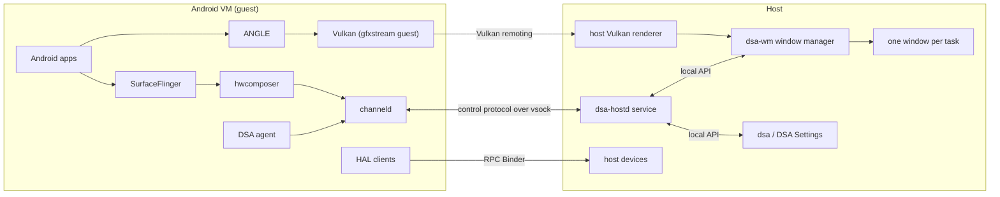

<div align="center">


# Desktop Subsystem for Android™

**Aplikasi Android sebagai jendela desktop sungguhan, di atas tumpukan perangkat lunak sumber terbuka.**

[](https://github.com/thisisthepy/desktop-subsystem-for-android/actions/workflows/test.yml)
[](https://github.com/thisisthepy/desktop-subsystem-for-android/actions/workflows/test-installer.yml)
[](https://github.com/thisisthepy/desktop-subsystem-for-android/actions/workflows/test-image.yml)
[](https://github.com/thisisthepy/desktop-subsystem-for-android/actions/workflows/test-kernel.yml)
[](https://github.com/thisisthepy/desktop-subsystem-for-android/releases/latest)
[](https://github.com/thisisthepy/desktop-subsystem-for-android/blob/main/LICENSE)

[English](../../README.md) · [한국어](README_ko.md) · [日本語](README_ja.md) · [简体中文](README_zh-CN.md) · [繁體中文](README_zh-TW.md) · [Español](README_es.md) · [Français](README_fr.md) · [Deutsch](README_de.md) · [Português (Brasil)](README_pt-BR.md) · [Русский](README_ru.md) · [Italiano](README_it.md) · [Tiếng Việt](README_vi.md) · **Bahasa Indonesia** · [Türkçe](README_tr.md)

</div>

> DSA adalah proyek sumber terbuka yang independen. DSA tidak berafiliasi dengan, tidak
> didukung oleh, dan tidak disponsori oleh Microsoft maupun Google. Android adalah merek
> dagang Google LLC. Windows adalah merek dagang grup perusahaan Microsoft.

## Apa itu DSA

DSA menjalankan Android di dalam VM ringan miliknya sendiri dan menampilkan setiap tugas
Android di jendela desktop native. Setiap aplikasi memiliki tombol bilah tugas, entri menu
Mulai, pemberitahuan, dan entri di daftar aplikasi terinstal sendiri, seperti pada Windows
Subsystem for Android (WSA), yang dihentikan Microsoft pada 5 Maret 2025. Setiap bagian DSA
bersifat sumber terbuka, sehingga siapa pun dapat meneruskannya.

**Status.** DSA berjalan di Windows 11, pada PC x64 dan ARM64. Rilis di bawah 1.0 adalah
pra-rilis; mulai 1.0, rilis hadir dalam kanal stabil dan kanal pra-rilis (lihat
[Pembaruan dan kanal rilis](#pembaruan-dan-kanal-rilis)). Fitur diuji di CI, dan pemeriksaan
manual di perangkat keras sungguhan terus dilakukan pada setiap rilis, jadi silakan laporkan
apa yang Anda temukan. Linux dan macOS sedang dikerjakan dan belum dirilis (lihat
[Platform yang didukung](#platform-yang-didukung)).

## Fitur

**Jendela dan input**

- Satu jendela native untuk setiap tugas Android, ditampilkan sebagai aplikasi itu sendiri,
  dengan nama program dan ikon aplikasi di bilah tugas, Alt+Tab, dan Pengelola Tugas. Tidak
  ada bingkai emulator yang menampilkan seluruh layar.
- Bilah judul yang menjadi bagian dari aplikasi: warna aplikasi mencapai bagian atas jendela,
  tombol keterangan Windows 11 berada di atasnya, serta ikon dan nama aplikasi ada di kiri.
  Ikon berubah menjadi panah kembali saat aplikasi dapat kembali. Tata letak snap, menyeret,
  klik ganda untuk memaksimalkan, dan menu jendela (Alt+Space) bekerja seperti di aplikasi
  Windows mana pun.
- Menu jendela menambahkan **Full screen**, **New window** (untuk aplikasi yang mengizinkan
  beberapa jendela), **Screenshot**, **Aspect ratio**, **Open by default**, dan **App info**.
- Ubah ukuran secara langsung tanpa membuat ulang aplikasi, dan maksimalkan yang mengisi area
  kerja monitor.
- Permintaan layar penuh dari aplikasi, seperti tombol layar penuh di pemutar video, mengisi
  layar; bilah judul muncul saat penunjuk menyentuh tepi atas. Aplikasi yang hanya
  menyembunyikan bilahnya, seperti feed video pendek, tetap berada di jendelanya. Keduanya
  dapat dipilih di DSA Settings, untuk semua aplikasi atau per aplikasi, dan F11 selalu
  mengalihkan layar penuh.
- Tampilan tajam di setiap monitor. Aplikasi terbuka dengan skala monitor tempat ia dibuka,
  dan saat Anda memindahkannya ke monitor dengan skala lain, aplikasi menggambar ulang pada
  skala baru setelah Anda melepasnya, atau DSA yang menskalakan jendelanya, sesuai pilihan
  Anda untuk setiap aplikasi. Aplikasi yang diketahui rusak jika skalanya berubah saat
  berjalan, seperti YouTube, secara bawaan diskalakan oleh DSA.
- Teks di aplikasi mengikuti pengaturan ukuran teks Windows.
- Mouse (dengan hover), sentuhan hingga sepuluh jari, pena (tekanan, penghapus, tombol
  barrel), dan keyboard dengan semua tata letak.
- Input teks melalui Windows text services framework (TSF): metode input Windows Anda,
  termasuk bahasa Korea, menyusun teks langsung di editor Android, dengan jendela kandidat di
  samping kursor. Konversi ulang, keyboard sentuh, pengetikan suara (Win+H), tulisan tangan,
  dan panel emoji bekerja pada teks milik editor itu sendiri. Tidak ada aplikasi keyboard
  Android.
- File dapat diseret antara File Explorer dan jendela aplikasi, ke dua arah.
- Gestur sentuh tiga dan empat jari Windows 11 dimatikan saat jendela DSA berada di depan
  (aktif secara bawaan), sehingga aplikasi yang menerimanya.
- Pohon aksesibilitas setiap aplikasi diekspos ke Windows UI Automation, untuk pembaca layar
  dan alat otomatisasi (lihat [UI Automation](#ui-automation) dan
  [Aksesibilitas](#aksesibilitas)).

**Integrasi shell**

- Entri menu Mulai dan pencarian Windows untuk setiap aplikasi Android, bahkan saat Android
  berhenti; aplikasi tercantum di Pengaturan > Aplikasi > Aplikasi yang diinstal, tempat
  aplikasi dapat dicopot.
- Pintasan desktop, dan pintasan milik aplikasi (seperti obrolan baru di aplikasi pesan) di
  jump list bilah tugas dan menu Mulai. Saat aplikasi berganti nama, entri menu Mulai,
  pintasan desktop, dan sematan bilah tugasnya mengikuti nama baru.
- Pemberitahuan Android sebagai pemberitahuan Windows dengan nama dan ikon setiap aplikasi;
  memilih pemberitahuan membuka aplikasi, dan menutupnya juga menutupnya di Android.
- Aplikasi yang berjalan di latar belakang tampil sebagai ikon di area pemberitahuan, dengan
  tombol media dan kontrol media Windows untuk aplikasi yang memutar media.
- Widget Android yang ditempatkan di desktop, masing-masing di jendelanya sendiri.
- Papan klip teks dibagikan ke dua arah, tautan web dibuka di browser Windows, file Windows
  dibuka di dan dibagikan ke aplikasi Android, dan folder Windows Anda dibagikan dengan
  Android.
- File Android di File Explorer, di bawah **Android** pada panel navigasi.
- Instalasi APK dengan klik ganda, dari menu konteks, dengan menjatuhkan file ke jendela, atau
  dengan `dsa install`, dengan jendela yang menunjukkan isi APK sebelum Android dimulai.
- "Share on PC" di lembar berbagi Android: teks, tautan, dan file masuk ke jendela berbagi
  Windows, termasuk Berbagi di sekitar.

**Media dan perangkat**

- Audio melalui perangkat output dan input bawaan Windows, dengan satu baris untuk setiap
  aplikasi di mixer volume.
- Video didekode di GPU host melalui Media Foundation: H.264, HEVC, VP9, dan AV1, hingga
  4096x2304. Gambar hasil dekode sampai ke Android melalui wilayah memori yang dibagikan host
  dan VM, alih-alih disalin melalui kanal video. Format yang tidak didekode GPU didekode di
  Android secara perangkat lunak.
- Rendering GPU di host: Vulkan remoting melalui gfxstream, dan OpenGL ES melalui ANGLE di
  atasnya.
- Kamera, mikrofon, lokasi, sensor (akselerometer, giroskop, orientasi, cahaya), dan daya,
  masing-masing dilindungi oleh pengaturan privasi Windows dan izin Android.
- Lokasi jaringan Android dijawab oleh host, dengan atau tanpa Google Play. Tanpa Google Play,
  pencarian alamat (`Geocoder`) dijawab di komputer dari data batas administratif yang
  disertakan bersama DSA: sebuah posisi menjadi negara, provinsi, dan kotanya, dan di Korea
  juga distrik dan lingkungannya. Tidak ada server maupun kunci yang terlibat, dan posisi
  tetap berada di komputer. Alamat jalan, dan mengubah alamat menjadi posisi, tidak tersedia.
  Dengan Google Play, geocoder Google yang menjawab.

**Sistem**

- Doze Android sebagai keadaan diam: 30 detik setelah jendela Android terakhir ditutup atau
  diminimalkan, Android masuk Doze, pemberitahuan tetap masuk selagi CPU beristirahat, dan
  memori yang menganggur kembali ke Windows selama Android berjalan. Membuka aplikasi
  membangunkannya seketika, tanpa perlu menunggu boot. Membekukan Android adalah opsi, nonaktif
  secara bawaan.
- Setiap pengguna Windows mendapat Android dan disk data sendiri, di profilnya sendiri.
- Akses root seperti `sudo`, nonaktif secara bawaan. Administrator mengaktifkannya; setelah
  itu setiap aplikasi, dan `adb shell` dalam mode pengembang, dapat diatur untuk meminta izin.
  Permintaan menampilkan prompt administrator Windows (UAC) dengan nama dan ikon aplikasi itu
  sendiri, dan persetujuan berlaku 15 menit. Aplikasi yang tidak diizinkan sama sekali tidak
  dapat melihat `su`. Setiap permintaan dicatat.
- Pencadangan data aplikasi ke folder pengguna Anda, terenkripsi, nonaktif secara bawaan.
- DSA Settings: aplikasi dan jendelanya, aplikasi latar belakang, widget, tampilan dan GPU,
  memori, jaringan, identitas perangkat, pembaruan, add-on, akses root, mode pengembang dengan
  adb, log langsung Android, dan diagnostik. Semua yang ada di sana juga tersedia sebagai
  perintah `dsa`.

**Add-on pilihan Anda**

DSA tidak menyertakan perangkat lunak Google. Masing-masing add-on berikut diunduh dari
sumbernya hanya saat Anda memintanya, setelah DSA menunjukkan sumber dan ketentuannya, lalu
disimpan di disk add-on di samping Android. Image sistem tidak pernah diubah, dan setiap
add-on dapat dihapus lagi dari DSA Settings atau baris perintah.

- **Google Play.** `dsa gapps install`, atau **Advanced** > **Google Play** di DSA Settings,
  mengunduh paket publik LiteGapps Core (layanan Google Play, Play Store, dan sinkronisasi
  akun) untuk versi Android Anda. Android ini tidak tersertifikasi Google, sehingga Google
  mungkin meminta Anda mendaftarkan perangkat; DSA Settings menunjukkan Android ID dan halaman
  untuk melakukannya. Google Play tidak pernah menghalangi Android untuk dimulai. Aplikasi
  Google tunduk pada ketentuan Google.
- **Widevine L3.** `dsa drm widevine install`, atau **Advanced** > **Protected content**,
  mengambil modul Widevine Google, tanpa diubah, dari image emulator Android milik Google untuk
  versi Android Anda (sekitar 2 GB untuk diunduh; hanya Widevine yang disimpan). Aplikasi
  streaming kemudian dapat memutar video yang dilindungi. Pada tingkat keamanan L3, layanan
  streaming mengirim paling tinggi definisi standar, jadi tontonlah dalam definisi tinggi di
  browser atau aplikasi Windows.
- **Terjemahan ARM.** Di PC x64, aplikasi yang hanya dibuat untuk ARM berjalan melalui
  penerjemah. Penerjemah sumber terbuka Digitalis disertakan dalam image x64 dan digunakan
  sejak awal. Anda dapat menggantinya dengan penerjemah Google
  (`dsa arm-translation fetch google`) atau paket milik Anda sendiri. Hanya aplikasi ARM 64-bit
  (`arm64-v8a`) yang berjalan. Di PC ARM64, Android menjalankan aplikasi ARM secara langsung.

**Tidak disertakan:** layanan Google Play, toko aplikasi, atau biner Google lainnya
(lisensinya menjadikan semua itu pilihan pengguna), dan biner WSA milik Microsoft apa pun.

## UI Automation

DSA mengekspos antarmuka pengguna di dalam setiap jendela aplikasi Android ke Windows UI
Automation (UIA), antarmuka yang sama yang digunakan aplikasi Windows. Pembaca layar, alat
pengujian, dan klien UIA lainnya melihat tombol, daftar, dan kolom teks aplikasi Android
sebagai elemen jendelanya, bukan sebagai satu gambar.

**Cara kerjanya.** Saat klien UIA pertama kali meminta pohon dari jendela aplikasi DSA,
jendela tersebut meminta agen DSA di Android untuk memantau tugas itu. Agen membaca node
aksesibilitas Android hanya untuk tugas tersebut dan mengirimnya ke host: pertama seluruh
pohon, lalu perubahannya. Host menyimpan pohon di proses jendela, sehingga setiap pembacaan
properti dan setiap panggilan navigasi dijawab secara lokal, tanpa bolak-balik ke VM. Jika
tidak ada klien UIA yang mendengarkan selama 30 detik, pemantauan berhenti, dan Android
berhenti membaca node. Pengguna yang tidak memakai klien UIA tidak menanggung biaya apa pun.

**Isi setiap elemen.**

- **Control type**, dari kelas view Android dan statusnya: button, check box, radio button,
  edit, slider, progress bar, combo box, list, list item, tab, menu, image, text, document
  (untuk `WebView`), toolbar, dan group. Switch Android adalah button dengan pola Toggle, dan
  heading adalah text.
- **Name**: deskripsi konten, jika tidak ada maka teksnya, jika tidak ada maka hint dari kolom
  edit yang kosong. Elemen yang dapat diklik tanpa nama sendiri mengambil nama anak-anaknya.
- **AutomationId**: ID resource view Android, seperti `com.example:id/send`.
- **ClassName**: kelas view Android. **FrameworkId** adalah `Android`.
- **HelpText** (hint), **ItemStatus** (deskripsi status Android), **IsEnabled**,
  **IsKeyboardFocusable**, **HasKeyboardFocus**, **IsPassword**, dan **BoundingRectangle**
  dalam koordinat layar.
- Elemen yang dilaporkan Android sebagai tidak terlihat oleh pengguna tidak dimasukkan ke
  pohon.
- Kolom kata sandi tidak pernah keluar dari Android sebagai teks: setiap karakter tiba sebagai
  titik bulat.

**Pola dan fungsinya di Android.**

| Pola UIA | Aksi Android |
|---|---|
| Invoke | `ACTION_CLICK` |
| Value (`SetValue`) | `ACTION_SET_TEXT`, yang mengganti seluruh teks kolom |
| Toggle | `ACTION_CLICK` |
| SelectionItem (`Select`) | `ACTION_SELECT`, atau `ACTION_CLICK` jika node tidak memiliki aksi pilih |
| Scroll | `ACTION_SCROLL_FORWARD` dan `ACTION_SCROLL_BACKWARD`, per halaman; tanpa persentase gulir |
| `SetFocus` | `ACTION_FOCUS`, atau `ACTION_ACCESSIBILITY_FOCUS` jika node tidak dapat menerima fokus input |

Aksi-aksi ini langsung ditujukan ke node. Aksi tersebut tidak menggerakkan mouse atau
menyuntikkan sentuhan.

**Peristiwa.** Jendela memunculkan focus changed (selama berada di depan), structure changed
saat anak muncul atau hilang, dan property changed untuk nama, nilai, status toggle, pilihan,
status aktif, dan bounding rectangle. Peristiwa hanya dimunculkan selama ada klien yang
mendengarkan.

**Input teks.** `SetValue` mengatur teks kolom dalam satu langkah. Pengetikan, komposisi, dan
metode input berjalan melalui TSF dan `InputConnection` aplikasi, seperti saat seseorang
mengetik di keyboard.

**Jendelanya sendiri.** Nama jendela adalah nama aplikasi. Tombol keterangan (minimalkan,
maksimalkan atau pulihkan, tutup) dan panah kembali di bilah judul adalah tombol bernama di
pohon.

**Menggunakannya dari alat lain.** Klien UIA apa pun dapat digunakan, seperti Inspect dan
Accessibility Insights for Windows, atau pustaka seperti FlaUI. Temukan jendela aplikasi dari
namanya, lalu elemennya dari AutomationId, nama, atau control type. Untuk skrip yang perlu
menekan sebuah titik alih-alih sebuah elemen, `dsa tap <package> <x> <y>` menekan di dalam
tugas aplikasi.

**Belum tersedia.** Belum ada pola Text, pola RangeValue atau ExpandCollapse, tekan lama
melalui UIA, tingkat heading, maupun peristiwa notification atau live region. Fokus
aksesibilitas Android tidak diekspor; hanya fokus input yang diekspor. Perbaikan dilacak di
issue [#744](https://github.com/thisisthepy/desktop-subsystem-for-android/issues/744)
(terbuka).

## Aksesibilitas

**Pembaca layar.** NVDA dan Narator (Narrator) membaca aplikasi Android melalui pohon UI
Automation di atas: kontrol memiliki nama dan peran, fokus mengikuti keyboard, dan tombol,
switch, daftar, serta kolom teks dapat digunakan tanpa mouse. JAWS menggunakan pohon yang sama;
proyek ini belum memeriksanya, jadi laporan sangat diterima.

**Yang sedang diperbaiki.** Hal-hal ini berasal dari laporan seorang pengguna pembaca layar,
issue [#744](https://github.com/thisisthepy/desktop-subsystem-for-android/issues/744).
Masing-masing masih terbuka dan dilacak di sana:

- **Fokus yang lebih cepat.** Saat ini perubahan fokus menunggu di Android sebelum sampai ke
  Windows, sekitar 250 hingga 450 ms setelah tombol ditekan, dan menahan tombol panah bergerak
  sekitar empat langkah per detik. Rencananya adalah mengirim perubahan fokus seketika, hanya
  membaca tugas asal suatu peristiwa, dan memakai jeda singkat hanya saat ada klien UIA yang
  mendengarkan.
- **Fokus aksesibilitas.** Saat ini hanya fokus input yang diekspor, sehingga perpindahan
  fokus aksesibilitas Android tidak memunculkan peristiwa fokus.
- **Pola Text.** Kolom edit belum memiliki pola Text, yang digunakan NVDA untuk membaca dan
  meninjau teks per karakter, kata, dan baris. Nilainya dapat dibaca dan diatur.

**Jendela milik DSA sendiri.**

- **DSA Settings** dapat digunakan dengan keyboard dan pembaca layar: navigasi, baris, dan
  kontrolnya adalah elemen UIA yang bernama.
- **APK Installer** memberi nama pada setiap elemennya, dan tautan **More**-nya dapat
  diperluas dan diciutkan melalui UIA.
- **Widget di desktop** menerima fokus keyboard. Enter, Space, tombol menu, dan Shift+F10
  membuka menu widget.
- **Menu** widget dan ikon area pemberitahuan adalah menu UIA dengan navigasi keyboard, dan
  **dialog konfirmasi** memiliki tombol akses dan tombol bawaan.
- **Prompt root** adalah prompt administrator milik Windows sendiri (UAC).
- Tombol keterangan menggunakan warna sistem dalam tema kontras tinggi.

Di Linux, host mengekspor pohon yang sama ke AT-SPI, dengan teks per karakter, kata, dan
baris, untuk Orca; Linux belum dirilis. Host macOS belum mengekspor pohon aplikasi.

**Melaporkan masalah.** Buka
[issue](https://github.com/thisisthepy/desktop-subsystem-for-android/issues/new) dengan nama
pembaca layar dan versinya, aplikasinya, apa yang Anda lakukan, apa yang Anda dengar, dan apa
yang Anda harapkan. Paket diagnostik dari `dsa logs collect -o diag.zip` akan membantu.
[Discord DSA](https://discord.gg/MtpQnR4eQQ) juga terbuka untuk pertanyaan.

## Platform yang didukung

| Host | Status |
|---|---|
| Windows 11, x64 | Dirilis sebagai `DSA-v<version>-win-x64-setup.exe` |
| Windows 11, ARM64 | Dirilis sebagai `DSA-v<version>-win-arm64-setup.exe`. Android juga ARM64, sehingga aplikasi ARM berjalan tanpa terjemahan |
| Linux (x64, ARM64) | Sedang dikerjakan, belum dirilis. Host KVM, compositor Wayland, serta paket `.deb` dan `.rpm` dibangun dan berjalan di CI |
| macOS (Apple silicon) | Sedang dikerjakan, belum dirilis. Host di atas Virtualization framework milik Apple dan app bundle-nya dibangun di CI |

### Versi Android

DSA mendukung dua versi mayor Android terbaru: saat ini Android 16 dan Android 17. Sebuah
versi tidak lagi didukung saat versi mayor kedua yang lebih baru dirilis, jadi Android 16
didukung hingga Android 18 dirilis. Pembaru image memindahkan setiap pengguna ke versi yang
didukung dan tidak pernah turun ke versi mayor yang lebih rendah dengan sendirinya. Anda dapat
memilih salah satu versi yang didukung di DSA Settings atau dengan `dsa android use`; pindah ke
versi yang lebih lama menghapus data Android, karena Android tidak dapat membaca data yang
ditulis oleh versi yang lebih baru.

<p align="center">
  
</p>

Tanggal setelah hari ini adalah perkiraan, bukan rilis.

## Instalasi

**Anda memerlukan** Windows 11 di PC x64 atau ARM64, dengan fitur Windows **Platform Mesin
Virtual** (Virtual Machine Platform) diaktifkan. Penyiapan memeriksanya dan berhenti dengan
petunjuk jika fitur itu nonaktif.

1. Aktifkan **Platform Mesin Virtual**: Pengaturan > Sistem > Fitur opsional > Fitur Windows
   lainnya, atau `dism /online /enable-feature /featurename:VirtualMachinePlatform /all`
   di terminal administrator. Mulai ulang.
2. Unduh `DSA-v<version>-win-x64-setup.exe`, atau `DSA-v<version>-win-arm64-setup.exe` di PC
   ARM64, dari [rilis terbaru](https://github.com/thisisthepy/desktop-subsystem-for-android/releases/latest)
   dan periksa dengan `SHA256SUMS.txt`.
3. Jalankan. Penyiapan menginstal layanan `DsaHost`, perintah `dsa`, DSA Settings, APK
   Installer, dan image Android pertama (diunduh jika penyiapan tidak membawanya).
   Android dimulai saat Anda masuk, sehingga aplikasi pertama yang Anda buka tidak menunggu
   boot.

Tidak ada kernel yang perlu dibangun dan tidak ada perubahan pada penyiapan WSL Anda: DSA
menyertakan kernel dan VM-nya sendiri. Pencopotan menghapus semua yang ditulis DSA kecuali disk
Android setiap pengguna.

## Pembaruan dan kanal rilis

DSA memperbarui dirinya sendiri dan image Android. Keduanya ditandatangani, dan tidak ada yang
diterapkan jika tanda tangan, ukuran, atau hash-nya tidak cocok.

- **DSA itu sendiri.** Layanan memeriksa daftar rilis yang ditandatangani dan menginstal versi
  yang lebih baru saat Android milik pengguna mana pun tidak sedang berjalan; jika tidak, ia
  menunggu, dan `dsa update` langsung menginstalnya. Anda diberi tahu sebelum dan sesudahnya.
  Pembaruan tidak pernah memindahkan DSA ke versi yang lebih rendah.
- **Kanal.** Mulai 1.0 ada dua kanal: **stable**, dan **pre-release** untuk versi yang masih
  disempurnakan. Kanal pra-rilis mengambil yang lebih baru di antara keduanya. Kanal Anda
  ditentukan oleh penginstal yang Anda gunakan, dan peningkatan versi mempertahankannya. Ubah
  dengan **Get pre-release versions** (dapatkan versi pra-rilis) di halaman **Updates**
  (pembaruan) DSA Settings, atau `dsa settings set prerelease-updates on|off`
  (administrator). Keluar dari pra-rilis tidak pernah memundurkan DSA: DSA menunggu rilis
  stabil yang lebih baru. Setiap rilis sebelum 1.0 adalah pra-rilis.
- **Image Android.** Pembaruan image tidak bergantung pada kanal. Image yang gagal boot
  diganti dengan image baik terakhir, dan `dsa status` memberitahukannya. Dengan **Restart
  Android into updates by itself**, Android dimulai ulang ke pembaruan yang sudah diunduh saat
  tidak ada jendela aplikasi yang terbuka.
- **Mematikan pembaruan.** Administrator dapat mematikan **Update DSA automatically** dan
  **Update the Android image automatically** di halaman **Updates**.

Rilis stabil hanya dibuat dari `main`, setelah ditinjau. Build dari `develop` adalah pra-rilis
atau build uji untuk kontributor.

## Mulai cepat

Buka aplikasi Android dari menu Mulai, atau gunakan perintah `dsa`:

```
dsa status                          # status Android dan pembaruan yang tertunda
dsa install app.apk                 # instal APK, atau bundel split-APK (.xapk, .apks, .apkm)
dsa apps list                       # aplikasi yang terinstal
dsa launch com.android.settings     # buka aplikasi di jendelanya sendiri
dsa settings set clipboard off      # ubah pengaturan (DSA Settings memiliki sakelar yang sama)
dsa logcat -d -b all *:W            # log Android, peringatan ke atas
dsa logs collect -o diag.zip        # semua yang dibutuhkan laporan masalah, dalam satu zip
```

`dsa` tanpa argumen menampilkan semua perintah. Log Android tetap berada di memori dan baru
mengalir ke host selama ada yang membacanya. Lampirkan `diag.zip` pada laporan masalah.

## Batasan

Hal-hal berikut berlaku saat ini:

- Hanya Windows yang sudah dirilis. Linux dan macOS sedang dikerjakan.
- DSA Settings hanya tampil dalam bahasa Inggris dan Korea.
- Hanya aplikasi 64-bit yang berjalan: `arm64-v8a` dan, di x64, `x86_64`. Aplikasi 32-bit
  tidak berjalan.
- Widevine adalah L3, sehingga streaming yang dilindungi diputar paling tinggi dalam definisi
  standar.
- Google Play tidak tersertifikasi Google di DSA; Google mungkin meminta Anda mendaftarkan
  perangkat.
- Papan klip hanya membagikan teks.
- Pilihan penskalaan **System (forced)** belum tersedia dan bekerja seperti **System**.
- Ekspor UI Automation memiliki kekurangan yang tercantum di [UI Automation](#ui-automation).
- Pencarian alamat tanpa Google Play memberikan wilayah (dari negara hingga kota, atau distrik
  di Korea), bukan alamat jalan.

## Panduan pengguna

Panduan langkah demi langkah mencakup instalasi, aplikasi dan jendela, APK, file, versi
Android, pengaturan, memori, mode pengembang, pemecahan masalah, dan pencopotan:
[docs/guides](../guides/id/README.md). [Halaman pengantar](../guides/intro/index.html)
menjelaskan proyek ini bagi pendatang baru.

## Arsitektur



- **Guest.** Agen bertanda tangan platform membuat tampilan menjadi freeform dan melaporkan
  tugas, aplikasi, pemberitahuan, dan pohon aksesibilitas. hwcomposer menyerahkan layer setiap
  tugas ke host sebagai tampilannya sendiri. Klien HAL menjangkau perangkat host melalui RPC
  Binder. Tidak ada launcher, bilah status, atau aplikasi keyboard: host adalah shell-nya.
- **Protokol.** Satu definisi, `dsa/protocol/control.proto`, dengan codec yang dihasilkan untuk
  Rust, Java, dan C++. Setiap koneksi memeriksa versi protokol, hash skema, dan rahasia per
  boot.
- **Host.** `dsa/host/core/` netral terhadap platform: sesi, registri aplikasi, dan kebijakan
  siklus hidup. Setiap OS menambahkan VM, transport, dan sistem jendela di bawah
  `dsa/host/platform/<os>/`. Di Windows, VM dibuat melalui Host Compute System, dan frame
  berjalan dari GPU ke setiap jendela melalui Direct3D 11 dan DirectComposition, tidak pernah
  melalui CPU.

## Membangun dari kode sumber

Crate Rust membentuk satu workspace di `dsa/`:

```
cd dsa
cargo test --workspace
cargo build -p dsa-host-windows --release
```

Bagian lain memiliki proses build sendiri, yang dijelaskan di sampingnya:

- penginstal: `dsa/host/platform/windows/installer/README.md`
- host Windows: `dsa/host/platform/windows/README.md`
- kernel guest: `dsa/kernel/`
- image Android dan komponen guest: `dsa/guest/`
- jalur grafis: `dsa/graphics/`

Proyek upstream (AOSP, gfxstream, kernel) tidak di-vendor: skrip mengambil revisi yang
dipatok dan menerapkan patch yang disimpan di sini. Alat Python dijalankan dengan `uv run`.

## Struktur repositori

| Path | Isinya |
|---|---|
| `dsa/protocol/` | Protokol kontrol guest-host dan pembuat kodenya |
| `dsa/host/core/` | Host yang netral terhadap platform |
| `dsa/host/cli/` | Perintah `dsa` |
| `dsa/host/platform/windows/` | Host Windows, pengelola jendela, penginstal, dan DSA Settings |
| `dsa/host/platform/linux/`, `macos/`, `unix/` | Host Linux dan macOS serta bagian yang mereka gunakan bersama |
| `dsa/graphics/` | Vulkan remoting, berawal dari gfxstream |
| `dsa/guest/` | Agen, hwcomposer, layanan HAL, dan konfigurasi image |
| `dsa/kernel/` | Konfigurasi dan build kernel guest |
| `scripts/tests/` | Pemeriksaan repositori |
| `.github/` | Alur kerja CI, skrip rilis, dan aset README |

## Berkontribusi

DSA masih muda dan masih dalam tahap pemantapan, jadi setiap laporan membantu, baik Anda
memiliki perbaikannya maupun tidak.

<p>
  <a href="https://github.com/thisisthepy/desktop-subsystem-for-android/issues/new"></a>
  <a href="https://discord.gg/MtpQnR4eQQ"></a>
</p>

- **Menemukan bug atau punya ide?** [Buka issue](https://github.com/thisisthepy/desktop-subsystem-for-android/issues/new).
  Ceritakan apa yang Anda lakukan dan apa yang terjadi, beserta build Windows Anda (`winver`)
  serta versi DSA dan Android (`dsa status`). Paket diagnostik dari
  `dsa logs collect -o diag.zip` membuat bug jauh lebih mudah dilacak.
- **Ingin bertanya dulu atau sekadar berdiskusi?** Datanglah ke
  [Discord DSA](https://discord.gg/MtpQnR4eQQ). Pertanyaan, apa yang sedang Anda coba
  jalankan, dan masukan awal semuanya diterima di sana.
- **Mengirim perubahan?** Pekerjaan dilakukan di branch `develop`; `main` diterbitkan darinya.
  Buka pull request ke `develop`, dengan satu perubahan logis per commit dan satu pengujian
  untuk setiap perubahan perilaku. Kode protokol yang dihasilkan tidak pernah diedit secara
  manual. Mohon jangan gunakan tanda pisah panjang (em dash) dalam teks: pemeriksaan
  repositori akan menolaknya.

## Lisensi

[Apache-2.0](https://github.com/thisisthepy/desktop-subsystem-for-android/blob/main/LICENSE).
Setiap komponen pihak ketiga yang disertakan tetap memakai lisensinya sendiri, yang tercantum
di penginstal.

## Merek dagang

Android adalah merek dagang Google LLC. Windows adalah merek dagang grup perusahaan Microsoft.
DSA tidak berafiliasi dengan, tidak didukung oleh, dan tidak disponsori oleh Microsoft maupun
Google.

## Riwayat bintang

<a href="https://www.star-history.com/#thisisthepy/desktop-subsystem-for-android&Date">
  <picture>
    <source media="(prefers-color-scheme: dark)" srcset="https://api.star-history.com/svg?repos=thisisthepy/desktop-subsystem-for-android&type=Date&theme=dark" />
    <source media="(prefers-color-scheme: light)" srcset="https://api.star-history.com/svg?repos=thisisthepy/desktop-subsystem-for-android&type=Date" />
    
  </picture>
</a>
