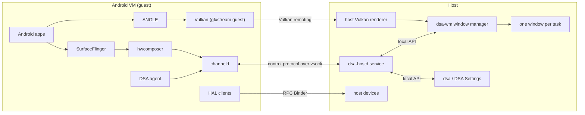

<div align="center">


# Desktop Subsystem for Android™

**App Android come vere finestre del desktop, su una base interamente open source.**

[](https://github.com/thisisthepy/desktop-subsystem-for-android/actions/workflows/test.yml)
[](https://github.com/thisisthepy/desktop-subsystem-for-android/actions/workflows/test-installer.yml)
[](https://github.com/thisisthepy/desktop-subsystem-for-android/actions/workflows/test-image.yml)
[](https://github.com/thisisthepy/desktop-subsystem-for-android/actions/workflows/test-kernel.yml)
[](https://github.com/thisisthepy/desktop-subsystem-for-android/releases/latest)
[](https://github.com/thisisthepy/desktop-subsystem-for-android/blob/main/LICENSE)

[English](../../README.md) · [한국어](README_ko.md) · [日本語](README_ja.md) · [简体中文](README_zh-CN.md) · [繁體中文](README_zh-TW.md) · [Español](README_es.md) · [Français](README_fr.md) · [Deutsch](README_de.md) · [Português (Brasil)](README_pt-BR.md) · [Русский](README_ru.md) · **Italiano** · [Tiếng Việt](README_vi.md) · [Bahasa Indonesia](README_id.md) · [Türkçe](README_tr.md)

</div>

> DSA è un progetto open source indipendente. Non è affiliato a Microsoft o Google, né
> approvato o sponsorizzato da loro. Android è un marchio di Google LLC. Windows è un marchio
> del gruppo di società Microsoft.

## Che cos'è

DSA esegue Android in una propria macchina virtuale leggera e mostra ogni attività Android in
una finestra nativa del desktop. Ogni app ha il proprio pulsante sulla barra delle
applicazioni, la propria voce nel menu Start, le proprie notifiche e la propria voce
nell'elenco delle app installate, come accadeva con il Sottosistema Windows per Android (WSA),
che Microsoft ha dismesso il 5 marzo 2025. Ogni parte di DSA è open source, quindi chiunque
può portarlo avanti.

**Stato.** DSA funziona su Windows 11, su PC x64 e ARM64. Le versioni precedenti alla 1.0
sono pre-release; dalla 1.0 le versioni escono su un canale stabile e su un canale
pre-release (vedere [Aggiornamenti e canali di rilascio](#aggiornamenti-e-canali-di-rilascio)).
Le funzionalità sono testate nella CI e la verifica manuale su hardware reale prosegue a ogni
versione, quindi La invitiamo a segnalare ciò che trova. Linux e macOS sono in sviluppo e non
ancora rilasciati (vedere [Piattaforme supportate](#piattaforme-supportate)).

## Funzionalità

**Finestre e input**

- Una finestra nativa per ogni attività Android, disegnata come l'app stessa, con il nome di
  programma e l'icona dell'app nella barra delle applicazioni, in Alt+Tab e in Gestione
  attività. Nessuna cornice da emulatore che mostra l'intero schermo.
- Una barra del titolo che fa parte dell'app: i colori dell'app arrivano fino al bordo
  superiore della finestra, i pulsanti della barra del titolo di Windows 11 stanno sopra di
  essa, e l'icona e il nome dell'app sono a sinistra. L'icona diventa una freccia indietro
  quando l'app può tornare indietro. I layout di ancoraggio, il trascinamento, il doppio clic
  per ingrandire e il menu della finestra (Alt+Spazio) funzionano come in qualsiasi app
  Windows.
- Il menu della finestra aggiunge **Full screen**, **New window** (per le app che consentono
  più finestre), **Screenshot**, **Aspect ratio**, **Open by default** e **App info**.
- Ridimensionamento in tempo reale senza ricreare l'app, e ingrandimento che riempie l'area di
  lavoro del monitor.
- La richiesta di schermo intero di un'app, come il pulsante schermo intero di un lettore
  video, riempie lo schermo; la barra del titolo compare quando il puntatore tocca il bordo
  superiore. Le app che nascondono soltanto le proprie barre, come un feed di video brevi,
  restano nella loro finestra. Entrambi i comportamenti si scelgono in DSA Settings, per tutte
  le app o per ciascuna, e F11 attiva o disattiva sempre lo schermo intero.
- Immagine nitida su ogni monitor. Quando sposta un'app su un monitor con un'altra scala, si
  ridisegna con la nuova scala appena la sua finestra vi arriva, oppure DSA scala la finestra
  al suo posto, a scelta per ogni app. Per impostazione predefinita, un'app che dichiara di
  gestire da sola un cambio di scala si ridisegna, e DSA scala tutte le altre. Le app note
  per guastarsi quando la scala cambia mentre sono in esecuzione, come YouTube, sono scalate
  da DSA per impostazione predefinita.
- Il testo nelle app segue l'impostazione delle dimensioni del testo di Windows.
- Mouse (con hover), tocco con un massimo di dieci dita, penna (pressione, gomma, pulsante
  laterale) e tastiera con qualsiasi layout.
- Inserimento del testo tramite il framework dei servizi di testo di Windows (TSF): il metodo
  di input di Windows, coreano compreso, compone direttamente nell'editor Android, con la
  finestra dei candidati accanto al cursore. Riconversione, tastiera virtuale, digitazione
  vocale (Win+H), scrittura a mano e pannello emoji agiscono sul testo dell'editor stesso. Non
  c'è un'app tastiera Android.
- Trascinamento di file tra Esplora file e le finestre delle app, in entrambe le direzioni.
- I movimenti touch a tre e quattro dita di Windows 11 vengono disattivati mentre una
  finestra DSA è in primo piano (attivo per impostazione predefinita), così l'app li riceve.
- L'albero di accessibilità di ogni app è esposto a Windows UI Automation, per le utilità per
  la lettura dello schermo e gli strumenti di automazione (vedere
  [UI Automation](#ui-automation) e [Accessibilità](#accessibilità)).

**Integrazione con la shell**

- Voci nel menu Start e nella ricerca di Windows per ogni app Android, anche mentre Android è
  fermo; app elencate in Impostazioni > App > App installate, da dove si possono
  disinstallare.
- Collegamenti sul desktop e scorciatoie proprie dell'app (come una nuova chat in un'app di
  messaggistica) nella jump list della barra delle applicazioni e del menu Start. Quando
  un'app cambia nome, la sua voce nel menu Start, i collegamenti sul desktop e l'aggiunta alla
  barra delle applicazioni seguono il nuovo nome.
- Notifiche Android come notifiche di Windows, con il nome e l'icona di ciascuna app;
  selezionarne una apre l'app, chiuderne una la chiude anche in Android.
- App in esecuzione in background come icone nell'area di notifica, con i tasti multimediali
  e i controlli multimediali di Windows per le app che riproducono contenuti.
- Widget Android posizionati sul desktop, ognuno in una propria finestra.
- Appunti di testo condivisi in entrambe le direzioni, link web aperti nel browser di Windows,
  file di Windows aperti nelle app Android e condivisi con esse, e cartelle di Windows
  condivise con Android.
- I file di Android in Esplora file, sotto **Android** nel riquadro di spostamento.
- Installazione di APK con un doppio clic, dal menu contestuale, trascinando il file su una
  finestra o con `dsa install`, con una finestra che mostra di che APK si tratta prima
  dell'avvio di Android.
- "Share on PC" nel foglio di condivisione di Android: testo, link e file vanno alla finestra
  di condivisione di Windows, Condivisione nelle vicinanze compresa.

**Multimedia e dispositivi**

- Audio tramite i dispositivi di uscita e di ingresso predefiniti di Windows, con una riga per
  ogni app nel mixer volume.
- Video decodificato sulla GPU dell'host tramite Media Foundation: H.264, HEVC, VP9 e AV1,
  fino a 4096x2304. Le immagini decodificate raggiungono Android attraverso una regione di
  memoria condivisa tra l'host e la VM, invece di essere copiate sul canale video. I formati
  che la GPU non decodifica vengono decodificati in Android via software.
- Rendering GPU sull'host: remoting Vulkan tramite gfxstream, e OpenGL ES tramite ANGLE sopra
  di esso.
- Fotocamera, microfono, posizione, sensori (accelerometro, giroscopio, orientamento, luce) e
  alimentazione, ciascuno protetto sia dalle impostazioni sulla privacy di Windows sia dalle
  autorizzazioni di Android.
- La posizione di rete di Android è fornita dall'host, con o senza Google Play. Senza Google
  Play, le ricerche di indirizzi (`Geocoder`) ricevono risposta sul computer dai dati dei
  confini amministrativi inclusi in DSA: una posizione diventa il suo paese, la sua provincia
  e la sua città e, in Corea, anche il distretto e il quartiere. Non sono coinvolti server né
  chiavi, e la posizione resta sul computer. Gli indirizzi stradali e la conversione di un
  indirizzo in una posizione non sono disponibili. Con Google Play risponde il geocoder di
  Google.

**Sistema**

- Doze di Android come stato di inattività: 30 secondi dopo che l'ultima finestra Android
  viene chiusa o ridotta a icona, Android entra in Doze, le notifiche continuano ad arrivare
  mentre la CPU riposa, e la memoria inattiva torna a Windows mentre Android è in esecuzione.
  Aprire un'app lo riattiva subito, senza attendere un avvio. Il congelamento di Android è
  un'opzione, disattivata per impostazione predefinita.
- Ogni utente di Windows ha il proprio Android e il proprio disco dati, nel proprio profilo.
- Accesso root come con `sudo`, disattivato per impostazione predefinita. Lo attiva un
  amministratore; poi ogni app, e `adb shell` in modalità sviluppatore, può essere impostata
  per chiedere. Una richiesta mostra la richiesta di amministratore di Windows (UAC) con il
  nome e l'icona dell'app, e un'approvazione dura 15 minuti. Le app non autorizzate non vedono
  affatto `su`. Ogni richiesta viene registrata.
- Backup crittografato dei dati delle app nella cartella utente, disattivato per impostazione
  predefinita.
- DSA Settings: app e relative finestre, app in background, widget, schermo e GPU, memoria,
  rete, identità del dispositivo, aggiornamenti, componenti aggiuntivi, accesso root,
  modalità sviluppatore con adb, log in tempo reale di Android e diagnostica. Tutto ciò che
  contiene è disponibile anche come comando `dsa`.

**Componenti aggiuntivi a scelta**

DSA non include software Google. Ciascuno di questi componenti viene scaricato dalla sua fonte
solo quando lo richiede, dopo che DSA Le ha mostrato la fonte e le condizioni, e viene messo su
un disco di componenti aggiuntivi accanto ad Android. L'immagine di sistema non viene mai
modificata, e ciascuno si può rimuovere di nuovo da DSA Settings o dalla riga di comando.

- **Google Play.** `dsa gapps install`, oppure **Advanced** > **Google Play** in DSA Settings,
  scarica il pacchetto pubblico LiteGapps Core (Google Play services, il Play Store e la
  sincronizzazione dell'account) per la Sua versione di Android. Questo Android non è
  certificato da Google, quindi Google potrebbe chiederLe di registrare il dispositivo; DSA
  Settings mostra l'ID Android e la pagina in cui farlo. Google Play non impedisce mai
  l'avvio di Android. Le app di Google seguono le condizioni di Google.
- **Widevine L3.** `dsa drm widevine install`, oppure **Advanced** > **Protected content**,
  prende il modulo Widevine di Google, senza modifiche, dall'immagine dell'emulatore Android di
  Google per la Sua versione di Android (circa 2 GB da scaricare; viene conservato solo
  Widevine). Le app di streaming possono così riprodurre video protetti. Con il livello di
  sicurezza L3, i servizi di streaming inviano al massimo la definizione standard, quindi per
  l'alta definizione usi un browser o un'app di Windows.
- **Traduzione ARM.** Sui PC x64, le app create solo per ARM funzionano tramite un traduttore.
  Il traduttore open source Digitalis è incluso nell'immagine x64 e viene usato dal primo
  avvio. Può sostituirlo con il traduttore di Google (`dsa arm-translation fetch google`) o con
  un pacchetto proprio. Funzionano solo le app ARM a 64 bit (`arm64-v8a`). Sui PC ARM64,
  Android esegue le app ARM direttamente.

**Non inclusi:** Google Play services, uno store di app o qualsiasi altro binario Google (le
loro licenze li rendono una scelta dell'utente), e nessuno dei binari WSA di Microsoft.

## UI Automation

DSA espone l'interfaccia utente all'interno di ogni finestra di app Android a Windows UI
Automation (UIA, l'interfaccia di automazione dell'interfaccia utente), la stessa interfaccia
usata dalle app Windows. Le utilità per la lettura dello schermo, gli strumenti di test e gli
altri client UIA vedono i pulsanti, gli elenchi e i campi di testo di un'app Android come
elementi della sua finestra, invece che come un'unica immagine.

**Come funziona.** Quando un client UIA chiede per la prima volta l'albero a una finestra di
app DSA, la finestra chiede all'agente di DSA in Android di osservare quell'attività. L'agente
legge i nodi di accessibilità di Android solo per quell'attività e li invia all'host: prima
l'intero albero, poi le modifiche. L'host conserva l'albero nel processo della finestra, così
ogni lettura di proprietà e ogni chiamata di navigazione riceve risposta in locale, senza un
viaggio di andata e ritorno verso la VM. Quando nessun client UIA è in ascolto da 30 secondi,
l'osservazione si ferma e Android smette di leggere i nodi. Chi non usa alcun client UIA non
paga nulla per questa funzione.

**Che cosa contiene ogni elemento.**

- **Control type**, dalla classe della view Android e dal suo stato: pulsante, casella di
  controllo, pulsante di opzione, campo di modifica, dispositivo di scorrimento, barra di
  avanzamento, casella combinata, elenco, voce di elenco, scheda, menu, immagine, testo,
  documento (per una `WebView`), barra degli strumenti e gruppo. Un interruttore Android è un
  pulsante con il pattern Toggle, e un'intestazione è testo.
- **Name**: la descrizione del contenuto, altrimenti il testo, altrimenti il suggerimento di
  un campo di modifica vuoto. Un elemento cliccabile senza un nome proprio prende i nomi dei
  suoi figli.
- **AutomationId**: l'ID risorsa della view Android, come `com.example:id/send`.
- **ClassName**: la classe della view Android. **FrameworkId** è `Android`.
- **HelpText** (il suggerimento), **ItemStatus** (la descrizione dello stato di Android),
  **IsEnabled**, **IsKeyboardFocusable**, **HasKeyboardFocus**, **IsPassword** e un
  **BoundingRectangle** in coordinate dello schermo.
- Gli elementi che Android segnala come non visibili all'utente sono esclusi dall'albero.
- I campi password non lasciano mai Android come testo: ogni carattere arriva come un pallino.

**I pattern e che cosa fanno in Android.**

| Pattern UIA | Azione Android |
|---|---|
| Invoke | `ACTION_CLICK` |
| Value (`SetValue`) | `ACTION_SET_TEXT`, che sostituisce l'intero testo del campo |
| Toggle | `ACTION_CLICK` |
| SelectionItem (`Select`) | `ACTION_SELECT`, oppure `ACTION_CLICK` quando il nodo non ha un'azione di selezione |
| Scroll | `ACTION_SCROLL_FORWARD` e `ACTION_SCROLL_BACKWARD`, per pagina; nessuna percentuale di scorrimento |
| `SetFocus` | `ACTION_FOCUS`, oppure `ACTION_ACCESSIBILITY_FOCUS` quando il nodo non può ricevere lo stato attivo per l'input |

Queste azioni vanno direttamente al nodo. Non spostano il mouse e non iniettano tocchi.

**Eventi.** La finestra genera il cambio dello stato attivo (mentre è in primo piano), il
cambio di struttura quando compaiono o scompaiono figli, e il cambio di proprietà per nome,
valore, stato dell'interruttore, selezione, stato di abilitazione e rettangolo di
delimitazione. Gli eventi vengono generati solo mentre un client è in ascolto.

**Inserimento del testo.** `SetValue` imposta il testo di un campo in un solo passaggio. La
digitazione, la composizione e i metodi di input passano invece da TSF e dall'`InputConnection`
dell'app, come per una persona alla tastiera.

**La finestra stessa.** Il nome della finestra è il nome dell'app. I pulsanti della barra del
titolo (riduci a icona, ingrandisci o ripristina, chiudi) e la freccia indietro della barra del
titolo sono pulsanti con nome nell'albero.

**Uso da altri strumenti.** Funziona qualsiasi client UIA, come Inspect e Accessibility
Insights for Windows, o librerie come FlaUI. Trovi la finestra dell'app dal suo nome, poi i
suoi elementi per AutomationId, nome o tipo di controllo. Per gli script che devono premere un
punto invece di un elemento, `dsa tap <package> <x> <y>` preme all'interno dell'attività
dell'app.

**Non ancora disponibile.** Non ci sono il pattern Text, i pattern RangeValue ed
ExpandCollapse, la pressione prolungata tramite UIA, il livello delle intestazioni, né gli
eventi di notifica o di area live. Lo stato attivo di accessibilità di Android non viene
esportato; viene esportato solo lo stato attivo per l'input. I miglioramenti sono seguiti
nella issue [#744](https://github.com/thisisthepy/desktop-subsystem-for-android/issues/744)
(aperta).

## Accessibilità

**Utilità per la lettura dello schermo.** NVDA e Assistente vocale (Narrator) leggono le app
Android tramite l'albero di UI Automation descritto sopra: i controlli hanno nomi e ruoli, lo
stato attivo segue la tastiera, e pulsanti, interruttori, elenchi e campi di testo si possono
usare senza mouse. JAWS usa lo stesso albero; il progetto non lo ha ancora verificato, quindi
le segnalazioni sono benvenute.

**Che cosa si sta migliorando.** Questi punti vengono dalla segnalazione di un utente di
un'utilità per la lettura dello schermo, la issue
[#744](https://github.com/thisisthepy/desktop-subsystem-for-android/issues/744). Ciascuno è
aperto e seguito lì:

- **Stato attivo più rapido.** Oggi un cambio dello stato attivo attende in Android prima di
  raggiungere Windows, circa 250-450 ms dopo la pressione di un tasto, e tenendo premuto un
  tasto freccia ci si sposta di circa quattro passi al secondo. Il piano è inviare subito i
  cambi dello stato attivo, leggere solo l'attività da cui proviene un evento, e riservare i
  tempi brevi ai momenti in cui un client UIA è in ascolto.
- **Stato attivo di accessibilità.** Oggi viene esportato solo lo stato attivo per l'input,
  quindi gli spostamenti dello stato attivo di accessibilità di Android non generano alcun
  evento di stato attivo.
- **Pattern Text.** I campi di modifica non hanno ancora il pattern Text, che NVDA usa per
  leggere e rivedere il testo per carattere, parola e riga. Il loro valore si può leggere e
  impostare.

**Le finestre di DSA.**

- **DSA Settings** funziona con la tastiera e con le utilità per la lettura dello schermo: la
  navigazione, le righe e i controlli sono elementi UIA con un nome.
- **L'APK Installer** dà un nome a ciascuno dei suoi elementi, e il suo link **More** si
  espande e si comprime tramite UIA.
- **I widget sul desktop** ricevono lo stato attivo della tastiera. Invio, Spazio, il tasto
  menu e Maiusc+F10 aprono il menu del widget.
- **I menu** dei widget e delle icone dell'area di notifica sono menu UIA con navigazione da
  tastiera, e **le finestre di conferma** hanno tasti di scelta e un pulsante predefinito.
- **La richiesta di root** è la richiesta di amministratore di Windows (UAC).
- I pulsanti della barra del titolo usano i colori di sistema in un tema a contrasto elevato.

Su Linux, l'host esporta lo stesso albero ad AT-SPI, con il testo per carattere, parola e
riga, per Orca; Linux non è ancora rilasciato. L'host macOS non esporta ancora gli alberi
delle app.

**Segnalare un problema.** Apra una
[issue](https://github.com/thisisthepy/desktop-subsystem-for-android/issues/new) indicando
l'utilità per la lettura dello schermo e la sua versione, l'app, che cosa ha fatto, che cosa ha
sentito e che cosa si aspettava. Un pacchetto di diagnostica creato con
`dsa logs collect -o diag.zip` è utile. Anche il
[Discord di DSA](https://discord.gg/MtpQnR4eQQ) è aperto alle domande.

## Piattaforme supportate

| Host | Stato |
|---|---|
| Windows 11, x64 | Rilasciato come `DSA-v<version>-win-x64-setup.exe` |
| Windows 11, ARM64 | Rilasciato come `DSA-v<version>-win-arm64-setup.exe`. Anche Android è ARM64, quindi le app ARM funzionano senza traduzione |
| Linux (x64, ARM64) | In sviluppo, non rilasciato. L'host KVM, il compositor Wayland e i pacchetti `.deb` e `.rpm` vengono compilati ed eseguiti nella CI |
| macOS (Apple silicon) | In sviluppo, non rilasciato. L'host basato sul Virtualization framework di Apple e il suo app bundle vengono compilati nella CI |

### Versioni di Android

DSA supporta le due versioni principali più recenti di Android: oggi Android 16 e Android 17.
Una versione esce dal supporto quando viene rilasciata la seconda versione principale più
recente, quindi Android 16 è supportato fino al rilascio di Android 18. Il programma di
aggiornamento dell'immagine porta ogni utente a una versione supportata e non passa mai da solo
a una versione principale inferiore. Può scegliere una delle due versioni supportate in DSA
Settings o con `dsa android use`; passare alla più vecchia cancella i dati di Android, perché
Android non può leggere i dati scritti da una versione più recente.

<p align="center">
  
</p>

Le date successive a oggi sono date previste, non rilasci.

## Installazione

**Serve** Windows 11 su un PC x64 o ARM64, con la funzionalità di Windows **Piattaforma
macchina virtuale** attivata. Il programma di installazione la verifica e, se è disattivata,
si interrompe con le istruzioni.

1. Attivi **Piattaforma macchina virtuale**: Impostazioni > Sistema >
   Funzionalità facoltative > Altre funzionalità di Windows, oppure
   `dism /online /enable-feature /featurename:VirtualMachinePlatform /all` in un terminale da
   amministratore. Riavvii.
2. Scarichi `DSA-v<version>-win-x64-setup.exe`, oppure `DSA-v<version>-win-arm64-setup.exe` su
   un PC ARM64, dall'[ultima versione](https://github.com/thisisthepy/desktop-subsystem-for-android/releases/latest)
   e lo verifichi con `SHA256SUMS.txt`.
3. Lo esegua. Il programma di installazione installa il servizio `DsaHost`, il comando `dsa`,
   DSA Settings, l'APK Installer e la prima immagine Android (scaricata quando il programma di
   installazione non ne contiene una). Android si avvia quando accede a Windows, così la prima
   app che apre non attende un avvio.

Nessun kernel da compilare e nessuna modifica alla configurazione di WSL: DSA include il
proprio kernel e la propria VM. La disinstallazione rimuove tutto ciò che DSA ha scritto,
tranne il disco Android di ogni utente.

## Aggiornamenti e canali di rilascio

DSA aggiorna se stesso e l'immagine Android. Entrambi sono firmati, e non viene applicato
nulla la cui firma, dimensione o hash non corrisponda.

- **DSA stesso.** Il servizio controlla un elenco firmato di versioni e installa una versione
  più recente quando l'Android di nessun utente è in esecuzione; altrimenti attende, e
  `dsa update` installa subito. Viene avvisato prima e dopo. Un aggiornamento non porta mai
  DSA a una versione inferiore.
- **Canali.** Dalla 1.0 ce ne sono due: **stable** e **pre-release**, per le versioni ancora in
  via di completamento. Il canale pre-release prende la più recente tra le due. Il Suo canale
  parte dal programma di installazione che ha usato, e gli aggiornamenti lo mantengono. Lo
  cambi con **Get pre-release versions** nella pagina **Updates** di DSA Settings, oppure con
  `dsa settings set prerelease-updates on|off` (amministratori). Uscire dalle pre-release non
  riporta mai DSA indietro: attende una versione stabile più recente. Ogni versione precedente
  alla 1.0 è una pre-release.
- **Immagine Android.** Gli aggiornamenti dell'immagine non dipendono dal canale. Un'immagine
  che non si avvia viene sostituita dall'ultima funzionante, e `dsa status` lo segnala. Con
  **Restart Android into updates by itself**, Android si riavvia in un aggiornamento scaricato
  quando nessuna finestra di app è aperta.
- **Disattivare gli aggiornamenti.** Gli amministratori possono disattivare **Update DSA
  automatically** e **Update the Android image automatically** nella pagina **Updates**.

Le versioni stabili vengono create solo da `main`, dopo una revisione. Le build di `develop`
sono pre-release o build di test per chi contribuisce.

## Avvio rapido

Apra un'app Android dal menu Start, oppure usi il comando `dsa`:

```
dsa status                          # stato di Android ed eventuali aggiornamenti in attesa
dsa install app.apk                 # installa un APK o un bundle di APK suddivisi (.xapk, .apks, .apkm)
dsa apps list                       # le app installate
dsa launch com.android.settings     # apre un'app nella sua finestra
dsa settings set clipboard off      # cambia un'impostazione (DSA Settings ha gli stessi interruttori)
dsa logcat -d -b all *:W            # il log di Android, avvisi e livelli superiori
dsa logs collect -o diag.zip        # tutto ciò che serve a una segnalazione, in un unico zip
```

`dsa` senza argomenti elenca tutti i comandi. Il log di Android resta in memoria e arriva
all'host solo mentre qualcosa lo legge. Alleghi `diag.zip` a una segnalazione di problema.

## Limiti

Oggi valgono questi limiti:

- È rilasciato solo Windows. Linux e macOS sono in sviluppo.
- DSA Settings è disponibile solo in inglese e in coreano.
- Funzionano solo le app a 64 bit: `arm64-v8a` e, su x64, `x86_64`. Le app a 32 bit non
  funzionano.
- Widevine è L3, quindi i flussi protetti vengono riprodotti al massimo in definizione
  standard.
- Google Play non è certificato da Google su DSA; Google potrebbe chiederLe di registrare il
  dispositivo.
- Gli appunti condividono solo testo.
- La scelta di ridimensionamento **System (forced)** non è ancora disponibile e funziona come
  **System**.
- L'esportazione di UI Automation ha le lacune elencate in [UI Automation](#ui-automation).
- Le ricerche di indirizzi senza Google Play restituiscono la zona (dal paese fino alla città,
  o al distretto in Corea), non gli indirizzi stradali.

## Guide per l'utente

Le guide passo passo trattano l'installazione, le app e le finestre, gli APK, i file, le
versioni di Android, le impostazioni, la memoria, la modalità sviluppatore, la risoluzione dei
problemi e la disinstallazione: [docs/guides](../guides/it/README.md). La
[pagina di introduzione](../guides/intro/index.html) presenta il progetto a chi lo scopre per
la prima volta.

## Architettura



- **Guest.** Un agente con firma di piattaforma rende lo schermo freeform e segnala attività,
  app, notifiche e alberi di accessibilità. L'hwcomposer passa all'host i livelli di ogni
  attività come un display a sé. I client HAL raggiungono i dispositivi dell'host tramite RPC
  Binder. Non ci sono launcher, barra di stato o app tastiera: la shell è l'host.
- **Protocollo.** Un'unica definizione, `dsa/protocol/control.proto`, con codec generati per
  Rust, Java e C++. Ogni connessione verifica la versione del protocollo, l'hash dello schema
  e un segreto valido per un solo avvio.
- **Host.** `dsa/host/core/` è indipendente dalla piattaforma: sessioni, registro delle app e
  criteri del ciclo di vita. Ogni sistema operativo aggiunge la VM, il trasporto e il sistema
  di finestre sotto `dsa/host/platform/<os>/`. Su Windows la VM viene creata tramite Host
  Compute System, e i fotogrammi vanno dalla GPU a ogni finestra tramite Direct3D 11 e
  DirectComposition, senza mai passare dalla CPU.

## Compilazione dai sorgenti

I crate Rust formano un unico workspace in `dsa/`:

```
cd dsa
cargo test --workspace
cargo build -p dsa-host-windows --release
```

Le altre parti hanno una propria build, descritta accanto a esse:

- il programma di installazione: `dsa/host/platform/windows/installer/README.md`
- l'host Windows: `dsa/host/platform/windows/README.md`
- il kernel guest: `dsa/kernel/`
- l'immagine Android e i componenti guest: `dsa/guest/`
- il percorso grafico: `dsa/graphics/`

I progetti upstream (AOSP, gfxstream, il kernel) non sono inclusi nel repository: degli script
scaricano una revisione fissata e applicano le patch conservate qui. Gli strumenti Python si
eseguono con `uv run`.

## Struttura del repository

| Percorso | Contenuto |
|---|---|
| `dsa/protocol/` | Il protocollo di controllo guest-host e i suoi generatori di codice |
| `dsa/host/core/` | L'host indipendente dalla piattaforma |
| `dsa/host/cli/` | Il comando `dsa` |
| `dsa/host/platform/windows/` | L'host Windows, il window manager, il programma di installazione e DSA Settings |
| `dsa/host/platform/linux/`, `macos/`, `unix/` | Gli host Linux e macOS e ciò che hanno in comune |
| `dsa/graphics/` | Il remoting Vulkan, a partire da gfxstream |
| `dsa/guest/` | L'agente, l'hwcomposer, i servizi HAL e la configurazione dell'immagine |
| `dsa/kernel/` | La configurazione e la build del kernel guest |
| `scripts/tests/` | I controlli del repository |
| `.github/` | Workflow di CI, script di rilascio e risorse del README |

## Contribuire

DSA è giovane e ancora in fase di stabilizzazione, quindi ogni segnalazione aiuta, che abbia o
no una correzione pronta.

<p>
  <a href="https://github.com/thisisthepy/desktop-subsystem-for-android/issues/new"></a>
  <a href="https://discord.gg/MtpQnR4eQQ"></a>
</p>

- **Ha trovato un bug o ha un'idea?** [Apra una issue](https://github.com/thisisthepy/desktop-subsystem-for-android/issues/new).
  Descriva che cosa ha fatto e che cosa è successo, indicando la build di Windows (`winver`) e
  le versioni di DSA e di Android (`dsa status`). Un pacchetto di diagnostica creato con
  `dsa logs collect -o diag.zip` rende un bug molto più facile da individuare.
- **Preferisce chiedere prima o semplicemente parlarne?** Venga sul
  [Discord di DSA](https://discord.gg/MtpQnR4eQQ). Domande, ciò che sta cercando di eseguire e
  i primi riscontri sono tutti benvenuti.
- **Vuole inviare una modifica?** Il lavoro si svolge sul branch `develop`; `main` viene
  pubblicato a partire da esso. Apra le pull request verso `develop`, con una sola modifica
  logica per commit e un test per ogni cambiamento di comportamento. Il codice del protocollo
  generato non si modifica mai a mano. La preghiamo di non usare trattini lunghi (em dash) nel
  testo: un controllo del repository li rifiuta.

## Licenza

[Apache-2.0](https://github.com/thisisthepy/desktop-subsystem-for-android/blob/main/LICENSE).
Ogni componente di terze parti incluso mantiene la propria licenza, elencata nel programma di
installazione.

## Marchi

Android è un marchio di Google LLC. Windows è un marchio del gruppo di società Microsoft. DSA
non è affiliato a Microsoft o Google, né approvato o sponsorizzato da loro.

## Cronologia delle stelle

<a href="https://www.star-history.com/#thisisthepy/desktop-subsystem-for-android&Date">
  <picture>
    <source media="(prefers-color-scheme: dark)" srcset="https://api.star-history.com/svg?repos=thisisthepy/desktop-subsystem-for-android&type=Date&theme=dark" />
    <source media="(prefers-color-scheme: light)" srcset="https://api.star-history.com/svg?repos=thisisthepy/desktop-subsystem-for-android&type=Date" />
    
  </picture>
</a>
