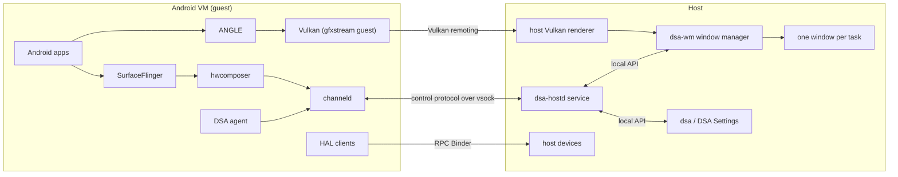

<div align="center">


# Desktop Subsystem for Android™

**Android アプリを本物のデスクトップ ウィンドウとして、オープンソースの基盤で。**

[](https://github.com/thisisthepy/desktop-subsystem-for-android/actions/workflows/test.yml)
[](https://github.com/thisisthepy/desktop-subsystem-for-android/actions/workflows/test-installer.yml)
[](https://github.com/thisisthepy/desktop-subsystem-for-android/actions/workflows/test-image.yml)
[](https://github.com/thisisthepy/desktop-subsystem-for-android/actions/workflows/test-kernel.yml)
[](https://github.com/thisisthepy/desktop-subsystem-for-android/releases/latest)
[](https://github.com/thisisthepy/desktop-subsystem-for-android/blob/main/LICENSE)

[English](../../README.md) · [한국어](README_ko.md) · **日本語** · [简体中文](README_zh-CN.md) · [繁體中文](README_zh-TW.md) · [Español](README_es.md) · [Français](README_fr.md) · [Deutsch](README_de.md) · [Português (Brasil)](README_pt-BR.md) · [Русский](README_ru.md) · [Italiano](README_it.md) · [Tiếng Việt](README_vi.md) · [Bahasa Indonesia](README_id.md) · [Türkçe](README_tr.md)

</div>

> DSA は独立したオープンソース プロジェクトです。
> Microsoft および Google とは提携しておらず、両社による承認や後援も受けていません。
> Android は Google LLC の商標です。
> Windows は Microsoft グループ企業の商標です。

## 概要

DSA は Android を専用の軽量 VM で実行し、Android のタスクごとにネイティブのデスクトップ ウィンドウを 1 つずつ表示します。
アプリごとにタスクバー ボタン、スタート メニューの項目、通知、インストール済みアプリの一覧の項目があります。
これは、Microsoft が 2025 年 3 月 5 日に提供を終了した Windows Subsystem for Android (WSA) と同じです。
DSA はすべての部分がオープンソースなので、誰でも開発を引き継げます。

**現在の状況。** DSA は Windows 11 の x64 PC と ARM64 PC で動作します。
1.0 未満のリリースはプレリリースです。
1.0 以降、リリースには安定版チャネルとプレリリース チャネルがあります ([アップデートとリリースチャネル](#アップデートとリリースチャネル) を参照)。
機能は CI でテストされており、実機での手動確認もリリースごとに続けています。
見つけた問題はぜひ報告してください。
Linux と macOS は開発中で、まだリリースされていません ([対応プラットフォーム](#対応プラットフォーム) を参照)。

## 機能

**ウィンドウと入力**

- Android のタスクごとにネイティブ ウィンドウが 1 つあり、アプリそのものとして描画されます。
  タスクバー、Alt+Tab、タスク マネージャーには、アプリ自身のプログラム名とアイコンが表示されます。
  画面全体を映すエミュレーターの枠はありません。
- タイトル バーはアプリの一部です。
  アプリの色がウィンドウの上端まで届き、その上に Windows 11 のキャプション ボタンが重なり、左端にアプリのアイコンと名前が表示されます。
  アプリが前の画面に戻れるときは、アイコンが戻る矢印に変わります。
  スナップ レイアウト、ドラッグ、ダブルクリックでの最大化、ウィンドウ メニュー (Alt+Space) は、ほかの Windows アプリと同じように使えます。
- ウィンドウ メニューには **Full screen**、**New window** (複数のウィンドウを許可するアプリの場合)、**Screenshot**、**Aspect ratio**、**Open by default**、**App info** が加わります。
- アプリを作り直さずにライブでサイズを変更でき、最大化するとモニターの作業領域いっぱいに広がります。
- 動画プレーヤーの全画面ボタンのような、アプリからの全画面表示の要求では画面全体に表示されます。
  ポインターを画面の上端に当てるとタイトル バーが現れます。
  ショート動画のフィードのようにバーを隠すだけのアプリは、ウィンドウの中にとどまります。
  どちらも DSA Settings で、すべてのアプリに対して、またはアプリごとに選べます。
  F11 キーでは常に全画面表示を切り替えられます。
- どのモニターでも表示がくっきりしています。
  アプリは開いたモニターの拡大率で開きます。
  拡大率の異なるモニターに移すと、ドラッグを終えた時点でアプリが新しい拡大率で描き直すか、DSA がウィンドウを拡大縮小します。
  どちらにするかはアプリごとに選べます。
  YouTube のように、実行中に拡大率が変わると表示が崩れることがわかっているアプリは、既定で DSA が拡大縮小します。
- アプリ内の文字は Windows の文字サイズの設定に従います。
- マウス (ホバーを含む)、最大 10 本指のタッチ、ペン (筆圧、消しゴム、バレル ボタン)、あらゆるレイアウトのキーボードに対応しています。
- 文字入力は Windows のテキスト サービス フレームワーク (TSF) を通ります。
  韓国語を含む Windows の入力方式で、Android のエディターの中でそのまま変換でき、候補ウィンドウはカーソルの隣に表示されます。
  再変換、タッチ キーボード、音声入力 (Win+H)、手書き入力、絵文字パネルは、エディター自身のテキストに対して動作します。
  Android のキーボード アプリはありません。
- エクスプローラーとアプリのウィンドウの間で、ファイルを双方向にドラッグできます。
- DSA のウィンドウが前面にある間は、Windows 11 の 3 本指と 4 本指のタッチ ジェスチャがオフになり (既定でオン)、そのジェスチャがアプリに届きます。
- 各アプリのアクセシビリティ ツリーを Windows の UI Automation に公開し、スクリーン リーダーや自動化ツールから使えます ([UI Automation](#ui-automation) と [アクセシビリティ](#アクセシビリティ) を参照)。

**シェルとの統合**

- すべての Android アプリにスタート メニューの項目があり、Android が停止している間も Windows 検索で見つかります。
  アプリは [設定] > [アプリ] > [インストールされているアプリ] に表示され、そこからアンインストールできます。
- デスクトップのショートカットを作れます。
  アプリ自身のショートカット (メッセンジャーの新しいチャットなど) は、タスクバーとスタート メニューのジャンプ リストに表示されます。
  アプリの名前が変わると、スタート メニューの項目、デスクトップのショートカット、タスクバーのピン留めも新しい名前に従います。
- Android の通知は、アプリごとの名前とアイコンで Windows の通知として表示されます。
  通知を選ぶとアプリが開き、閉じると Android 側でも閉じられます。
- バックグラウンドで動くアプリは通知領域のアイコンになります。
  メディアを再生するアプリでは、メディア キーと Windows のメディア コントロールが使えます。
- Android のウィジェットを、それぞれ専用のウィンドウとしてデスクトップに置けます。
- テキストのクリップボードを双方向に共有し、Web リンクは Windows のブラウザーで開きます。
  Windows のファイルを Android アプリで開いたり Android アプリに共有したりでき、Windows のフォルダーを Android と共有できます。
- Android のファイルは、エクスプローラーのナビゲーション ウィンドウの **Android** から開けます。
- APK は、ダブルクリック、コンテキスト メニュー、ウィンドウへのドロップ、または `dsa install` でインストールできます。
  Android が起動する前に、APK の内容をウィンドウで確認できます。
- Android の共有シートに「Share on PC」があります。
  テキスト、リンク、ファイルが Windows の共有ウィンドウに送られ、近距離共有も使えます。

**メディアとデバイス**

- 音声は Windows の既定の出力デバイスと入力デバイスを通り、音量ミキサーにはアプリごとの行があります。
- 動画はホストの GPU で Media Foundation を通してデコードされます。
  H.264、HEVC、VP9、AV1 に対応し、最大 4096x2304 です。
  デコードした画像は動画チャネル経由でコピーされず、ホストと VM が共有するメモリ領域を通って Android に届きます。
  GPU がデコードできない形式は、Android 内でソフトウェアでデコードされます。
- GPU による描画はホストで行われます。
  Vulkan は gfxstream によるリモーティングで、OpenGL ES はその上の ANGLE で動きます。
- カメラ、マイク、位置情報、センサー (加速度計、ジャイロスコープ、向き、照度)、電源に対応しています。
  いずれも Windows のプライバシー設定と Android の権限の両方で守られています。
- Android のネットワーク位置情報には、Google Play の有無にかかわらずホストが応答します。
  Google Play がない場合、住所の検索 (`Geocoder`) には、DSA に含まれる行政区域のデータを使ってコンピューター上で応答します。
  位置は国、州や県、市に変換され、韓国では区と洞まで変換されます。
  サーバーもキーも使わず、位置はコンピューターの外に出ません。
  番地までの住所や、住所から位置への変換には対応していません。
  Google Play がある場合は、Google のジオコーダーが応答します。

**システム**

- Android の Doze がアイドル状態です。
  最後の Android ウィンドウを閉じるか最小化してから 30 秒たつと Android は Doze に入り、CPU が休んでいる間も通知は届き続けます。
  Android の実行中も、使われていないメモリは Windows に返されます。
  アプリを開くと Android はすぐに復帰し、起動を待つ必要はありません。
  Android のフリーズはオプションで、既定ではオフです。
- Windows のユーザーごとに、専用の Android とデータ ディスクがそのユーザーのプロファイルにあります。
- `sudo` のような root 権限があり、既定ではオフです。
  管理者がこれをオンにすると、アプリごと、および開発者モードの `adb shell` に、確認を求める設定ができます。
  要求があると、アプリ自身の名前とアイコンで Windows の管理者確認のプロンプト (UAC) が表示され、承認は 15 分間有効です。
  許可されていないアプリからは `su` がまったく見えません。
  すべての要求が記録されます。
- アプリのデータをユーザー フォルダーに暗号化してバックアップできます (既定ではオフ)。
- DSA Settings では、アプリとそのウィンドウ、バックグラウンド アプリ、ウィジェット、ディスプレイと GPU、メモリ、ネットワーク、デバイス ID、アップデート、アドオン、root 権限、adb を使う開発者モード、Android のライブ ログと診断を扱えます。
  そのすべてが `dsa` コマンドでも操作できます。

**選んで追加するアドオン**

DSA は Google のソフトウェアを同梱していません。
以下のアドオンは、求められたときにだけ、DSA が入手元と利用条件を示したうえで入手元からダウンロードし、Android とは別のアドオン用ディスクに置きます。
システム イメージは一切変更されず、どれも DSA Settings またはコマンド ラインから再び削除できます。

- **Google Play。** `dsa gapps install`、または DSA Settings の **Advanced** > **Google Play** で、使っている Android のバージョン向けの公開 LiteGapps Core パッケージ (Google Play 開発者サービス、Play ストア、アカウント同期) をダウンロードします。
  この Android は Google の認定を受けていないため、Google からデバイスの登録を求められることがあります。
  DSA Settings に Android ID と登録用のページが表示されます。
  Google Play が原因で Android が起動できなくなることはありません。
  Google のアプリには Google の利用規約が適用されます。
- **Widevine L3。** `dsa drm widevine install`、または **Advanced** > **Protected content** で、使っている Android のバージョン向けの Google の Android エミュレーター イメージから、Google の Widevine モジュールを変更せずに取り出します (ダウンロードは約 2 GB で、残すのは Widevine だけです)。
  これでストリーミング アプリが保護された動画を再生できます。
  セキュリティ レベル L3 では、ストリーミング サービスは最大でも標準画質しか送らないため、高画質で見るには Windows のブラウザーやアプリを使ってください。
- **ARM 変換。** x64 PC では、ARM 専用に作られたアプリが変換ツールを通して動きます。
  オープンソースの変換ツール Digitalis が x64 イメージに含まれており、最初の起動から使われます。
  これを Google の変換ツール (`dsa arm-translation fetch google`) や独自のパッケージに置き換えることもできます。
  動くのは 64 ビット ARM アプリ (`arm64-v8a`) だけです。
  ARM64 PC では、Android が ARM アプリをそのまま実行します。

**同梱しないもの:** Google Play 開発者サービス、アプリ ストア、その他の Google のバイナリ (ライセンス上、利用者が選ぶものだからです)、および Microsoft の WSA のバイナリ。

## UI Automation

DSA は、各 Android アプリ ウィンドウ内のユーザー インターフェイスを、Windows アプリと同じインターフェイスである Windows の UI Automation (UIA) に公開します。
スクリーン リーダー、テスト ツール、その他の UIA クライアントからは、Android アプリのボタン、リスト、テキスト フィールドが 1 枚の画像ではなく、ウィンドウの要素として見えます。

**仕組み。** UIA クライアントが DSA のアプリ ウィンドウに初めてツリーを求めると、ウィンドウは Android 内の DSA のエージェントに、そのタスクの監視を依頼します。
エージェントはそのタスクの Android のアクセシビリティ ノードだけを読み取り、最初にツリー全体を、その後は変更分をホストに送ります。
ホストはツリーをウィンドウのプロセス内に保持するので、プロパティの読み取りやナビゲーションの呼び出しはすべてローカルで応答され、VM との往復は発生しません。
UIA クライアントが 30 秒間何も待ち受けていないと監視は止まり、Android はノードの読み取りをやめます。
UIA クライアントを使わない人には、負担が一切かかりません。

**各要素が持つ情報。**

- **Control type** (コントロールの種類): Android のビュー クラスとその状態から決まります。
  ボタン、チェック ボックス、ラジオ ボタン、エディット、スライダー、プログレス バー、コンボ ボックス、リスト、リスト項目、タブ、メニュー、画像、テキスト、ドキュメント (`WebView` の場合)、ツール バー、グループがあります。
  Android のスイッチは Toggle パターンを持つボタンで、見出しはテキストです。
- **Name**: コンテンツの説明、それがなければテキスト、それもなければ空のエディット フィールドのヒントです。
  自身の名前を持たないクリック可能な要素は、子要素の名前を使います。
- **AutomationId**: `com.example:id/send` のような、Android のビューのリソース ID です。
- **ClassName**: Android のビュー クラスです。**FrameworkId** は `Android` です。
- **HelpText** (ヒント)、**ItemStatus** (Android の状態の説明)、**IsEnabled**、**IsKeyboardFocusable**、**HasKeyboardFocus**、**IsPassword**、および画面座標での **BoundingRectangle**。
- Android がユーザーに見えないと報告する要素は、ツリーから除かれます。
- パスワード フィールドの内容がテキストとして Android の外に出ることはありません。
  各文字は黒丸として届きます。

**パターンと、Android での動作。**

| UIA のパターン | Android での動作 |
|---|---|
| Invoke | `ACTION_CLICK` |
| Value (`SetValue`) | `ACTION_SET_TEXT`。フィールドのテキスト全体を置き換えます |
| Toggle | `ACTION_CLICK` |
| SelectionItem (`Select`) | `ACTION_SELECT`。ノードに選択の動作がない場合は `ACTION_CLICK` |
| Scroll | `ACTION_SCROLL_FORWARD` と `ACTION_SCROLL_BACKWARD`、ページ単位。スクロールの割合はありません |
| `SetFocus` | `ACTION_FOCUS`。ノードが入力フォーカスを受け取れない場合は `ACTION_ACCESSIBILITY_FOCUS` |

これらの動作はノードに直接送られます。
マウスを動かしたり、タッチを注入したりはしません。

**イベント。** ウィンドウは、フォーカスの変更 (前面にある間)、子要素が現れたり消えたりしたときの構造の変更、名前、値、トグルの状態、選択、有効状態、境界の四角形についてのプロパティの変更を通知します。
イベントは、クライアントが待ち受けている間だけ発生します。

**文字入力。** `SetValue` はフィールドのテキストを一度に設定します。
タイピング、変換、入力方式は、キーボードの前にいる人の場合と同じく、TSF とアプリの `InputConnection` を通ります。

**ウィンドウそのもの。** ウィンドウの名前はアプリの名前です。
キャプション ボタン (最小化、最大化または元に戻す、閉じる) とタイトル バーの戻る矢印は、ツリーの中で名前の付いたボタンです。

**ほかのツールから使う。** Inspect や Accessibility Insights for Windows、FlaUI のようなライブラリなど、どの UIA クライアントでも使えます。
アプリのウィンドウを名前で見つけ、要素を AutomationId、名前、コントロールの種類で見つけます。
要素ではなく座標を押す必要があるスクリプトでは、`dsa tap <package> <x> <y>` でアプリのタスク内を押せます。

**まだないもの。** Text パターン、RangeValue パターン、ExpandCollapse パターン、UIA を通した長押し、見出しのレベル、通知イベントとライブ リージョンのイベントはまだありません。
Android のアクセシビリティ フォーカスは公開されず、入力フォーカスだけが公開されます。
改善は issue [#744](https://github.com/thisisthepy/desktop-subsystem-for-android/issues/744) (オープン) で追跡しています。

## アクセシビリティ

**スクリーン リーダー。** NVDA とナレーター (Narrator) は、上の UI Automation のツリーを通して Android アプリを読み上げます。
コントロールには名前と役割があり、フォーカスはキーボードに従います。
ボタン、スイッチ、リスト、テキスト フィールドはマウスなしで使えます。
JAWS も同じツリーを使いますが、プロジェクトではまだ確認していないので、報告を歓迎します。

**改善中の点。** 以下はスクリーン リーダーの利用者からの報告、issue [#744](https://github.com/thisisthepy/desktop-subsystem-for-android/issues/744) に基づくものです。
いずれもオープンで、そこで追跡しています。

- **フォーカスの高速化。** 現在、フォーカスの変更は Android 内で待たされてから Windows に届き、キーを押してから約 250 ms から 450 ms かかります。
  矢印キーを押し続けると、1 秒に約 4 ステップ進みます。
  フォーカスの変更をすぐに送り、イベントが来たタスクだけを読み取り、短い間隔は UIA クライアントが待ち受けているときに限る予定です。
- **アクセシビリティ フォーカス。** 現在は入力フォーカスだけが公開されているため、Android のアクセシビリティ フォーカスが移動してもフォーカスのイベントは発生しません。
- **Text パターン。** エディット フィールドにはまだ Text パターンがありません。
  NVDA は、このパターンを使って文字、単語、行の単位でテキストを読み、確認します。
  値の読み取りと設定はできます。

**DSA 自身のウィンドウ。**

- **DSA Settings** はキーボードとスクリーン リーダーで使えます。
  ナビゲーション、行、コントロールは名前の付いた UIA 要素です。
- **APK Installer** はすべての要素に名前を付けており、**More** リンクは UIA で展開と折りたたみができます。
- **デスクトップのウィジェット** はキーボード フォーカスを受け取ります。
  Enter、Space、アプリケーション キー、Shift+F10 でウィジェットのメニューが開きます。
- ウィジェットと通知領域のアイコンの **メニュー** は、キーボードで操作できる UIA のメニューです。
  **確認のダイアログ** にはアクセス キーと既定のボタンがあります。
- **root の確認プロンプト** は、Windows 自身の管理者確認のプロンプト (UAC) です。
- キャプション ボタンは、ハイ コントラストのテーマではシステムの色を使います。

Linux では、ホストが同じツリーを、文字、単語、行の単位のテキストとともに AT-SPI に公開し、Orca から使えます。
ただし Linux はまだリリースされていません。
macOS のホストは、まだアプリのツリーを公開していません。

**問題の報告。** スクリーン リーダーとそのバージョン、アプリ、行った操作、聞こえた内容、期待した内容を書いて [issue](https://github.com/thisisthepy/desktop-subsystem-for-android/issues/new) を作成してください。
`dsa logs collect -o diag.zip` で作る診断用のまとめがあると役立ちます。
質問は [DSA Discord](https://discord.gg/MtpQnR4eQQ) でも受け付けています。

## 対応プラットフォーム

| ホスト | 状況 |
|---|---|
| Windows 11、x64 | `DSA-v<version>-win-x64-setup.exe` としてリリース済み |
| Windows 11、ARM64 | `DSA-v<version>-win-arm64-setup.exe` としてリリース済み。Android も ARM64 なので、ARM アプリは変換なしで動きます |
| Linux (x64、ARM64) | 開発中で、未リリース。KVM ホスト、Wayland コンポジター、`.deb` と `.rpm` のパッケージは CI でビルドと実行ができています |
| macOS (Apple シリコン) | 開発中で、未リリース。Apple の Virtualization フレームワーク上のホストとそのアプリ バンドルは CI でビルドできています |

### Android のバージョン

DSA は Android の最新の 2 つのメジャー バージョン、現在は Android 16 と Android 17 に対応しています。
2 つ新しいメジャー バージョンが出ると、そのバージョンのサポートは終わります。
つまり Android 16 は、Android 18 がリリースされるまでサポートされます。
イメージの更新機能は、各ユーザーを対応中のバージョンに移し、自分から下のメジャー バージョンに移すことはありません。
対応中のどちらのバージョンも、DSA Settings または `dsa android use` で選べます。
古いほうに移ると Android のデータは消去されます。
Android は、新しいバージョンが書き込んだデータを読めないからです。

<p align="center">
  
</p>

今日より後の日付は予定日で、リリースではありません。

## インストール

**必要なもの:** x64 または ARM64 PC 上の Windows 11 で、Windows の機能 **仮想マシン プラットフォーム** (Virtual Machine Platform) がオンになっていること。
セットアップはこれを確認し、オフの場合は手順を示して止まります。

1. **仮想マシン プラットフォーム** をオンにします。
   [設定] > [システム] > [オプション機能] > [Windows のその他の機能] を開くか、管理者のターミナルで `dism /online /enable-feature /featurename:VirtualMachinePlatform /all` を実行します。
   その後、再起動します。
2. [最新のリリース](https://github.com/thisisthepy/desktop-subsystem-for-android/releases/latest) から `DSA-v<version>-win-x64-setup.exe` (ARM64 PC では `DSA-v<version>-win-arm64-setup.exe`) をダウンロードし、`SHA256SUMS.txt` と照合します。
3. それを実行します。
   セットアップは、`DsaHost` サービス、`dsa` コマンド、DSA Settings、APK Installer、最初の Android イメージをインストールします (セットアップにイメージが含まれていない場合はダウンロードします)。
   Android はサインイン時に起動するので、最初に開くアプリが起動を待つことはありません。

カーネルのビルドも、WSL の設定の変更も不要です。
DSA は独自のカーネルと独自の VM を同梱しています。
アンインストールすると、各ユーザーの Android ディスクを除き、DSA が書き込んだものはすべて削除されます。

## アップデートとリリースチャネル

DSA は自分自身と Android イメージを更新します。
どちらも署名されており、署名、サイズ、ハッシュのいずれかが一致しないものは適用されません。

- **DSA 本体。** サービスは署名されたリリースの一覧を確認し、どのユーザーの Android も動いていないときに新しいバージョンをインストールします。
  動いている場合は待ちますが、`dsa update` ですぐにインストールすることもできます。
  更新の前と後にお知らせします。
  更新によって DSA が下のバージョンに移ることはありません。
- **チャネル。** 1.0 以降は 2 つあります。
  **stable** (安定版) と、仕上げ中のバージョン向けの **pre-release** (プレリリース) です。
  プレリリース チャネルでは、2 つのうち新しいほうを受け取ります。
  チャネルは使ったインストーラーで決まり、アップグレードしても変わりません。
  DSA Settings の **Updates** ページにある **Get pre-release versions** (プレリリース版を受け取る)、または `dsa settings set prerelease-updates on|off` (管理者) で変更できます。
  プレリリースをやめても DSA が前のバージョンに戻ることはなく、より新しい安定版のリリースを待ちます。
  1.0 より前のリリースはすべてプレリリースです。
- **Android イメージ。** イメージの更新はチャネルに左右されません。
  起動に失敗したイメージは最後に正常だったイメージに置き換えられ、`dsa status` にその旨が表示されます。
  **Restart Android into updates by itself** (自動で再起動して更新を適用) をオンにすると、アプリのウィンドウが開いていないときに、ダウンロードした更新で Android が再起動します。
- **更新をオフにする。** 管理者は **Updates** ページで **Update DSA automatically** (DSA を自動更新) と **Update the Android image automatically** (Android イメージを自動更新) をオフにできます。

安定版のリリースは、レビューを経て `main` からのみ作られます。
`develop` のビルドは、プレリリースまたはコントリビューター向けのテスト ビルドです。

## クイックスタート

スタート メニューから Android アプリを開くか、`dsa` コマンドを使います。

```
dsa status                          # Android の状態と保留中の更新
dsa install app.apk                 # APK または分割 APK のバンドル (.xapk, .apks, .apkm) をインストール
dsa apps list                       # インストール済みのアプリ
dsa launch com.android.settings     # アプリを専用のウィンドウで開く
dsa settings set clipboard off      # 設定を変更 (DSA Settings にも同じスイッチがあります)
dsa logcat -d -b all *:W            # Android のログ、警告以上
dsa logs collect -o diag.zip        # 問題の報告に必要なものを 1 つの zip にまとめる
```

引数なしの `dsa` はすべてのコマンドを一覧表示します。
Android のログはメモリ上にとどまり、何かが読み取っている間だけホストに流れます。
問題を報告するときは `diag.zip` を添付してください。

## 制限事項

現時点では、次のとおりです。

- リリースされているのは Windows だけです。Linux と macOS は開発中です。
- DSA Settings の表示言語は英語と韓国語だけです。
- 動くのは 64 ビットのアプリだけです。`arm64-v8a` と、x64 では `x86_64` が対象です。32 ビットのアプリは動きません。
- Widevine は L3 なので、保護されたストリームは最大でも標準画質で再生されます。
- DSA 上の Google Play は Google の認定を受けていないため、Google からデバイスの登録を求められることがあります。
- クリップボードで共有できるのはテキストだけです。
- 拡大縮小の選択肢 **System (forced)** はまだ使えず、**System** と同じように動きます。
- UI Automation の公開には、[UI Automation](#ui-automation) に挙げた不足があります。
- Google Play がない場合の住所の検索では、番地までの住所ではなく、地域 (国から市まで、韓国では区まで) がわかります。

## ユーザーガイド

インストール、アプリとウィンドウ、APK、ファイル、Android のバージョン、設定、メモリ、開発者モード、トラブルシューティング、アンインストールの手順を説明したガイドがあります: [docs/guides](../guides/ja/README.md)。
[紹介ページ](../guides/intro/index.html) では、初めての方向けにプロジェクトを説明しています。

## アーキテクチャ



- **ゲスト。** プラットフォーム署名されたエージェントがディスプレイをフリーフォームにし、タスク、アプリ、通知、アクセシビリティ ツリーを報告します。
  hwcomposer は、各タスクのレイヤーをそれぞれ独立したディスプレイとしてホストに渡します。
  HAL クライアントは RPC Binder でホストのデバイスにつながります。
  ランチャー、ステータス バー、キーボード アプリはありません。ホストがシェルの役割を担います。
- **プロトコル。** 定義は `dsa/protocol/control.proto` の 1 つだけで、Rust、Java、C++ 向けのコーデックが生成されます。
  すべての接続で、プロトコルのバージョン、スキーマのハッシュ、起動ごとのシークレットを確認します。
- **ホスト。** `dsa/host/core/` はプラットフォームに依存せず、セッション、アプリのレジストリ、ライフサイクルのポリシーを扱います。
  OS ごとに、VM、通信路、ウィンドウ システムを `dsa/host/platform/<os>/` に追加します。
  Windows では VM は Host Compute System で作られ、フレームは Direct3D 11 と DirectComposition を通して GPU から各ウィンドウに届き、CPU を経由しません。

## ソースからのビルド

Rust のクレートは `dsa/` で 1 つのワークスペースを構成しています。

```
cd dsa
cargo test --workspace
cargo build -p dsa-host-windows --release
```

ほかの部分には独自のビルドがあり、それぞれの場所に説明があります。

- インストーラー: `dsa/host/platform/windows/installer/README.md`
- Windows のホスト: `dsa/host/platform/windows/README.md`
- ゲストのカーネル: `dsa/kernel/`
- Android イメージとゲストのコンポーネント: `dsa/guest/`
- グラフィックスの経路: `dsa/graphics/`

上流のプロジェクト (AOSP、gfxstream、カーネル) はリポジトリに取り込んでいません。
スクリプトが固定されたリビジョンを取得し、このリポジトリにあるパッチを適用します。
Python のツールは `uv run` で実行します。

## リポジトリの構成

| パス | 内容 |
|---|---|
| `dsa/protocol/` | ゲストとホストの間の制御プロトコルと、そのコード生成ツール |
| `dsa/host/core/` | プラットフォームに依存しないホスト |
| `dsa/host/cli/` | `dsa` コマンド |
| `dsa/host/platform/windows/` | Windows のホスト、ウィンドウ マネージャー、インストーラー、DSA Settings |
| `dsa/host/platform/linux/`, `macos/`, `unix/` | Linux と macOS のホストと、その共通部分 |
| `dsa/graphics/` | gfxstream を出発点とする Vulkan リモーティング |
| `dsa/guest/` | エージェント、hwcomposer、HAL サービス、イメージの構成 |
| `dsa/kernel/` | ゲストのカーネルの構成とビルド |
| `scripts/tests/` | リポジトリのチェック |
| `.github/` | CI のワークフロー、リリース用スクリプト、README の素材 |

## コントリビュート

DSA はまだ若く、安定化を進めている段階です。
修正案があってもなくても、どんな報告も役に立ちます。

<p>
  <a href="https://github.com/thisisthepy/desktop-subsystem-for-android/issues/new"></a>
  <a href="https://discord.gg/MtpQnR4eQQ"></a>
</p>

- **バグを見つけた、またはアイデアがある場合。** [issue を作成](https://github.com/thisisthepy/desktop-subsystem-for-android/issues/new) してください。
  行った操作と起きたことを、Windows のビルド (`winver`) と DSA と Android のバージョン (`dsa status`) とともに書いてください。
  `dsa logs collect -o diag.zip` で作る診断用のまとめがあると、バグをずっと突き止めやすくなります。
- **まず質問したい、または話し合いたい場合。** [DSA Discord](https://discord.gg/MtpQnR4eQQ) に来てください。
  質問、動かそうとしているもの、早い段階でのフィードバックなど、何でも歓迎します。
- **変更を送る場合。** 作業は `develop` ブランチで行われ、`main` はそこから公開されます。
  プル リクエストは `develop` に向けて作成し、コミットごとに 1 つの論理的な変更にして、動作を変えるたびにテストを付けてください。
  生成されたプロトコルのコードは、手で編集しません。
  テキストには em ダッシュを使わないでください。リポジトリのチェックで拒否されます。

## ライセンス

[Apache-2.0](https://github.com/thisisthepy/desktop-subsystem-for-android/blob/main/LICENSE)。
同梱しているサードパーティのコンポーネントは、それぞれ独自のライセンスに従います。
ライセンスはインストーラーに一覧があります。

## 商標

Android は Google LLC の商標です。
Windows は Microsoft グループ企業の商標です。
DSA は Microsoft および Google とは提携しておらず、両社による承認や後援も受けていません。

## スター履歴

<a href="https://www.star-history.com/#thisisthepy/desktop-subsystem-for-android&Date">
  <picture>
    <source media="(prefers-color-scheme: dark)" srcset="https://api.star-history.com/svg?repos=thisisthepy/desktop-subsystem-for-android&type=Date&theme=dark" />
    <source media="(prefers-color-scheme: light)" srcset="https://api.star-history.com/svg?repos=thisisthepy/desktop-subsystem-for-android&type=Date" />
    
  </picture>
</a>
