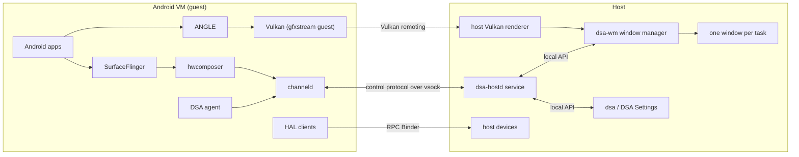

<div align="center">


# Desktop Subsystem for Android™

**Apps Android como janelas reais da área de trabalho, sobre uma base de código aberto.**

[](https://github.com/thisisthepy/desktop-subsystem-for-android/actions/workflows/test.yml)
[](https://github.com/thisisthepy/desktop-subsystem-for-android/actions/workflows/test-installer.yml)
[](https://github.com/thisisthepy/desktop-subsystem-for-android/actions/workflows/test-image.yml)
[](https://github.com/thisisthepy/desktop-subsystem-for-android/actions/workflows/test-kernel.yml)
[](https://github.com/thisisthepy/desktop-subsystem-for-android/releases/latest)
[](https://github.com/thisisthepy/desktop-subsystem-for-android/blob/main/LICENSE)

[English](../../README.md) · [한국어](README_ko.md) · [日本語](README_ja.md) · [简体中文](README_zh-CN.md) · [繁體中文](README_zh-TW.md) · [Español](README_es.md) · [Français](README_fr.md) · [Deutsch](README_de.md) · **Português (Brasil)** · [Русский](README_ru.md) · [Italiano](README_it.md) · [Tiếng Việt](README_vi.md) · [Bahasa Indonesia](README_id.md) · [Türkçe](README_tr.md)

</div>

> O DSA é um projeto de código aberto independente. Ele não é afiliado à Microsoft nem ao
> Google, nem endossado ou patrocinado por eles. Android é uma marca registrada da Google LLC.
> Windows é uma marca registrada do grupo de empresas Microsoft.

## O que é

O DSA executa o Android em uma VM leve própria e mostra cada tarefa do Android em uma janela
nativa da área de trabalho. Cada app tem seu próprio botão na barra de tarefas, sua entrada no
menu Iniciar, suas notificações e sua entrada na lista de aplicativos instalados, como acontecia
com o Windows Subsystem for Android (WSA), que a Microsoft encerrou em 5 de março de 2025. Todas
as partes do DSA são de código aberto, então qualquer pessoa pode dar continuidade a ele.

**Status.** O DSA funciona no Windows 11, em PCs x64 e ARM64. As versões abaixo da 1.0 são
pré-lançamentos; a partir da 1.0, as versões saem em um canal estável e em um canal de
pré-lançamento (veja [Atualizações e canais de versão](#atualizações-e-canais-de-versão)). Os
recursos são testados na CI, e a verificação manual em hardware real continua a cada versão,
então informe o que você encontrar. Linux e macOS estão em andamento e não foram lançados (veja
[Plataformas compatíveis](#plataformas-compatíveis)).

## Recursos

**Janelas e entrada**

- Uma janela nativa por tarefa do Android, desenhada como o próprio app, com o nome de programa
  e o ícone do app na barra de tarefas, no Alt+Tab e no Gerenciador de Tarefas. Não há moldura
  de emulador mostrando a tela inteira.
- Uma barra de título que faz parte do app: as cores do app chegam ao topo da janela, os botões
  de legenda do Windows 11 ficam sobre ela, e o ícone e o nome do app ficam à esquerda. O ícone
  vira uma seta de voltar quando o app pode voltar. Layouts de ajuste, arrastar, clicar duas
  vezes para maximizar e o menu da janela (Alt+Espaço) funcionam como em qualquer app do
  Windows.
- O menu da janela acrescenta **Full screen** (tela cheia), **New window** (nova janela, para
  apps que permitem várias), **Screenshot** (captura de tela), **Aspect ratio** (proporção),
  **Open by default** (abrir por padrão) e **App info** (informações do app).
- Redimensionamento ao vivo sem recriar o app, e maximização que preenche a área de trabalho do
  monitor.
- Um pedido de tela cheia do app, como o botão de tela cheia de um player de vídeo, preenche a
  tela; a barra de título aparece quando o ponteiro toca a borda superior. Apps que apenas
  escondem suas barras, como um feed de vídeos curtos, ficam na própria janela. Os dois
  comportamentos podem ser escolhidos nas DSA Settings, para todos os apps ou para cada um, e
  F11 sempre alterna a tela cheia.
- Imagem nítida em todos os monitores. Quando você move um app para um monitor com outra
  escala, ele é redesenhado na nova escala assim que a janela chega lá, ou o DSA escala a
  janela, conforme você escolher para cada app. Por padrão, um app que diz tratar sozinho uma
  mudança de escala é redesenhado, e o DSA escala todos os outros. Apps que sabidamente
  quebram quando a escala muda durante a execução, como o YouTube, são escalados pelo DSA
  por padrão.
- O texto nos apps segue a configuração de tamanho do texto do Windows.
- Mouse (com hover), toque com até dez dedos, caneta (pressão, borracha, botão lateral) e o
  teclado em qualquer layout.
- Entrada de texto pela estrutura de serviços de texto do Windows (TSF): o seu método de
  entrada do Windows, inclusive o coreano, compõe o texto diretamente no editor do Android, com
  a janela de candidatos ao lado do cursor. Reconversão, o teclado virtual, a digitação por voz
  (Win+H), a escrita à mão e o painel de emojis funcionam sobre o próprio texto do editor. Não
  há app de teclado do Android.
- Arquivos arrastados entre o Explorador de Arquivos e as janelas dos apps, nos dois sentidos.
- Os gestos de toque com três e quatro dedos do Windows 11 desativados enquanto uma janela do
  DSA está em primeiro plano (ativado por padrão), para que o app os receba.
- A árvore de acessibilidade de cada app exposta ao UI Automation do Windows, para leitores de
  tela e ferramentas de automação (veja [UI Automation](#ui-automation) e
  [Acessibilidade](#acessibilidade)).

**Integração com o shell**

- Entradas no menu Iniciar e na Pesquisa do Windows para cada app Android, mesmo com o Android
  parado; apps listados em Configurações > Aplicativos > Aplicativos instalados, onde podem ser
  desinstalados.
- Atalhos na área de trabalho e os atalhos do próprio app (como uma nova conversa de um
  mensageiro) na lista de atalhos da barra de tarefas e do menu Iniciar. Quando um app é
  renomeado, sua entrada no menu Iniciar, seus atalhos na área de trabalho e sua fixação na
  barra de tarefas seguem o novo nome.
- Notificações do Android como notificações do Windows, com o nome e o ícone de cada app;
  selecionar uma abre o app, e descartar uma a descarta no Android.
- Apps que rodam em segundo plano como ícones na área de notificação, com as teclas de mídia e
  os controles de mídia do Windows para apps que reproduzem mídia.
- Widgets do Android colocados na área de trabalho, cada um em uma janela própria.
- Área de transferência de texto compartilhada nos dois sentidos, links da web abertos no
  navegador do Windows, arquivos do Windows abertos em apps Android e compartilhados com eles, e
  suas pastas do Windows compartilhadas com o Android.
- Os arquivos do Android no Explorador de Arquivos, em **Android** no painel de navegação.
- Instalação de APK com clique duplo, pelo menu de contexto, soltando o arquivo em uma janela ou
  com `dsa install`, com uma janela que mostra o que é o APK antes de o Android iniciar.
- "Share on PC" na planilha de compartilhamento do Android: texto, links e arquivos vão para a
  janela de compartilhamento do Windows, incluindo o Compartilhamento por proximidade.

**Mídia e dispositivos**

- Áudio pelos dispositivos padrão de saída e entrada do Windows, com uma linha para cada app no
  mixer de volume.
- Vídeo decodificado na GPU do host pelo Media Foundation: H.264, HEVC, VP9 e AV1, até
  4096x2304. As imagens decodificadas chegam ao Android por uma região de memória que o host e a
  VM compartilham, em vez de serem copiadas pelo canal de vídeo. Os formatos que a GPU não
  decodifica são decodificados no Android, em software.
- Renderização na GPU do host: Vulkan remoto via gfxstream e OpenGL ES via ANGLE sobre ele.
- Câmera, microfone, localização, sensores (acelerômetro, giroscópio, orientação, luz) e
  energia, cada um protegido tanto pelas configurações de privacidade do Windows quanto pelas
  permissões do Android.
- A localização por rede do Android respondida pelo host, com ou sem o Google Play. Sem o Google
  Play, as consultas de endereço (`Geocoder`) são respondidas no computador a partir de dados de
  limites administrativos que vêm com o DSA: uma posição vira seu país, estado e cidade e, na
  Coreia, seu distrito e bairro. Nenhum servidor e nenhuma chave são usados, e a posição fica no
  computador. Endereços com rua, e a conversão de um endereço em uma posição, não são
  oferecidos. Com o Google Play, quem responde é o geocodificador do Google.

**Sistema**

- O Doze do Android como estado ocioso: 30 segundos depois que a última janela do Android é
  fechada ou minimizada, o Android entra em Doze, as notificações continuam chegando enquanto a
  CPU descansa, e a memória ociosa volta para o Windows enquanto o Android roda. Abrir um app o
  acorda na hora, sem esperar por uma inicialização. Congelar o Android é uma opção, desativada
  por padrão.
- Cada usuário do Windows tem seu próprio Android e seu próprio disco de dados, no próprio
  perfil.
- Acesso root como o `sudo`, desativado por padrão. Um administrador o ativa; depois, cada app,
  e o `adb shell` no modo de desenvolvedor, pode ser configurado para pedir. Um pedido mostra a
  solicitação de administrador do Windows (UAC) com o nome e o ícone do próprio app, e uma
  aprovação vale por 15 minutos. Apps sem permissão nem enxergam o `su`. Todo pedido é
  registrado.
- Backup criptografado dos dados dos apps na sua pasta de usuário, desativado por padrão.
- DSA Settings (as configurações do DSA): apps e suas janelas, apps em segundo plano, widgets,
  tela e GPU, memória, rede, identidade do dispositivo, atualizações, complementos, acesso root,
  modo de desenvolvedor com adb, o log ao vivo do Android e diagnósticos. Tudo nelas também
  existe como comando `dsa`.

**Complementos que você escolhe**

O DSA não inclui nenhum software do Google. Cada um destes itens é baixado da sua origem apenas
quando você pede, depois que o DSA mostra a origem e os termos, e vai para um disco de
complementos ao lado do Android. A imagem do sistema nunca é alterada, e cada item pode ser
removido de novo pelas DSA Settings ou pela linha de comando.

- **Google Play.** `dsa gapps install`, ou **Advanced** > **Google Play** nas DSA Settings,
  baixa o pacote público LiteGapps Core (Google Play services, a Play Store e a sincronização de
  conta) para a sua versão do Android. Este Android não é certificado pelo Google, então o Google
  pode pedir que você registre o dispositivo; as DSA Settings mostram o ID do Android e a página
  onde fazer isso. O Google Play nunca impede o Android de iniciar. Os apps do Google seguem os
  termos do Google.
- **Widevine L3.** `dsa drm widevine install`, ou **Advanced** > **Protected content**, obtém o
  módulo Widevine do Google, sem alterações, da imagem do emulador Android do Google para a sua
  versão do Android (cerca de 2 GB para baixar; só o Widevine é mantido). Assim, apps de
  streaming podem reproduzir vídeo protegido. No nível de segurança L3, os serviços de streaming
  enviam no máximo definição padrão, então assista em alta definição em um navegador ou app do
  Windows.
- **Tradução de ARM.** Em PCs x64, apps feitos só para ARM rodam por meio de um tradutor. O
  tradutor de código aberto Digitalis vem com a imagem x64 e é usado desde a primeira
  inicialização. Você pode substituí-lo pelo tradutor do Google
  (`dsa arm-translation fetch google`) ou por um pacote seu. Só apps ARM de 64 bits
  (`arm64-v8a`) rodam. Em PCs ARM64, o próprio Android roda os apps ARM.

**Não incluídos:** Google Play services, uma loja de apps ou qualquer outro binário do Google
(as licenças deles fazem disso uma escolha do usuário), e nenhum dos binários do WSA da
Microsoft.

## UI Automation

O DSA expõe a interface de usuário dentro de cada janela de app Android ao UI Automation (UIA)
do Windows, a mesma interface que os apps do Windows usam. Leitores de tela, ferramentas de
teste e outros clientes de UIA veem os botões, listas e campos de texto de um app Android como
elementos da janela dele, e não como uma única imagem.

**Como funciona.** Quando um cliente de UIA pede pela primeira vez a árvore de uma janela de app
do DSA, a janela pede ao agente do DSA no Android que observe aquela tarefa. O agente lê os nós
de acessibilidade do Android apenas daquela tarefa e os envia ao host: primeiro a árvore
inteira, depois as alterações. O host mantém a árvore no processo da janela, então cada leitura
de propriedade e cada chamada de navegação é respondida localmente, sem ida e volta até a VM.
Quando nenhum cliente de UIA escuta por 30 segundos, a observação para, e o Android deixa de ler
os nós. Quem não usa nenhum cliente de UIA não paga nada por isso.

**O que cada elemento traz.**

- **Control type** (tipo de controle), a partir da classe de view do Android e do seu estado:
  botão, caixa de seleção, botão de opção, campo de edição, controle deslizante, barra de
  progresso, caixa de combinação, lista, item de lista, guia, menu, imagem, texto, documento
  (para uma `WebView`), barra de ferramentas e grupo. Um switch do Android é um botão com o
  padrão Toggle, e um título é texto.
- **Name**: a descrição de conteúdo; se não houver, o texto; se não houver, a dica de um campo
  de edição vazio. Um elemento clicável sem nome próprio recebe os nomes dos filhos.
- **AutomationId**: o ID de recurso da view do Android, como `com.example:id/send`.
- **ClassName**: a classe de view do Android. **FrameworkId** é `Android`.
- **HelpText** (a dica), **ItemStatus** (a descrição de estado do Android), **IsEnabled**,
  **IsKeyboardFocusable**, **HasKeyboardFocus**, **IsPassword** e um **BoundingRectangle** em
  coordenadas de tela.
- Os elementos que o Android informa como não visíveis para o usuário ficam fora da árvore.
- Campos de senha nunca saem do Android como texto: cada caractere chega como um marcador.

**Os padrões e o que eles fazem no Android.**

| Padrão de UIA | Ação no Android |
|---|---|
| Invoke | `ACTION_CLICK` |
| Value (`SetValue`) | `ACTION_SET_TEXT`, que substitui todo o texto do campo |
| Toggle | `ACTION_CLICK` |
| SelectionItem (`Select`) | `ACTION_SELECT`, ou `ACTION_CLICK` quando o nó não tem ação de seleção |
| Scroll | `ACTION_SCROLL_FORWARD` e `ACTION_SCROLL_BACKWARD`, por página; sem porcentagem de rolagem |
| `SetFocus` | `ACTION_FOCUS`, ou `ACTION_ACCESSIBILITY_FOCUS` quando o nó não pode receber o foco de entrada |

Essas ações vão direto para o nó. Elas não movem o mouse nem injetam toques.

**Eventos.** A janela gera foco alterado (enquanto está em primeiro plano), estrutura alterada
quando filhos aparecem ou somem, e propriedade alterada para o nome, o valor, o estado de
alternância, a seleção, o estado habilitado e o retângulo delimitador. Os eventos só são gerados
enquanto um cliente escuta.

**Entrada de texto.** `SetValue` define o texto de um campo em um único passo. A digitação, a
composição e os métodos de entrada passam pelo TSF e pelo `InputConnection` do app, como
acontece com uma pessoa ao teclado.

**A própria janela.** O nome da janela é o nome do app. Os botões de legenda (minimizar,
maximizar ou restaurar, fechar) e a seta de voltar da barra de título são botões com nome na
árvore.

**Uso a partir de outras ferramentas.** Qualquer cliente de UIA funciona, como o Inspect e o
Accessibility Insights for Windows, ou bibliotecas como o FlaUI. Encontre a janela do app pelo
nome e, depois, os elementos por AutomationId, nome ou tipo de controle. Para scripts que
precisam pressionar um ponto em vez de um elemento, `dsa tap <package> <x> <y>` pressiona dentro
da tarefa do app.

**Ainda não disponível.** Não há padrão Text, nem padrão RangeValue ou ExpandCollapse, nem toque
longo pelo UIA, nem nível de título, nem eventos de notificação ou de região dinâmica. O foco de
acessibilidade do Android não é exportado; só o foco de entrada é. As melhorias são
acompanhadas na issue
[#744](https://github.com/thisisthepy/desktop-subsystem-for-android/issues/744) (aberta).

## Acessibilidade

**Leitores de tela.** O NVDA e o Narrador (Narrator) leem os apps Android pela árvore de UI
Automation descrita acima: os controles têm nomes e funções, o foco segue o teclado, e botões,
switches, listas e campos de texto podem ser usados sem mouse. O JAWS usa a mesma árvore; o
projeto ainda não o verificou, então relatos são bem-vindos.

**O que está sendo melhorado.** Estes itens vêm do relato de um usuário de leitor de tela, a
issue [#744](https://github.com/thisisthepy/desktop-subsystem-for-android/issues/744). Cada um
está aberto e é acompanhado lá:

- **Foco mais rápido.** Hoje uma mudança de foco espera no Android antes de chegar ao Windows,
  cerca de 250 a 450 ms depois de pressionar uma tecla, e segurar uma tecla de seta avança cerca
  de quatro passos por segundo. O plano é enviar as mudanças de foco na hora, ler apenas a
  tarefa de onde veio o evento e manter os tempos curtos só para quando um cliente de UIA
  escuta.
- **Foco de acessibilidade.** Hoje só o foco de entrada é exportado, então os movimentos do foco
  de acessibilidade do Android não geram evento de foco.
- **Padrão Text.** Os campos de edição ainda não têm o padrão Text, que o NVDA usa para ler e
  revisar o texto por caractere, palavra e linha. O valor deles pode ser lido e definido.

**As janelas do próprio DSA.**

- **DSA Settings** funciona com o teclado e com leitores de tela: a navegação, as linhas e os
  controles são elementos de UIA com nome.
- **The APK Installer** (o instalador de APK) dá nome a cada um dos seus elementos, e o link
  **More** expande e recolhe pelo UIA.
- **Os widgets na área de trabalho** recebem o foco do teclado. Enter, Espaço, a tecla de menu
  e Shift+F10 abrem o menu do widget.
- **Os menus** dos widgets e dos ícones da área de notificação são menus de UIA com navegação
  pelo teclado, e **as caixas de diálogo de confirmação** têm teclas de acesso e um botão
  padrão.
- **A solicitação de root** é a própria solicitação de administrador do Windows (UAC).
- Os botões de legenda usam as cores do sistema em um tema de alto contraste.

No Linux, o host exporta a mesma árvore para o AT-SPI, com texto por caractere, palavra e linha,
para o Orca; o Linux ainda não foi lançado. O host do macOS ainda não exporta as árvores dos
apps.

**Como relatar um problema.** Abra uma
[issue](https://github.com/thisisthepy/desktop-subsystem-for-android/issues/new) com o leitor de
tela e a versão dele, o app, o que você fez, o que ouviu e o que esperava. Um pacote de
diagnóstico gerado por `dsa logs collect -o diag.zip` ajuda. O
[Discord do DSA](https://discord.gg/MtpQnR4eQQ) também está aberto para perguntas.

## Plataformas compatíveis

| Host | Status |
|---|---|
| Windows 11, x64 | Lançado como `DSA-v<version>-win-x64-setup.exe` |
| Windows 11, ARM64 | Lançado como `DSA-v<version>-win-arm64-setup.exe`. O Android também é ARM64, então os apps ARM rodam sem tradução |
| Linux (x64, ARM64) | Em andamento, não lançado. O host KVM, o compositor Wayland e os pacotes `.deb` e `.rpm` são compilados e executados na CI |
| macOS (Apple silicon) | Em andamento, não lançado. O host sobre o Virtualization framework da Apple e o pacote do app são compilados na CI |

### Versões do Android

O DSA oferece suporte às duas versões principais mais recentes do Android: hoje, Android 16 e
Android 17. Uma versão sai do suporte quando a segunda versão principal mais nova é lançada,
então o Android 16 tem suporte até o lançamento do Android 18. O atualizador de imagem leva cada
usuário para uma versão com suporte e nunca, por conta própria, para uma versão principal mais
antiga. Você pode escolher qualquer uma das versões com suporte nas DSA Settings ou com
`dsa android use`; mudar para a mais antiga apaga os dados do Android, porque o Android não
consegue ler dados gravados por uma versão mais nova.

<p align="center">
  
</p>

As datas posteriores a hoje são previsões, não lançamentos.

## Instalação

**Você precisa de** Windows 11 em um PC x64 ou ARM64, com o recurso do Windows **Plataforma de
Máquina Virtual** ativado. A instalação verifica isso e para com instruções se ele estiver
desativado.

1. Ative a **Plataforma de Máquina Virtual**: Configurações > Sistema > Recursos opcionais > Mais
   recursos do Windows, ou `dism /online /enable-feature /featurename:VirtualMachinePlatform /all`
   em um terminal de administrador. Reinicie.
2. Baixe `DSA-v<version>-win-x64-setup.exe`, ou `DSA-v<version>-win-arm64-setup.exe` em um PC
   ARM64, da [versão mais recente](https://github.com/thisisthepy/desktop-subsystem-for-android/releases/latest)
   e confira-o com `SHA256SUMS.txt`.
3. Execute-o. A instalação instala o serviço `DsaHost`, o comando `dsa`, as DSA Settings, o APK
   Installer e a primeira imagem do Android (baixada quando o instalador não traz uma). O
   Android inicia quando você entra na sua conta, então o primeiro app que você abrir não espera
   por uma inicialização.

Não há kernel para compilar nem alteração na sua configuração do WSL: o DSA traz o próprio
kernel e a própria VM. A desinstalação remove tudo o que o DSA gravou, exceto o disco do Android
de cada usuário.

## Atualizações e canais de versão

O DSA atualiza a si mesmo e a imagem do Android. Os dois são assinados, e nada é aplicado se a
assinatura, o tamanho ou o hash não conferir.

- **O próprio DSA.** O serviço verifica uma lista assinada de versões e instala uma versão mais
  nova quando o Android de nenhum usuário está rodando; caso contrário, ele espera, e
  `dsa update` instala na hora. Você é avisado antes e depois. Uma atualização nunca leva o DSA
  para uma versão mais antiga.
- **Canais.** A partir da 1.0 há dois: **stable** (estável) e **pre-release** (pré-lançamento),
  para versões que ainda estão sendo finalizadas. O canal de pré-lançamento recebe a mais nova
  entre as duas. O seu canal começa pelo instalador que você usou, e as atualizações o mantêm.
  Altere-o com **Get pre-release versions** na página **Updates** das DSA Settings, ou com
  `dsa settings set prerelease-updates on|off` (administradores). Sair do pré-lançamento nunca
  faz o DSA voltar: ele espera por uma versão estável mais nova. Todas as versões anteriores à
  1.0 são pré-lançamentos.
- **Imagem do Android.** As atualizações de imagem não dependem do canal. Uma imagem que não
  consegue inicializar é substituída pela última que funcionou, e `dsa status` informa isso. Com
  **Restart Android into updates by itself**, o Android reinicia em uma atualização baixada
  quando não há nenhuma janela de app aberta.
- **Desativar as atualizações.** Os administradores podem desativar **Update DSA
  automatically** e **Update the Android image automatically** na página **Updates**.

As versões estáveis são feitas só a partir de `main`, após revisão. Os builds de `develop` são
pré-lançamentos ou builds de teste para colaboradores.

## Início rápido

Abra um app Android pelo menu Iniciar ou use o comando `dsa`:

```
dsa status                          # estado do Android e atualização pendente, se houver
dsa install app.apk                 # instala um APK ou um pacote split-APK (.xapk, .apks, .apkm)
dsa apps list                       # os apps instalados
dsa launch com.android.settings     # abre um app na própria janela
dsa settings set clipboard off      # altera uma configuração (as DSA Settings têm as mesmas chaves)
dsa logcat -d -b all *:W            # log do Android, avisos e acima
dsa logs collect -o diag.zip        # tudo o que um relato de problema precisa, em um zip
```

`dsa` sem argumentos lista todos os comandos. O log do Android fica na memória e só flui para o
host enquanto algo o lê. Anexe `diag.zip` a um relato de problema.

## Limitações

Isto vale hoje:

- Só o Windows foi lançado. Linux e macOS estão em andamento.
- As DSA Settings aparecem só em inglês e coreano.
- Só apps de 64 bits rodam: `arm64-v8a` e, em x64, `x86_64`. Apps de 32 bits não rodam.
- O Widevine é L3, então os streams protegidos são reproduzidos no máximo em definição padrão.
- O Google Play não é certificado pelo Google no DSA; o Google pode pedir que você registre o
  dispositivo.
- A área de transferência compartilha só texto.
- A opção de escala **System (forced)** ainda não está disponível e funciona como **System**.
- A exportação para o UI Automation tem as lacunas listadas em [UI Automation](#ui-automation).
- As consultas de endereço sem o Google Play dão a região (do país até a cidade, ou o distrito
  na Coreia), não endereços com rua.

## Guias do usuário

Guias passo a passo cobrem a instalação, apps e janelas, APKs, arquivos, versões do Android,
configurações, memória, modo de desenvolvedor, solução de problemas e desinstalação:
[docs/guides](../guides/pt-BR/README.md). A [página de introdução](../guides/intro/index.html)
explica o projeto para quem está chegando agora.

## Arquitetura



- **Convidado.** Um agente assinado com a chave da plataforma deixa a tela em modo de forma
  livre e informa tarefas, apps, notificações e árvores de acessibilidade. O hwcomposer entrega
  as camadas de cada tarefa ao host como uma tela própria. Os clientes de HAL alcançam os
  dispositivos do host por RPC Binder. Não há launcher, barra de status nem app de teclado: o
  host é o shell.
- **Protocolo.** Uma única definição, `dsa/protocol/control.proto`, com codecs gerados para
  Rust, Java e C++. Toda conexão verifica a versão do protocolo, o hash do esquema e um segredo
  por inicialização.
- **Host.** `dsa/host/core/` é neutro em relação à plataforma: sessões, o registro de apps e a
  política de ciclo de vida. Cada sistema operacional acrescenta a VM, o transporte e o sistema
  de janelas em `dsa/host/platform/<os>/`. No Windows, a VM é criada pelo Host Compute System, e
  os quadros vão da GPU para cada janela por Direct3D 11 e DirectComposition, nunca pela CPU.

## Compilar a partir do código-fonte

Os crates Rust formam um único workspace em `dsa/`:

```
cd dsa
cargo test --workspace
cargo build -p dsa-host-windows --release
```

As outras partes têm o próprio build, descrito junto delas:

- o instalador: `dsa/host/platform/windows/installer/README.md`
- o host do Windows: `dsa/host/platform/windows/README.md`
- o kernel do convidado: `dsa/kernel/`
- a imagem do Android e os componentes do convidado: `dsa/guest/`
- o caminho gráfico: `dsa/graphics/`

Os projetos upstream (AOSP, gfxstream, o kernel) não são incorporados ao repositório: scripts
baixam uma revisão fixada e aplicam os patches mantidos aqui. As ferramentas Python rodam com
`uv run`.

## Estrutura do repositório

| Caminho | O que contém |
|---|---|
| `dsa/protocol/` | O protocolo de controle entre convidado e host e seus geradores de código |
| `dsa/host/core/` | O host neutro em relação à plataforma |
| `dsa/host/cli/` | O comando `dsa` |
| `dsa/host/platform/windows/` | O host do Windows, o gerenciador de janelas, o instalador e as DSA Settings |
| `dsa/host/platform/linux/`, `macos/`, `unix/` | Os hosts do Linux e do macOS e o que eles compartilham |
| `dsa/graphics/` | Vulkan remoto, a partir do gfxstream |
| `dsa/guest/` | O agente, o hwcomposer, os serviços de HAL e a configuração da imagem |
| `dsa/kernel/` | A configuração e o build do kernel do convidado |
| `scripts/tests/` | Verificações do repositório |
| `.github/` | Workflows de CI, scripts de versão e os recursos do README |

## Como contribuir

O DSA é jovem e ainda está sendo estabilizado, então todo relato ajuda, tendo você uma correção
pronta ou não.

<p>
  <a href="https://github.com/thisisthepy/desktop-subsystem-for-android/issues/new"></a>
  <a href="https://discord.gg/MtpQnR4eQQ"></a>
</p>

- **Encontrou um bug ou tem uma ideia?** [Abra uma issue](https://github.com/thisisthepy/desktop-subsystem-for-android/issues/new).
  Diga o que você fez e o que aconteceu, com o seu build do Windows (`winver`) e as versões do
  DSA e do Android (`dsa status`). Um pacote de diagnóstico gerado por
  `dsa logs collect -o diag.zip` torna um bug muito mais fácil de rastrear.
- **Quer perguntar antes ou só conversar?** Venha para o
  [Discord do DSA](https://discord.gg/MtpQnR4eQQ). Perguntas, o que você está tentando rodar e
  primeiras impressões são todos bem-vindos lá.
- **Vai enviar uma alteração?** O trabalho acontece no branch `develop`; `main` é publicado a
  partir dele. Abra pull requests contra `develop`, com uma alteração lógica por commit e um
  teste para cada mudança de comportamento. O código de protocolo gerado nunca é editado à mão.
  Não use travessões longos (em dash) no texto: uma verificação do repositório os rejeita.

## Licença

[Apache-2.0](https://github.com/thisisthepy/desktop-subsystem-for-android/blob/main/LICENSE).
Cada componente de terceiros incluído mantém a própria licença, listada no instalador.

## Marcas registradas

Android é uma marca registrada da Google LLC. Windows é uma marca registrada do grupo de
empresas Microsoft. O DSA não é afiliado à Microsoft nem ao Google, nem endossado ou patrocinado
por eles.

## Histórico de estrelas

<a href="https://www.star-history.com/#thisisthepy/desktop-subsystem-for-android&Date">
  <picture>
    <source media="(prefers-color-scheme: dark)" srcset="https://api.star-history.com/svg?repos=thisisthepy/desktop-subsystem-for-android&type=Date&theme=dark" />
    <source media="(prefers-color-scheme: light)" srcset="https://api.star-history.com/svg?repos=thisisthepy/desktop-subsystem-for-android&type=Date" />
    
  </picture>
</a>
