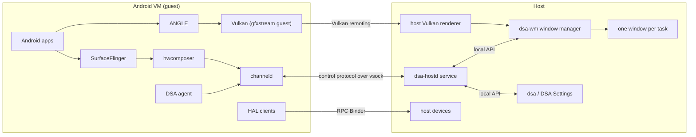

<div align="center">


# Desktop Subsystem for Android™

**Приложения Android в настоящих окнах рабочего стола, на открытом программном стеке.**

[](https://github.com/thisisthepy/desktop-subsystem-for-android/actions/workflows/test.yml)
[](https://github.com/thisisthepy/desktop-subsystem-for-android/actions/workflows/test-installer.yml)
[](https://github.com/thisisthepy/desktop-subsystem-for-android/actions/workflows/test-image.yml)
[](https://github.com/thisisthepy/desktop-subsystem-for-android/actions/workflows/test-kernel.yml)
[](https://github.com/thisisthepy/desktop-subsystem-for-android/releases/latest)
[](https://github.com/thisisthepy/desktop-subsystem-for-android/blob/main/LICENSE)

[English](../../README.md) · [한국어](README_ko.md) · [日本語](README_ja.md) · [简体中文](README_zh-CN.md) · [繁體中文](README_zh-TW.md) · [Español](README_es.md) · [Français](README_fr.md) · [Deutsch](README_de.md) · [Português (Brasil)](README_pt-BR.md) · **Русский** · [Italiano](README_it.md) · [Tiếng Việt](README_vi.md) · [Bahasa Indonesia](README_id.md) · [Türkçe](README_tr.md)

</div>

> DSA это независимый проект с открытым исходным кодом. Он не связан с Microsoft или Google,
> не одобрен и не спонсируется ими. Android является товарным знаком Google LLC. Windows
> является товарным знаком группы компаний Microsoft.

## Что это такое

DSA запускает Android в собственной лёгкой виртуальной машине и показывает каждую задачу
Android в отдельном нативном окне рабочего стола. У каждого приложения есть своя кнопка на
панели задач, свой пункт в меню «Пуск», свои уведомления и своя запись в списке установленных
приложений, как это было в подсистеме Windows для Android (WSA), которую Microsoft прекратила
5 марта 2025 года. Весь код DSA открыт, поэтому продолжить его развитие может любой.

**Состояние.** DSA работает в Windows 11 на ПК с x64 и ARM64. Выпуски до 1.0 являются
предварительными. Начиная с 1.0 выпуски выходят в стабильном и в предварительном канале (см.
[Обновления и каналы выпусков](#обновления-и-каналы-выпусков)). Функции проверяются в CI, а
ручная проверка на реальном оборудовании продолжается с каждым выпуском, поэтому, пожалуйста,
сообщайте о том, что найдёте. Linux и macOS находятся в разработке и не выпущены (см.
[Поддерживаемые платформы](#поддерживаемые-платформы)).

## Возможности

**Окна и ввод**

- Одно нативное окно на каждую задачу Android. Окно выглядит как само приложение, а на панели
  задач, в Alt+Tab и в диспетчере задач отображаются собственные имя программы и значок
  приложения. Нет рамки эмулятора, показывающей весь экран.
- Строка заголовка является частью приложения: цвета приложения доходят до верхнего края окна,
  кнопки заголовка Windows 11 располагаются поверх них, а значок и имя приложения находятся
  слева. Значок превращается в стрелку «Назад», когда приложение может вернуться назад. Макеты
  прикрепления, перетаскивание, развёртывание двойным щелчком и меню окна (Alt+Пробел)
  работают, как в любом приложении Windows.
- Меню окна добавляет пункты **Full screen**, **New window** (для приложений, которые
  допускают несколько окон), **Screenshot**, **Aspect ratio**, **Open by default** и
  **App info**.
- Изменение размера на лету без пересоздания приложения и развёртывание на всю рабочую область
  монитора.
- Запрос приложения на полноэкранный режим, например кнопка полного экрана в видеоплеере,
  заполняет весь экран. Строка заголовка появляется, когда указатель касается верхнего края.
  Приложения, которые только скрывают свои панели, например лента коротких видео, остаются в
  своём окне. И то и другое настраивается в DSA Settings, для всех приложений или для каждого
  отдельно, а F11 всегда переключает полноэкранный режим.
- Чёткое изображение на любом мониторе. Приложение открывается с масштабом того монитора, на
  котором оно открылось. Когда вы переносите его на монитор с другим масштабом, оно
  перерисовывается в новом масштабе, как только вы отпустите окно, или же окно масштабирует
  DSA: это выбирается для каждого приложения. Приложения, которые, как известно, ломаются при
  смене масштаба во время работы, например YouTube, по умолчанию масштабирует DSA.
- Текст в приложениях следует настройке размера текста Windows.
- Мышь (с наведением), сенсорный ввод до десяти пальцев, перо (нажим, ластик, боковая кнопка)
  и клавиатура с любой раскладкой.
- Ввод текста через платформу текстовых служб Windows (TSF): ваш метод ввода Windows, в том
  числе корейский, составляет текст прямо в редакторе Android, а окно кандидатов находится
  рядом с курсором. Повторное преобразование, сенсорная клавиатура, голосовой ввод (Win+H),
  рукописный ввод и панель эмодзи работают с текстом самого редактора. Приложения клавиатуры
  Android нет.
- Перетаскивание файлов между проводником и окнами приложений в обе стороны.
- Трёх- и четырёхпальцевые сенсорные жесты Windows 11 отключаются, пока окно DSA находится на
  переднем плане (включено по умолчанию), чтобы эти жесты получало приложение.
- Дерево специальных возможностей каждого приложения доступно для Windows UI Automation, для
  программ чтения с экрана и средств автоматизации (см. [UI Automation](#ui-automation) и
  [Специальные возможности](#специальные-возможности)).

**Интеграция с оболочкой**

- Пункты меню «Пуск» и поиск Windows для каждого приложения Android, даже когда Android
  остановлен. Приложения перечислены в разделе «Параметры > Приложения > Установленные
  приложения», откуда их можно удалить.
- Ярлыки на рабочем столе и собственные ярлыки приложения (например, новый чат в мессенджере)
  в его списке переходов на панели задач и в меню «Пуск». Когда приложение переименовывается,
  его пункт в меню «Пуск», ярлыки на рабочем столе и закрепление на панели задач получают новое
  имя.
- Уведомления Android приходят как уведомления Windows с именем и значком каждого приложения.
  Выбор уведомления открывает приложение, а закрытие уведомления закрывает его и в Android.
- Приложения, работающие в фоне, отображаются значками в области уведомлений. Для приложений,
  воспроизводящих медиа, работают мультимедийные клавиши и элементы управления мультимедиа
  Windows.
- Виджеты Android на рабочем столе, каждый в собственном окне.
- Общий буфер обмена для текста в обе стороны, веб-ссылки открываются в браузере Windows, файлы
  Windows открываются в приложениях Android и передаются в них, а ваши папки Windows доступны
  Android.
- Файлы Android в проводнике, в пункте **Android** области навигации.
- Установка APK двойным щелчком, из контекстного меню, перетаскиванием файла на окно или
  командой `dsa install`. Окно установки показывает, что это за APK, ещё до запуска Android.
- «Share on PC» в меню «Поделиться» Android: текст, ссылки и файлы передаются в окно
  «Поделиться» Windows, включая обмен с устройствами поблизости.

**Мультимедиа и устройства**

- Звук через устройства вывода и ввода Windows по умолчанию, с отдельной строкой для каждого
  приложения в микшере громкости.
- Видео декодируется на GPU хоста через Media Foundation: H.264, HEVC, VP9 и AV1, до
  4096x2304. Декодированные кадры попадают в Android через область памяти, общую для хоста и
  виртуальной машины, а не копируются через видеоканал. Форматы, которые GPU не декодирует,
  декодируются программно в Android.
- Отрисовка на GPU хоста: удалённый Vulkan через gfxstream и поверх него OpenGL ES через
  ANGLE.
- Камера, микрофон, местоположение, датчики (акселерометр, гироскоп, ориентация, освещённость)
  и питание. Каждое из них защищено и параметрами конфиденциальности Windows, и разрешениями
  Android.
- На запросы сетевого местоположения Android отвечает хост, с Google Play или без него. Без
  Google Play поиск адресов (`Geocoder`) выполняется на компьютере по данным административных
  границ, которые поставляются вместе с DSA: координаты превращаются в страну, область и город,
  а в Корее также в район и квартал. Сервер и ключ не нужны, а координаты не покидают
  компьютер. Точные адреса улиц и преобразование адреса в координаты не поддерживаются. С
  Google Play отвечает геокодер Google.

**Система**

- Режим Doze в Android служит состоянием простоя: через 30 секунд после того, как последнее окно
  Android закрыто или свёрнуто, Android переходит в Doze. Уведомления продолжают приходить, пока
  процессор отдыхает, а неиспользуемая память возвращается Windows, пока Android работает.
  Открытие приложения сразу будит Android, ждать загрузки не нужно. Заморозка Android доступна
  как параметр, по умолчанию выключена.
- Каждый пользователь Windows получает собственный Android и собственный диск данных в своём
  профиле.
- Права root по образцу `sudo`, по умолчанию выключены. Их включает администратор, после чего
  для каждого приложения, а в режиме разработчика и для `adb shell`, можно включить запрос.
  Запрос показывает окно администратора Windows (UAC) с именем и значком самого приложения, а
  одобрение действует 15 минут. Приложения без разрешения вообще не видят `su`. Каждый запрос
  записывается в журнал.
- Зашифрованное резервное копирование данных приложений в вашу папку пользователя, по умолчанию
  выключено.
- DSA Settings: приложения и их окна, фоновые приложения, виджеты, экран и GPU, память, сеть,
  идентификация устройства, обновления, дополнения, права root, режим разработчика с adb,
  журнал Android в реальном времени и диагностика. Всё это доступно и как команды `dsa`.

**Дополнения на ваш выбор**

DSA не поставляет программы Google. Каждое из этих дополнений загружается из своего источника
только по вашему запросу, после того как DSA покажет вам источник и условия, и размещается на
диске дополнений рядом с Android. Системный образ никогда не изменяется, и каждое дополнение
можно снова удалить в DSA Settings или из командной строки.

- **Google Play.** Команда `dsa gapps install` или **Advanced** > **Google Play** в DSA
  Settings загружает общедоступный пакет LiteGapps Core (сервисы Google Play, Play Маркет и
  синхронизация аккаунта) для вашей версии Android. Этот Android не сертифицирован Google,
  поэтому Google может попросить зарегистрировать устройство. DSA Settings показывает Android ID
  и страницу для регистрации. Google Play никогда не мешает запуску Android. На приложения
  Google распространяются условия Google.
- **Widevine L3.** Команда `dsa drm widevine install` или **Advanced** > **Protected
  content** берёт модуль Widevine от Google без изменений из образа эмулятора Android от Google
  для вашей версии Android (около 2 ГБ для загрузки, сохраняется только Widevine). После этого
  стриминговые приложения могут воспроизводить защищённое видео. На уровне безопасности L3
  стриминговые сервисы передают видео не выше стандартной чёткости, поэтому смотрите в высокой
  чёткости в браузере или приложении Windows.
- **Трансляция ARM.** На ПК с x64 приложения, собранные только для ARM, работают через
  транслятор. Транслятор с открытым исходным кодом Digitalis входит в образ x64 и используется с
  первого запуска. Его можно заменить транслятором Google
  (`dsa arm-translation fetch google`) или собственным пакетом. Работают только 64-битные
  приложения ARM (`arm64-v8a`). На ПК с ARM64 Android сам запускает приложения ARM.

**Не поставляются:** сервисы Google Play, магазин приложений и любые другие двоичные файлы
Google (их лицензии оставляют выбор за пользователем), а также любые двоичные файлы WSA от
Microsoft.

## UI Automation

DSA открывает пользовательский интерфейс внутри окна каждого приложения Android для Windows UI
Automation (UIA, модель автоматизации пользовательского интерфейса), того же интерфейса,
которым пользуются приложения Windows. Программы чтения с экрана, средства тестирования и
другие клиенты UIA видят кнопки, списки и текстовые поля приложения Android как элементы его
окна, а не как одну картинку.

**Как это работает.** Когда клиент UIA впервые запрашивает у окна приложения DSA его дерево,
окно просит агент DSA в Android следить за этой задачей. Агент читает узлы специальных
возможностей Android только для этой задачи и отправляет их хосту: сначала всё дерево, затем
изменения. Хост хранит дерево в процессе окна, поэтому каждое чтение свойства и каждый вызов
навигации обрабатываются локально, без обращения к виртуальной машине. Если ни один клиент UIA
не обращался к окну 30 секунд, наблюдение прекращается, и Android перестаёт читать узлы. Тем,
кто не пользуется клиентами UIA, это ничего не стоит.

**Что содержит каждый элемент.**

- **Control type**, по классу представления Android и его состоянию: кнопка, флажок,
  переключатель, поле ввода, ползунок, индикатор выполнения, поле со списком, список, элемент
  списка, вкладка, меню, изображение, текст, документ (для `WebView`), панель инструментов и
  группа. Переключатель Android является кнопкой с шаблоном Toggle, а заголовок является
  текстом.
- **Name**: описание содержимого, иначе текст, иначе подсказка пустого поля ввода. Нажимаемый
  элемент без собственного имени получает имена своих дочерних элементов.
- **AutomationId**: идентификатор ресурса представления Android, например
  `com.example:id/send`.
- **ClassName**: класс представления Android. **FrameworkId** равен `Android`.
- **HelpText** (подсказка), **ItemStatus** (описание состояния в Android), **IsEnabled**,
  **IsKeyboardFocusable**, **HasKeyboardFocus**, **IsPassword** и **BoundingRectangle** в
  экранных координатах.
- Элементы, которые Android считает невидимыми для пользователя, в дерево не попадают.
- Поля пароля никогда не покидают Android в виде текста: каждый символ приходит как точка.

**Шаблоны и их действие в Android.**

| Шаблон UIA | Действие Android |
|---|---|
| Invoke | `ACTION_CLICK` |
| Value (`SetValue`) | `ACTION_SET_TEXT`, заменяет весь текст поля |
| Toggle | `ACTION_CLICK` |
| SelectionItem (`Select`) | `ACTION_SELECT` или `ACTION_CLICK`, если у узла нет действия выбора |
| Scroll | `ACTION_SCROLL_FORWARD` и `ACTION_SCROLL_BACKWARD`, постранично; процент прокрутки не поддерживается |
| `SetFocus` | `ACTION_FOCUS` или `ACTION_ACCESSIBILITY_FOCUS`, если узел не может получить фокус ввода |

Эти действия передаются узлу напрямую. Они не двигают мышь и не имитируют касания.

**События.** Окно создаёт события смены фокуса (пока оно на переднем плане), изменения
структуры, когда дочерние элементы появляются или исчезают, и изменения свойств для имени,
значения, состояния переключателя, выбора, доступности и ограничивающего прямоугольника. События
создаются только тогда, когда клиент их ожидает.

**Ввод текста.** `SetValue` задаёт текст поля за один шаг. Набор, составление текста и методы
ввода идут через TSF и `InputConnection` приложения, как у человека за клавиатурой.

**Само окно.** Имя окна совпадает с именем приложения. Кнопки заголовка (свернуть, развернуть
или восстановить, закрыть) и стрелка «Назад» в строке заголовка являются именованными кнопками
в дереве.

**Использование из других инструментов.** Подходит любой клиент UIA, например Inspect и
Accessibility Insights for Windows, или библиотеки, такие как FlaUI. Найдите окно приложения по
имени, а затем его элементы по AutomationId, имени или типу элемента управления. Для скриптов,
которым нужно нажать точку, а не элемент, команда `dsa tap <package> <x> <y>` нажимает внутри
задачи приложения.

**Чего пока нет.** Нет шаблона Text, шаблонов RangeValue и ExpandCollapse, долгого нажатия через
UIA, уровня заголовка, событий уведомлений и динамических областей. Фокус специальных
возможностей Android не экспортируется, экспортируется только фокус ввода. Улучшения
отслеживаются в задаче
[#744](https://github.com/thisisthepy/desktop-subsystem-for-android/issues/744) (открыта).

## Специальные возможности

**Программы чтения с экрана.** NVDA и Экранный диктор (Narrator) читают приложения Android через
описанное выше дерево UI Automation: у элементов управления есть имена и роли, фокус следует за
клавиатурой, а кнопками, переключателями, списками и текстовыми полями можно пользоваться без
мыши. JAWS использует то же дерево. Проект его ещё не проверял, поэтому отзывы приветствуются.

**Что улучшается.** Эти пункты взяты из сообщения пользователя программы чтения с экрана, задача
[#744](https://github.com/thisisthepy/desktop-subsystem-for-android/issues/744). Каждый из них
открыт и отслеживается там:

- **Более быстрый фокус.** Сейчас смена фокуса ждёт в Android, прежде чем дойти до Windows:
  примерно от 250 до 450 мс после нажатия клавиши, а при удержании клавиши со стрелкой фокус
  движется примерно на четыре шага в секунду. План такой: отправлять смену фокуса сразу, читать
  только ту задачу, из которой пришло событие, и использовать короткие интервалы только тогда,
  когда клиент UIA слушает.
- **Фокус специальных возможностей.** Сейчас экспортируется только фокус ввода, поэтому
  перемещения фокуса специальных возможностей Android не создают событий фокуса.
- **Шаблон Text.** У полей ввода пока нет шаблона Text, с помощью которого NVDA читает и
  просматривает текст по символам, словам и строкам. Их значение можно прочитать и задать.

**Собственные окна DSA.**

- **DSA Settings** работает с клавиатурой и программами чтения с экрана: навигация, строки и
  элементы управления являются элементами UIA с именами.
- **APK Installer** даёт имя каждому своему элементу, а его ссылка **More** раскрывается и
  сворачивается через UIA.
- **Виджеты на рабочем столе** получают фокус клавиатуры. Enter, Пробел, клавиша меню и
  Shift+F10 открывают меню виджета.
- **Меню** виджетов и значков в области уведомлений являются меню UIA с навигацией с клавиатуры,
  а у **диалогов подтверждения** есть клавиши доступа и кнопка по умолчанию.
- **Запрос root** является собственным окном администратора Windows (UAC).
- В контрастной теме кнопки заголовка используют системные цвета.

В Linux хост экспортирует то же дерево в AT-SPI, с текстом по символам, словам и строкам, для
Orca. Linux пока не выпущен. Хост macOS пока не экспортирует деревья приложений.

**Как сообщить о проблеме.** Откройте
[задачу](https://github.com/thisisthepy/desktop-subsystem-for-android/issues/new), указав
программу чтения с экрана и её версию, приложение, что вы делали, что услышали и что ожидали.
Поможет диагностический архив, созданный командой `dsa logs collect -o diag.zip`. С вопросами
также можно прийти в [Discord DSA](https://discord.gg/MtpQnR4eQQ).

## Поддерживаемые платформы

| Хост | Состояние |
|---|---|
| Windows 11, x64 | Выпущен как `DSA-v<version>-win-x64-setup.exe` |
| Windows 11, ARM64 | Выпущен как `DSA-v<version>-win-arm64-setup.exe`. Android тоже ARM64, поэтому приложения ARM работают без трансляции |
| Linux (x64, ARM64) | В разработке, не выпущен. Хост KVM, композитор Wayland и пакеты `.deb` и `.rpm` собираются и работают в CI |
| macOS (Apple silicon) | В разработке, не выпущен. Хост на Virtualization framework от Apple и его пакет приложения собираются в CI |

### Версии Android

DSA поддерживает две новейшие основные версии Android: сейчас это Android 16 и Android 17.
Версия перестаёт поддерживаться, когда выходит вторая более новая основная версия, поэтому
Android 16 поддерживается до выхода Android 18. Средство обновления образа переводит каждого
пользователя на поддерживаемую версию и никогда само не понижает основную версию. Любую из
поддерживаемых версий можно выбрать в DSA Settings или командой `dsa android use`. Переход на
более старую версию стирает данные Android, потому что Android не может читать данные, записанные
более новой версией.

<p align="center">
  
</p>

Даты позже сегодняшнего дня являются ожидаемыми, а не датами выпусков.

## Установка

**Вам понадобится** Windows 11 на ПК с x64 или ARM64 и включённый компонент Windows
**Платформа виртуальной машины**. Программа установки проверяет его и, если он выключен,
останавливается с инструкциями.

1. Включите **Платформу виртуальной машины**: «Параметры > Система > Дополнительные компоненты >
   Другие компоненты Windows» или команда
   `dism /online /enable-feature /featurename:VirtualMachinePlatform /all` в терминале
   администратора. Перезагрузите компьютер.
2. Скачайте `DSA-v<version>-win-x64-setup.exe`, а на ПК с ARM64
   `DSA-v<version>-win-arm64-setup.exe`, из
   [последнего выпуска](https://github.com/thisisthepy/desktop-subsystem-for-android/releases/latest)
   и сверьте его с `SHA256SUMS.txt`.
3. Запустите его. Программа установки устанавливает службу `DsaHost`, команду `dsa`, DSA
   Settings, APK Installer и первый образ Android (он загружается, если программа установки его
   не содержит). Android запускается при входе в систему, поэтому первое открытое приложение не
   ждёт загрузки.

Не нужно собирать ядро и ничего менять в настройке WSL: DSA поставляет собственное ядро и
собственную виртуальную машину. Удаление убирает всё, что записал DSA, кроме диска Android
каждого пользователя.

## Обновления и каналы выпусков

DSA обновляет себя и образ Android. Оба подписаны, и ничего не применяется, если подпись, размер
или хеш не совпадают.

- **Сам DSA.** Служба проверяет подписанный список выпусков и устанавливает более новую версию,
  когда ни у одного пользователя не запущен Android. Иначе она ждёт, а `dsa update` устанавливает
  обновление сразу. Вас уведомляют до и после. Обновление никогда не понижает версию DSA.
- **Каналы.** Начиная с 1.0 их два: **стабильный** и **предварительный** для версий, работа над
  которыми ещё идёт. Предварительный канал берёт более новую из двух. Ваш канал определяется
  программой установки, которой вы пользовались, и сохраняется при обновлениях. Изменить его
  можно параметром **Get pre-release versions** на странице **Updates** в DSA Settings или
  командой `dsa settings set prerelease-updates on|off` (для администраторов). Выход из
  предварительного канала никогда не откатывает DSA: он ждёт более нового стабильного выпуска.
  Все выпуски до 1.0 являются предварительными.
- **Образ Android.** Обновления образа не зависят от канала. Образ, который не загружается,
  заменяется последним рабочим, и `dsa status` сообщает об этом. С параметром **Restart Android
  into updates by itself** Android перезапускается в загруженное обновление, когда не открыто ни
  одного окна приложения.
- **Отключение обновлений.** Администраторы могут выключить **Update DSA automatically** и
  **Update the Android image automatically** на странице **Updates**.

Стабильные выпуски создаются только из `main`, после проверки. Сборки `develop` являются
предварительными выпусками или тестовыми сборками для участников.

## Быстрый старт

Откройте приложение Android из меню «Пуск» или воспользуйтесь командой `dsa`:

```
dsa status                          # состояние Android и ожидающее обновление
dsa install app.apk                 # установить APK или набор split-APK (.xapk, .apks, .apkm)
dsa apps list                       # установленные приложения
dsa launch com.android.settings     # открыть приложение в отдельном окне
dsa settings set clipboard off      # изменить параметр (в DSA Settings те же переключатели)
dsa logcat -d -b all *:W            # журнал Android, предупреждения и выше
dsa logs collect -o diag.zip        # всё, что нужно для сообщения о проблеме, одним zip-файлом
```

`dsa` без аргументов выводит все команды. Журнал Android хранится в памяти и передаётся хосту,
только пока его что-то читает. Приложите `diag.zip` к сообщению о проблеме.

## Ограничения

На сегодня действуют следующие ограничения:

- Выпущена только версия для Windows. Linux и macOS в разработке.
- DSA Settings отображается только на английском и корейском.
- Работают только 64-битные приложения: `arm64-v8a` и, на x64, `x86_64`. 32-битные приложения
  не работают.
- Widevine имеет уровень L3, поэтому защищённые потоки воспроизводятся не выше стандартной
  чёткости.
- Google Play в DSA не сертифицирован Google, и Google может попросить зарегистрировать
  устройство.
- Буфер обмена передаёт только текст.
- Вариант масштабирования **System (forced)** пока недоступен и работает как **System**.
- В экспорте UI Automation есть пробелы, перечисленные в разделе [UI Automation](#ui-automation).
- Поиск адресов без Google Play даёт местность (от страны до города, а в Корее до района), а не
  адрес улицы.

## Руководства пользователя

Пошаговые руководства описывают установку, приложения и окна, APK, файлы, версии Android,
параметры, память, режим разработчика, устранение неполадок и удаление:
[docs/guides](../guides/ru/README.md). [Вводная страница](../guides/intro/index.html)
рассказывает о проекте для новичков.

## Архитектура



- **Гость.** Агент, подписанный ключом платформы, переводит экран в режим свободных окон и
  сообщает о задачах, приложениях, уведомлениях и деревьях специальных возможностей.
  hwcomposer передаёт слои каждой задачи хосту как отдельный экран. Клиенты HAL обращаются к
  устройствам хоста через RPC Binder. Нет ни лаунчера, ни строки состояния, ни приложения
  клавиатуры: оболочкой служит хост.
- **Протокол.** Одно определение, `dsa/protocol/control.proto`, с кодеками, сгенерированными
  для Rust, Java и C++. Каждое соединение проверяет версию протокола, хеш схемы и секрет,
  создаваемый при каждой загрузке.
- **Хост.** `dsa/host/core/` не зависит от платформы: сеансы, реестр приложений и политика
  жизненного цикла. Каждая ОС добавляет виртуальную машину, транспорт и оконную систему в
  `dsa/host/platform/<os>/`. В Windows виртуальная машина создаётся через Host Compute System,
  а кадры идут от GPU к каждому окну через Direct3D 11 и DirectComposition, никогда не проходя
  через процессор.

## Сборка из исходного кода

Крейты Rust образуют одно рабочее пространство в `dsa/`:

```
cd dsa
cargo test --workspace
cargo build -p dsa-host-windows --release
```

У остальных частей своя сборка, описанная рядом с ними:

- программа установки: `dsa/host/platform/windows/installer/README.md`
- хост Windows: `dsa/host/platform/windows/README.md`
- ядро гостя: `dsa/kernel/`
- образ Android и компоненты гостя: `dsa/guest/`
- графический тракт: `dsa/graphics/`

Сторонние проекты (AOSP, gfxstream, ядро) не включаются в репозиторий: скрипты загружают
закреплённую ревизию и применяют хранящиеся здесь исправления. Инструменты Python запускаются
через `uv run`.

## Структура репозитория

| Путь | Что содержит |
|---|---|
| `dsa/protocol/` | Протокол управления между гостем и хостом и его генераторы кода |
| `dsa/host/core/` | Платформонезависимый хост |
| `dsa/host/cli/` | Команда `dsa` |
| `dsa/host/platform/windows/` | Хост Windows, оконный менеджер, программа установки и DSA Settings |
| `dsa/host/platform/linux/`, `macos/`, `unix/` | Хосты Linux и macOS и их общий код |
| `dsa/graphics/` | Удалённый Vulkan на основе gfxstream |
| `dsa/guest/` | Агент, hwcomposer, службы HAL и конфигурация образа |
| `dsa/kernel/` | Конфигурация и сборка ядра гостя |
| `scripts/tests/` | Проверки репозитория |
| `.github/` | Рабочие процессы CI, скрипты выпуска и ресурсы README |

## Участие в проекте

DSA молод и ещё стабилизируется, поэтому помогает каждое сообщение, независимо от того, есть ли
у вас готовое исправление.

<p>
  <a href="https://github.com/thisisthepy/desktop-subsystem-for-android/issues/new"></a>
  <a href="https://discord.gg/MtpQnR4eQQ"></a>
</p>

- **Нашли ошибку или есть идея?** [Откройте задачу](https://github.com/thisisthepy/desktop-subsystem-for-android/issues/new).
  Опишите, что вы делали и что произошло, укажите сборку Windows (`winver`) и версии DSA и
  Android (`dsa status`). Диагностический архив, созданный командой
  `dsa logs collect -o diag.zip`, сильно упрощает поиск ошибки.
- **Хотите сначала спросить или просто обсудить?** Приходите в
  [Discord DSA](https://discord.gg/MtpQnR4eQQ). Там рады вопросам, рассказам о том, что вы
  пытаетесь запустить, и ранним отзывам.
- **Отправляете изменение?** Работа ведётся в ветке `develop`, а `main` публикуется из неё.
  Открывайте запросы на слияние в `develop`, по одному логическому изменению на коммит и с тестом
  на каждое изменение поведения. Сгенерированный код протокола никогда не правится вручную.
  Пожалуйста, не используйте в тексте длинное тире: проверка репозитория его отклоняет.

## Лицензия

[Apache-2.0](https://github.com/thisisthepy/desktop-subsystem-for-android/blob/main/LICENSE).
Каждый поставляемый сторонний компонент сохраняет свою лицензию, они перечислены в программе
установки.

## Товарные знаки

Android является товарным знаком Google LLC. Windows является товарным знаком группы компаний
Microsoft. DSA не связан с Microsoft или Google, не одобрен и не спонсируется ими.

## История звёзд

<a href="https://www.star-history.com/#thisisthepy/desktop-subsystem-for-android&Date">
  <picture>
    <source media="(prefers-color-scheme: dark)" srcset="https://api.star-history.com/svg?repos=thisisthepy/desktop-subsystem-for-android&type=Date&theme=dark" />
    <source media="(prefers-color-scheme: light)" srcset="https://api.star-history.com/svg?repos=thisisthepy/desktop-subsystem-for-android&type=Date" />
    
  </picture>
</a>
