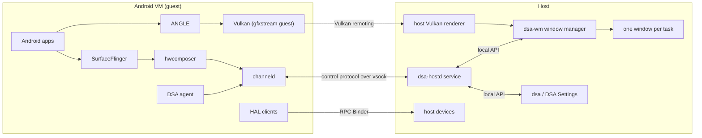

<div align="center">


# Desktop Subsystem for Android™

**Android uygulamaları gerçek masaüstü pencereleri olarak, açık kaynaklı bir yığın üzerinde.**

[](https://github.com/thisisthepy/desktop-subsystem-for-android/actions/workflows/test.yml)
[](https://github.com/thisisthepy/desktop-subsystem-for-android/actions/workflows/test-installer.yml)
[](https://github.com/thisisthepy/desktop-subsystem-for-android/actions/workflows/test-image.yml)
[](https://github.com/thisisthepy/desktop-subsystem-for-android/actions/workflows/test-kernel.yml)
[](https://github.com/thisisthepy/desktop-subsystem-for-android/releases/latest)
[](https://github.com/thisisthepy/desktop-subsystem-for-android/blob/main/LICENSE)

[English](../../README.md) · [한국어](README_ko.md) · [日本語](README_ja.md) · [简体中文](README_zh-CN.md) · [繁體中文](README_zh-TW.md) · [Español](README_es.md) · [Français](README_fr.md) · [Deutsch](README_de.md) · [Português (Brasil)](README_pt-BR.md) · [Русский](README_ru.md) · [Italiano](README_it.md) · [Tiếng Việt](README_vi.md) · [Bahasa Indonesia](README_id.md) · **Türkçe**

</div>

> DSA bağımsız bir açık kaynak projesidir. Microsoft veya Google ile bağlantılı değildir, onlar
> tarafından onaylanmamış ve desteklenmemektedir. Android, Google LLC'nin ticari markasıdır.
> Windows, Microsoft şirketler grubunun ticari markasıdır.

## Nedir

DSA, Android'i kendine ait hafif bir sanal makinede çalıştırır ve her Android görevini yerel bir
masaüstü penceresinde gösterir. Her uygulamanın kendi görev çubuğu düğmesi, Başlat menüsü girdisi,
bildirimleri ve yüklü uygulamalar listesinde bir girdisi vardır. Bu, Microsoft'un 5 Mart 2025'te
sonlandırdığı Windows Subsystem for Android (WSA) ile aynıdır. DSA'nın her parçası açık
kaynaklıdır, bu nedenle herkes onu sürdürebilir.

**Durum.** DSA, Windows 11'de x64 ve ARM64 bilgisayarlarda çalışır. 1.0'dan önceki sürümler ön
sürümdür. 1.0'dan itibaren sürümler bir kararlı ve bir ön sürüm kanalında yayımlanır (bkz.
[Güncellemeler ve sürüm kanalları](#güncellemeler-ve-sürüm-kanalları)). Özellikler CI'da test
edilir ve gerçek donanımda elle denetlenmeleri her sürümle sürer. Bu yüzden lütfen bulduğunuz
sorunları bildirin. Linux ve macOS üzerinde çalışılıyor ve henüz yayımlanmadı (bkz.
[Desteklenen platformlar](#desteklenen-platformlar)).

## Özellikler

**Pencereler ve giriş**

- Her Android görevi için uygulamanın kendisi olarak çizilen bir yerel pencere. Görev çubuğunda,
  Alt+Tab'da ve Görev Yöneticisi'nde uygulamanın kendi program adı ve simgesi görünür. Tüm ekranı
  gösteren bir öykünücü çerçevesi yoktur.
- Uygulamanın parçası olan bir başlık çubuğu: uygulamanın renkleri pencerenin üst kenarına kadar
  uzanır, Windows 11 başlık çubuğu düğmeleri bunun üzerinde durur ve uygulamanın simgesiyle adı
  solda yer alır. Uygulama geri gidebildiğinde simge bir geri okuna dönüşür. Ek düzenleri (Snap
  layouts), sürükleme, ekranı kaplamak için çift tıklama ve pencere menüsü (Alt+Space), her
  Windows uygulamasında olduğu gibi çalışır.
- Pencere menüsüne **Full screen** (tam ekran), **New window** (yeni pencere; birden çok pencereye
  izin veren uygulamalar için), **Screenshot** (ekran görüntüsü), **Aspect ratio** (en boy oranı),
  **Open by default** (varsayılan olarak aç) ve **App info** (uygulama bilgisi) eklenir.
- Uygulamayı yeniden oluşturmadan canlı yeniden boyutlandırma ve monitörün çalışma alanını
  dolduran ekranı kaplama.
- Bir uygulamanın tam ekran isteği (örneğin bir video oynatıcının tam ekran düğmesi) ekranı
  doldurur. İşaretçi üst kenara değdiğinde başlık çubuğu görünür. Yalnızca çubuklarını gizleyen
  uygulamalar (örneğin kısa video akışları) kendi pencerelerinde kalır. İkisi de DSA Settings'te
  tüm uygulamalar için veya her uygulama için ayrı seçilebilir. F11 her zaman tam ekranı açıp
  kapatır.
- Her monitörde keskin görüntü. Bir uygulamayı başka ölçekteki bir monitöre taşıdığınızda,
  penceresi oraya ulaşır ulaşmaz yeni ölçekte yeniden çizilir ya da her uygulama için
  seçtiğiniz gibi DSA penceresini ölçekler. Varsayılan olarak, ölçek değişikliğini kendisinin
  işlediğini söyleyen bir uygulama yeniden çizilir, diğerlerini DSA ölçekler. Çalışırken ölçeği
  değişince bozulduğu bilinen uygulamalar (örneğin YouTube) varsayılan olarak DSA tarafından
  ölçeklenir.
- Uygulamalardaki metin, Windows metin boyutu ayarını izler.
- Fare (üzerine gelme dahil), en fazla on parmakla dokunma, kalem (basınç, silgi, yan düğme) ve
  her düzende klavye.
- Windows Metin Hizmetleri Çerçevesi (TSF) üzerinden metin girişi: Windows giriş yönteminiz
  (Korece dahil), Android düzenleyicisinde satır içinde oluşturur ve aday penceresi imlecin
  yanında durur. Yeniden dönüştürme, dokunmatik klavye, sesle yazma (Win+H), el yazısı ve emoji
  paneli düzenleyicinin kendi metni üzerinde çalışır. Android klavye uygulaması yoktur.
- Dosya Gezgini ile uygulama pencereleri arasında iki yönde dosya sürükleme.
- Bir DSA penceresi öndeyken Windows 11'in üç ve dört parmaklı dokunma hareketleri kapatılır
  (varsayılan olarak açık), böylece uygulama bunları alır.
- Her uygulamanın erişilebilirlik ağacı, ekran okuyucular ve otomasyon araçları için Windows UI
  Automation'a (Kullanıcı Arabirimi Otomasyonu) açılır (bkz. [UI Automation](#ui-automation) ve
  [Erişilebilirlik](#erişilebilirlik)).

**Kabuk tümleştirmesi**

- Android dursa bile her Android uygulaması için Başlat menüsü girdileri ve Windows araması.
  Uygulamalar Ayarlar > Uygulamalar > Yüklü uygulamalar altında listelenir ve oradan
  kaldırılabilir.
- Masaüstü kısayolları ve uygulamanın kendi kısayolları (örneğin bir mesajlaşma uygulamasının
  yeni sohbeti), görev çubuğunda ve Başlat menüsündeki atlama listesinde. Bir uygulamanın adı
  değiştiğinde Başlat menüsü girdisi, masaüstü kısayolları ve görev çubuğuna sabitlemesi yeni adı
  izler.
- Android bildirimleri, her uygulamanın adı ve simgesiyle Windows bildirimleri olarak gösterilir.
  Birini seçmek uygulamayı açar, birini kapatmak onu Android'de de kapatır.
- Arka planda çalışan uygulamalar bildirim alanında simge olarak görünür. Medya oynatan
  uygulamalar medya tuşları ve Windows medya denetimleriyle çalışır.
- Masaüstüne yerleştirilen Android pencere öğeleri (widget), her biri kendi penceresinde.
- İki yönde paylaşılan metin panosu, Windows tarayıcısında açılan web bağlantıları, Android
  uygulamalarında açılan ve onlarla paylaşılan Windows dosyaları ve Android ile paylaşılan Windows
  klasörleriniz.
- Android dosyaları Dosya Gezgini'nde, gezinti bölmesindeki **Android** altında.
- Çift tıklayarak, bağlam menüsünden, dosyayı bir pencereye bırakarak veya `dsa install` ile APK
  yükleme. Bir pencere, Android başlamadan önce APK'nin ne olduğunu gösterir.
- Android paylaşım sayfasında "Share on PC": metin, bağlantılar ve dosyalar, Yakındakilerle
  paylaşım dahil Windows paylaşım penceresine gider.

**Medya ve cihazlar**

- Windows varsayılan çıkış ve giriş cihazları üzerinden ses, ses karıştırıcıda her uygulama için
  bir satır ile.
- Media Foundation aracılığıyla ana bilgisayar GPU'sunda video kod çözme: H.264, HEVC, VP9 ve
  AV1, 4096x2304'e kadar. Çözülen görüntüler video kanalı üzerinden kopyalanmak yerine, ana
  bilgisayarla sanal makinenin paylaştığı bir bellek bölgesi üzerinden Android'e ulaşır. GPU'nun
  çözmediği biçimler Android'de yazılımla çözülür.
- Ana bilgisayarda GPU ile görüntü oluşturma: gfxstream üzerinden Vulkan uzaktan çalıştırma ve
  bunun üzerinde ANGLE aracılığıyla OpenGL ES.
- Kamera, mikrofon, konum, sensörler (ivmeölçer, jiroskop, yönlendirme, ışık) ve güç, her biri
  hem Windows gizlilik ayarlarının hem de Android izinlerinin arkasında.
- Android'in ağ konumu, Google Play olsun ya da olmasın ana bilgisayar tarafından yanıtlanır.
  Google Play olmadan adres sorguları (`Geocoder`), DSA ile birlikte gelen idari sınır verileriyle
  bilgisayarda yanıtlanır: bir konum ülkesine, iline ve şehrine, Kore'de ise ilçesine ve
  mahallesine dönüşür. Hiçbir sunucu veya anahtar kullanılmaz ve konum bilgisayarda kalır. Sokak
  adresleri ve bir adresi konuma çevirme sunulmaz. Google Play ile Google'ın coğrafi kodlayıcısı
  yanıtlar.

**Sistem**

- Boşta durumu olarak Android'in Doze'u: son Android penceresi kapatıldıktan veya simge durumuna
  küçültüldükten 30 saniye sonra Android Doze'a girer. İşlemci dinlenirken bildirimler gelmeye
  devam eder ve Android çalışırken boştaki bellek Windows'a geri döner. Bir uygulamayı açmak onu
  hemen uyandırır, beklenecek bir önyükleme yoktur. Android'i dondurmak bir seçenektir ve
  varsayılan olarak kapalıdır.
- Her Windows kullanıcısı kendi profilinde kendi Android'ini ve veri diskini alır.
- `sudo` gibi kök erişimi, varsayılan olarak kapalı. Bir yönetici açar; ardından her uygulama ve
  geliştirici modunda `adb shell`, sormaya ayarlanabilir. Bir istek, uygulamanın kendi adı ve
  simgesiyle Windows yönetici istemini (UAC) gösterir ve bir onay 15 dakika geçerlidir. İzin
  verilmeyen uygulamalar `su`'yu hiç göremez. Her istek kaydedilir.
- Uygulama verilerinin kullanıcı klasörünüze şifreli yedeklenmesi, varsayılan olarak kapalı.
- DSA Settings: uygulamalar ve pencereleri, arka plan uygulamaları, pencere öğeleri, ekran ve GPU,
  bellek, ağ, cihaz kimliği, güncellemeler, eklentiler, kök erişimi, adb ile geliştirici modu,
  Android'in canlı günlüğü ve tanılama. İçindeki her şey aynı zamanda bir `dsa` komutudur.

**Seçtiğiniz eklentiler**

DSA hiçbir Google yazılımı içermez. Aşağıdakilerin her biri yalnızca siz istediğinizde, DSA size
kaynağı ve koşulları gösterdikten sonra kaynağından indirilir ve Android'in yanındaki bir eklenti
diskine yerleştirilir. Sistem görüntüsü hiçbir zaman değiştirilmez ve her biri DSA Settings'ten
veya komut satırından yeniden kaldırılabilir.

- **Google Play.** `dsa gapps install` veya DSA Settings'te **Advanced** (gelişmiş) >
  **Google Play**, Android sürümünüz için herkese açık LiteGapps Core paketini (Google Play
  hizmetleri, Play Store ve hesap eşitleme) indirir. Bu Android, Google sertifikalı değildir, bu
  yüzden Google cihazı kaydetmenizi isteyebilir. DSA Settings, Android kimliğini ve bunu yapacağınız
  sayfayı gösterir. Google Play, Android'in başlamasını hiçbir zaman engellemez. Google'ın
  uygulamaları Google'ın koşullarına tabidir.
- **Widevine L3.** `dsa drm widevine install` veya **Advanced** > **Protected content**
  (korumalı içerik), Google'ın Widevine modülünü değiştirmeden, Android sürümünüz için Google'ın
  Android öykünücü görüntüsünden alır (yaklaşık 2 GB indirme; yalnızca Widevine saklanır). Böylece
  yayın uygulamaları korumalı video oynatabilir. L3 güvenlik düzeyinde yayın hizmetleri en fazla
  standart çözünürlük gönderir, bu yüzden yüksek çözünürlük için bir Windows tarayıcısında veya
  uygulamasında izleyin.
- **ARM çevirisi.** x64 bilgisayarlarda yalnızca ARM için derlenmiş uygulamalar bir çevirmen
  üzerinden çalışır. Açık kaynaklı çevirmen Digitalis, x64 görüntüsüyle birlikte gelir ve ilk
  başlatmadan itibaren kullanılır. Onu Google'ın çevirmeniyle (`dsa arm-translation fetch google`)
  veya kendi paketinizle değiştirebilirsiniz. Yalnızca 64 bit ARM uygulamaları (`arm64-v8a`)
  çalışır. ARM64 bilgisayarlarda Android, ARM uygulamalarını kendisi çalıştırır.

**Dahil olmayanlar:** Google Play hizmetleri, bir uygulama mağazası veya başka herhangi bir Google
ikili dosyası (lisansları bunları kullanıcının seçimi yapar) ve Microsoft'un WSA ikili
dosyalarının hiçbiri.

## UI Automation

DSA, her Android uygulama penceresinin içindeki kullanıcı arabirimini, Windows uygulamalarının da
kullandığı arabirim olan Windows UI Automation'a (UIA) açar. Ekran okuyucular, test araçları ve
diğer UIA istemcileri, bir Android uygulamasının düğmelerini, listelerini ve metin alanlarını tek
bir resim olarak değil, penceresinin öğeleri olarak görür.

**Nasıl çalışır.** Bir UIA istemcisi bir DSA uygulama penceresinden ağacını ilk kez istediğinde,
pencere Android'deki DSA aracısından o görevi izlemesini ister. Aracı yalnızca o görevin Android
erişilebilirlik düğümlerini okur ve ana bilgisayara gönderir: önce ağacın tamamını, sonra
değişiklikleri. Ana bilgisayar ağacı pencere işleminde tutar, böylece her özellik okuması ve her
gezinti çağrısı sanal makineye gidip gelmeden yerel olarak yanıtlanır. 30 saniye boyunca hiçbir
UIA istemcisi dinlemediğinde izleme durur ve Android düğüm okumayı bırakır. Hiçbir UIA istemcisi
kullanmayan kullanıcılar bunun için hiçbir bedel ödemez.

**Her öğe neler taşır.**

- **Control type** (denetim türü), Android görünüm sınıfından ve durumundan: düğme, onay kutusu,
  radyo düğmesi, düzenleme alanı, kaydırıcı, ilerleme çubuğu, birleşik giriş kutusu, liste, liste
  öğesi, sekme, menü, resim, metin, belge (`WebView` için), araç çubuğu ve grup. Bir Android
  anahtarı Toggle desenli bir düğmedir, bir başlık ise metindir.
- **Name**: içerik açıklaması, yoksa metin, o da yoksa boş bir düzenleme alanının ipucu. Kendi adı
  olmayan tıklanabilir bir öğe, alt öğelerinin adlarını alır.
- **AutomationId**: Android görünümünün kaynak kimliği, örneğin `com.example:id/send`.
- **ClassName**: Android görünüm sınıfı. **FrameworkId** `Android`'dir.
- **HelpText** (ipucu), **ItemStatus** (Android'in durum açıklaması), **IsEnabled**,
  **IsKeyboardFocusable**, **HasKeyboardFocus**, **IsPassword** ve ekran koordinatlarında bir
  **BoundingRectangle**.
- Android'in kullanıcıya görünmez olarak bildirdiği öğeler ağaca alınmaz.
- Parola alanları Android'den hiçbir zaman metin olarak çıkmaz: her karakter bir nokta olarak
  gelir.

**Desenler ve Android'de yaptıkları.**

| UIA deseni | Android eylemi |
|---|---|
| Invoke | `ACTION_CLICK` |
| Value (`SetValue`) | Alanın tüm metnini değiştiren `ACTION_SET_TEXT` |
| Toggle | `ACTION_CLICK` |
| SelectionItem (`Select`) | `ACTION_SELECT`, düğümün seçme eylemi yoksa `ACTION_CLICK` |
| Scroll | Sayfa sayfa `ACTION_SCROLL_FORWARD` ve `ACTION_SCROLL_BACKWARD`; kaydırma yüzdesi yok |
| `SetFocus` | `ACTION_FOCUS`, düğüm giriş odağı alamıyorsa `ACTION_ACCESSIBILITY_FOCUS` |

Bu eylemler doğrudan düğüme gider. Fareyi hareket ettirmez veya dokunma enjekte etmezler.

**Olaylar.** Pencere; odak değişti (öndeyken), alt öğeler belirip kaybolduğunda yapı değişti ve
ad, değer, açma/kapama durumu, seçim, etkinlik durumu ve sınırlayıcı dikdörtgen için özellik
değişti olaylarını oluşturur. Olaylar yalnızca bir istemci dinlerken oluşturulur.

**Metin girişi.** `SetValue` bir alanın metnini tek adımda ayarlar. Yazma, oluşturma ve giriş
yöntemleri ise klavye başındaki bir kişide olduğu gibi TSF ve uygulamanın `InputConnection`'ı
üzerinden gider.

**Pencerenin kendisi.** Pencerenin adı uygulamanın adıdır. Başlık çubuğu düğmeleri (simge durumuna
küçült, ekranı kapla veya geri yükle, kapat) ve başlık çubuğundaki geri oku, ağaçta adı olan
düğmelerdir.

**Diğer araçlardan kullanma.** Inspect ve Accessibility Insights for Windows gibi herhangi bir UIA
istemcisi veya FlaUI gibi kitaplıklar çalışır. Uygulamanın penceresini adıyla, sonra öğelerini
AutomationId, ad veya denetim türüyle bulun. Bir öğe yerine bir noktaya basması gereken betikler
için `dsa tap <package> <x> <y>` uygulamanın görevinin içine basar.

**Henüz olmayanlar.** Text deseni, RangeValue veya ExpandCollapse deseni, UIA üzerinden uzun basma,
başlık düzeyi ve bildirim veya canlı bölge olayları yoktur. Android'in erişilebilirlik odağı
aktarılmaz; yalnızca giriş odağı aktarılır. İyileştirmeler
[#744](https://github.com/thisisthepy/desktop-subsystem-for-android/issues/744) numaralı sorunda
(açık) izlenir.

## Erişilebilirlik

**Ekran okuyucular.** NVDA ve Ekran Okuyucusu (Narrator), Android uygulamalarını yukarıdaki UI
Automation ağacı üzerinden okur: denetimlerin adları ve rolleri vardır, odak klavyeyi izler ve
düğmeler, anahtarlar, listeler ve metin alanları fare olmadan kullanılabilir. JAWS aynı ağacı
kullanır; proje bunu henüz denetlemedi, bu yüzden geri bildirimler memnuniyetle karşılanır.

**Neler iyileştiriliyor.** Bunlar bir ekran okuyucu kullanıcısının raporundan gelir:
[#744](https://github.com/thisisthepy/desktop-subsystem-for-android/issues/744) numaralı sorun.
Her biri açıktır ve orada izlenir:

- **Daha hızlı odak.** Bugün bir odak değişikliği Windows'a ulaşmadan önce Android'de bekler; bu,
  bir tuşa basıldıktan sonra yaklaşık 250 ile 450 ms arasıdır ve basılı tutulan bir ok tuşu
  saniyede yaklaşık dört adım ilerler. Plan, odak değişikliklerini hemen göndermek, yalnızca
  olayın geldiği görevi okumak ve kısa zamanlamaları bir UIA istemcisinin dinlediği zamanlarla
  sınırlamaktır.
- **Erişilebilirlik odağı.** Bugün yalnızca giriş odağı aktarılır, bu yüzden Android'in
  erişilebilirlik odağının hareketleri hiçbir odak olayı oluşturmaz.
- **Text deseni.** Düzenleme alanlarında henüz Text deseni yoktur; NVDA bunu metni karakter,
  sözcük ve satır olarak okumak ve gözden geçirmek için kullanır. Değerleri okunabilir ve
  ayarlanabilir.

**DSA'nın kendi pencereleri.**

- **DSA Settings** klavye ve ekran okuyucularla çalışır: gezintisi, satırları ve denetimleri adı
  olan UIA öğeleridir.
- **APK Installer** her öğesini adlandırır ve **More** (daha fazla) bağlantısı UIA üzerinden
  genişler ve daralır.
- **Masaüstündeki pencere öğeleri** klavye odağı alır. Enter, Space, menü tuşu ve Shift+F10 pencere
  öğesinin menüsünü açar.
- Pencere öğelerinin ve bildirim alanı simgelerinin **menüleri**, klavyeyle gezinilebilen UIA
  menüleridir. **Onay iletişim kutularının** erişim tuşları ve bir varsayılan düğmesi vardır.
- **Kök istemi**, Windows'un kendi yönetici istemidir (UAC).
- Başlık çubuğu düğmeleri yüksek karşıtlık temasında sistem renklerini kullanır.

Linux'ta ana bilgisayar aynı ağacı, karakter, sözcük ve satır olarak metinle birlikte Orca için
AT-SPI'ye aktarır; Linux henüz yayımlanmadı. macOS ana bilgisayarı uygulama ağaçlarını henüz
aktarmaz.

**Sorun bildirme.** Ekran okuyucu ve sürümü, uygulama, ne yaptığınız, ne duyduğunuz ve ne
beklediğinizle birlikte bir
[sorun](https://github.com/thisisthepy/desktop-subsystem-for-android/issues/new) açın.
`dsa logs collect -o diag.zip` ile alınan bir tanılama paketi yardımcı olur.
[DSA Discord](https://discord.gg/MtpQnR4eQQ) da sorulara açıktır.

## Desteklenen platformlar

| Ana bilgisayar | Durum |
|---|---|
| Windows 11, x64 | `DSA-v<version>-win-x64-setup.exe` olarak yayımlandı |
| Windows 11, ARM64 | `DSA-v<version>-win-arm64-setup.exe` olarak yayımlandı. Android de ARM64 olduğundan ARM uygulamaları çeviri olmadan çalışır |
| Linux (x64, ARM64) | Üzerinde çalışılıyor, yayımlanmadı. KVM ana bilgisayarı, Wayland birleştiricisi ve `.deb` ile `.rpm` paketleri CI'da derlenir ve çalışır |
| macOS (Apple silicon) | Üzerinde çalışılıyor, yayımlanmadı. Apple'ın Virtualization framework'ü üzerindeki ana bilgisayar ve uygulama paketi CI'da derlenir |

### Android sürümleri

DSA en yeni iki Android ana sürümünü destekler: bugün Android 16 ve Android 17. Bir sürüm, ondan
iki yeni ana sürüm yayımlandığında desteğin dışına çıkar; yani Android 16, Android 18 yayımlanana
kadar desteklenir. Görüntü güncelleyicisi her kullanıcıyı desteklenen bir sürüme taşır ve kendi
başına hiçbir zaman daha düşük bir ana sürüme geçirmez. Desteklenen iki sürümden birini DSA
Settings'te veya `dsa android use` ile seçebilirsiniz. Eskisine geçmek Android verilerini siler,
çünkü Android daha yeni bir sürümün yazdığı verileri okuyamaz.

<p align="center">
  
</p>

Bugünden sonraki tarihler sürüm değil, beklenen tarihlerdir.

## Yükleme

**Gerekenler:** x64 veya ARM64 bir bilgisayarda Windows 11 ve açık olan **Sanal Makine
Platformu** (Virtual Machine Platform) Windows özelliği. Kurulum bunu denetler ve kapalıysa
talimatlarla durur.

1. **Sanal Makine Platformu**'nu açın: Ayarlar > Sistem > İsteğe bağlı özellikler > Diğer Windows
   özellikleri veya yönetici terminalinde
   `dism /online /enable-feature /featurename:VirtualMachinePlatform /all`. Yeniden başlatın.
2. [En son sürümden](https://github.com/thisisthepy/desktop-subsystem-for-android/releases/latest)
   `DSA-v<version>-win-x64-setup.exe` dosyasını (ARM64 bilgisayarda
   `DSA-v<version>-win-arm64-setup.exe`) indirin ve `SHA256SUMS.txt` ile karşılaştırın.
3. Çalıştırın. Kurulum; `DsaHost` hizmetini, `dsa` komutunu, DSA Settings'i, APK Installer'ı ve
   ilk Android görüntüsünü (kurulum bir tane içermiyorsa indirilir) yükler. Android oturum
   açtığınızda başlar, böylece açtığınız ilk uygulama bir önyüklemeyi beklemez.

Derlenecek bir çekirdek yoktur ve WSL kurulumunuzda hiçbir değişiklik yapılmaz: DSA kendi
çekirdeğini ve kendi sanal makinesini getirir. Kaldırma, her kullanıcının Android diski dışında
DSA'nın yazdığı her şeyi siler.

## Güncellemeler ve sürüm kanalları

DSA kendisini ve Android görüntüsünü günceller. İkisi de imzalıdır ve imzası, boyutu veya özeti
eşleşmeyen hiçbir şey uygulanmaz.

- **DSA'nın kendisi.** Hizmet, imzalı bir sürüm listesini denetler ve hiçbir kullanıcının Android'i
  çalışmıyorken daha yeni bir sürümü yükler. Aksi halde bekler; `dsa update` hemen yükler. Öncesinde
  ve sonrasında size bilgi verilir. Bir güncelleme DSA'yı hiçbir zaman daha düşük bir sürüme
  geçirmez.
- **Kanallar.** 1.0'dan itibaren iki kanal vardır: **stable** (kararlı) ve hâlâ tamamlanmakta olan
  sürümler için **pre-release** (ön sürüm). Ön sürüm kanalı, ikisinden hangisi daha yeniyse onu
  alır. Kanalınız kullandığınız yükleyiciyle başlar ve yükseltmeler onu korur. Bunu DSA Settings'in
  **Updates** (güncellemeler) sayfasındaki **Get pre-release versions** ile veya
  `dsa settings set prerelease-updates on|off` ile (yöneticiler) değiştirin. Ön sürümlerden
  ayrılmak DSA'yı hiçbir zaman geri götürmez: daha yeni bir kararlı sürümü bekler. 1.0'dan önceki
  her sürüm bir ön sürümdür.
- **Android görüntüsü.** Görüntü güncellemeleri kanala bağlı değildir. Önyükleme yapamayan bir
  görüntü son sağlam görüntüyle değiştirilir ve `dsa status` bunu bildirir. **Restart Android
  into updates by itself** açıkken, hiçbir uygulama penceresi açık değilse Android indirilmiş bir
  güncellemeyle yeniden başlar.
- **Güncellemeleri kapatma.** Yöneticiler **Updates** sayfasında **Update DSA automatically** ve
  **Update the Android image automatically** ayarlarını kapatabilir.

Kararlı sürümler yalnızca `main`'den, inceleme sonrasında yapılır. `develop` derlemeleri, katkıda
bulunanlar için ön sürümler veya test derlemeleridir.

## Hızlı başlangıç

Başlat menüsünden bir Android uygulaması açın veya `dsa` komutunu kullanın:

```
dsa status                          # Android'in durumu ve bekleyen güncellemeler
dsa install app.apk                 # bir APK veya bölünmüş APK paketi yükler (.xapk, .apks, .apkm)
dsa apps list                       # yüklü uygulamalar
dsa launch com.android.settings     # bir uygulamayı kendi penceresinde açar
dsa settings set clipboard off      # bir ayarı değiştirir (DSA Settings'te aynı anahtarlar var)
dsa logcat -d -b all *:W            # Android'in günlüğü, uyarılar ve üzeri
dsa logs collect -o diag.zip        # bir sorun raporunun gerektirdiği her şey, tek bir zip olarak
```

Bağımsız değişken olmadan `dsa` her komutu listeler. Android'in günlüğü bellekte kalır ve yalnızca
bir şey onu okurken ana bilgisayara akar. `diag.zip` dosyasını bir sorun raporuna ekleyin.

## Sınırlamalar

Bugün geçerli olanlar:

- Yalnızca Windows yayımlandı. Linux ve macOS üzerinde çalışılıyor.
- DSA Settings yalnızca İngilizce ve Korece görünür.
- Yalnızca 64 bit uygulamalar çalışır: `arm64-v8a` ve x64'te `x86_64`. 32 bit uygulamalar
  çalışmaz.
- Widevine L3'tür, bu yüzden korumalı yayınlar en fazla standart çözünürlükte oynatılır.
- Google Play, DSA'da Google sertifikalı değildir; Google cihazı kaydetmenizi isteyebilir.
- Pano yalnızca metin paylaşır.
- **System (forced)** ölçekleme seçeneği henüz kullanılamaz ve **System** gibi çalışır.
- UI Automation aktarımında [UI Automation](#ui-automation) altında listelenen eksikler vardır.
- Google Play olmadan adres sorguları sokak adreslerini değil, bölgeyi (ülkeden şehre kadar veya
  Kore'de ilçe) verir.

## Kullanıcı kılavuzları

Adım adım kılavuzlar yüklemeyi, uygulamaları ve pencereleri, APK'leri, dosyaları, Android
sürümlerini, ayarları, belleği, geliştirici modunu, sorun gidermeyi ve kaldırmayı kapsar:
[docs/guides](../guides/tr/README.md). [Tanıtım sayfası](../guides/intro/index.html), projeyi
yeni gelenlere anlatır.

## Mimari



- **Konuk.** Platform imzalı bir aracı, ekranı serbest biçimli (freeform) yapar ve görevleri,
  uygulamaları, bildirimleri ve erişilebilirlik ağaçlarını bildirir. hwcomposer, her görevin
  katmanlarını ana bilgisayara ayrı bir ekran olarak verir. HAL istemcileri ana bilgisayar
  cihazlarına RPC Binder üzerinden ulaşır. Başlatıcı, durum çubuğu veya klavye uygulaması yoktur:
  kabuk ana bilgisayardır.
- **Protokol.** Tek bir tanım, `dsa/protocol/control.proto`, Rust, Java ve C++ için üretilen
  kodlayıcılarla. Her bağlantı protokol sürümünü, şema özetini ve önyükleme başına bir gizli
  değeri denetler.
- **Ana bilgisayar.** `dsa/host/core/` platformdan bağımsızdır: oturumlar, uygulama kayıt defteri
  ve yaşam döngüsü ilkesi. Her işletim sistemi, sanal makineyi, aktarımı ve pencere sistemini
  `dsa/host/platform/<os>/` altında ekler. Windows'ta sanal makine Host Compute System üzerinden
  oluşturulur ve kareler GPU'dan her pencereye Direct3D 11 ve DirectComposition üzerinden gider,
  hiçbir zaman işlemciden geçmez.

## Kaynaktan derleme

Rust paketleri `dsa/` içinde tek bir çalışma alanı oluşturur:

```
cd dsa
cargo test --workspace
cargo build -p dsa-host-windows --release
```

Diğer parçaların, yanlarında açıklanan kendi derlemeleri vardır:

- yükleyici: `dsa/host/platform/windows/installer/README.md`
- Windows ana bilgisayarı: `dsa/host/platform/windows/README.md`
- konuk çekirdeği: `dsa/kernel/`
- Android görüntüsü ve konuk bileşenleri: `dsa/guest/`
- grafik yolu: `dsa/graphics/`

Yukarı akış projeleri (AOSP, gfxstream, çekirdek) depoya dahil edilmez: betikler sabitlenmiş bir
revizyonu getirir ve burada tutulan yamaları uygular. Python araçları `uv run` ile çalışır.

## Depo yapısı

| Yol | İçerdiği |
|---|---|
| `dsa/protocol/` | Konuk ile ana bilgisayar arasındaki denetim protokolü ve kod üreticileri |
| `dsa/host/core/` | Platformdan bağımsız ana bilgisayar |
| `dsa/host/cli/` | `dsa` komutu |
| `dsa/host/platform/windows/` | Windows ana bilgisayarı, pencere yöneticisi, yükleyici ve DSA Settings |
| `dsa/host/platform/linux/`, `macos/`, `unix/` | Linux ve macOS ana bilgisayarları ve paylaştıkları |
| `dsa/graphics/` | gfxstream'den başlayan Vulkan uzaktan çalıştırma |
| `dsa/guest/` | Aracı, hwcomposer, HAL hizmetleri ve görüntü yapılandırması |
| `dsa/kernel/` | Konuk çekirdeği yapılandırması ve derlemesi |
| `scripts/tests/` | Depo denetimleri |
| `.github/` | CI iş akışları, sürüm betikleri ve README'nin varlıkları |

## Katkıda bulunma

DSA genç bir projedir ve hâlâ kararlı hale getirilmektedir. Bu yüzden elinizde bir düzeltme olsun
ya da olmasın her rapor yardımcı olur.

<p>
  <a href="https://github.com/thisisthepy/desktop-subsystem-for-android/issues/new"></a>
  <a href="https://discord.gg/MtpQnR4eQQ"></a>
</p>

- **Bir hata mı buldunuz veya bir fikriniz mi var?** [Bir sorun açın](https://github.com/thisisthepy/desktop-subsystem-for-android/issues/new).
  Ne yaptığınızı ve ne olduğunu, Windows derlemeniz (`winver`) ve DSA ile Android sürümleriyle
  (`dsa status`) birlikte yazın. `dsa logs collect -o diag.zip` ile alınan bir tanılama paketi,
  bir hatanın izini sürmeyi çok kolaylaştırır.
- **Önce sormak veya sadece konuşmak mı istiyorsunuz?**
  [DSA Discord](https://discord.gg/MtpQnR4eQQ)'a gelin. Sorular, çalıştırmaya çalıştığınız şeyler
  ve erken geri bildirimler orada memnuniyetle karşılanır.
- **Bir değişiklik mi gönderiyorsunuz?** Çalışma `develop` dalında yapılır; `main` ondan yayımlanır.
  Çekme isteklerini `develop`'a karşı, commit başına tek bir mantıksal değişiklik ve her davranış
  değişikliği için bir test ile açın. Üretilen protokol kodu hiçbir zaman elle düzenlenmez. Lütfen
  metinlerde uzun tire (em dash) kullanmayın: bir depo denetimi bunları reddeder.

## Lisans

[Apache-2.0](https://github.com/thisisthepy/desktop-subsystem-for-android/blob/main/LICENSE).
Birlikte gelen her üçüncü taraf bileşeni kendi lisansını korur; lisanslar yükleyicide listelenir.

## Ticari markalar

Android, Google LLC'nin ticari markasıdır. Windows, Microsoft şirketler grubunun ticari markasıdır.
DSA, Microsoft veya Google ile bağlantılı değildir, onlar tarafından onaylanmamış ve
desteklenmemektedir.

## Yıldız geçmişi

<a href="https://www.star-history.com/#thisisthepy/desktop-subsystem-for-android&Date">
  <picture>
    <source media="(prefers-color-scheme: dark)" srcset="https://api.star-history.com/svg?repos=thisisthepy/desktop-subsystem-for-android&type=Date&theme=dark" />
    <source media="(prefers-color-scheme: light)" srcset="https://api.star-history.com/svg?repos=thisisthepy/desktop-subsystem-for-android&type=Date" />
    
  </picture>
</a>
