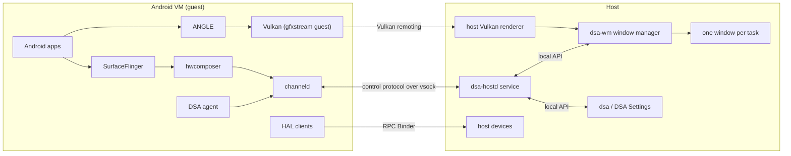

<div align="center">


# Desktop Subsystem for Android™

**Ứng dụng Android là những cửa sổ desktop thực thụ, trên một nền tảng mã nguồn mở.**

[](https://github.com/thisisthepy/desktop-subsystem-for-android/actions/workflows/test.yml)
[](https://github.com/thisisthepy/desktop-subsystem-for-android/actions/workflows/test-installer.yml)
[](https://github.com/thisisthepy/desktop-subsystem-for-android/actions/workflows/test-image.yml)
[](https://github.com/thisisthepy/desktop-subsystem-for-android/actions/workflows/test-kernel.yml)
[](https://github.com/thisisthepy/desktop-subsystem-for-android/releases/latest)
[](https://github.com/thisisthepy/desktop-subsystem-for-android/blob/main/LICENSE)

[English](../../README.md) · [한국어](README_ko.md) · [日本語](README_ja.md) · [简体中文](README_zh-CN.md) · [繁體中文](README_zh-TW.md) · [Español](README_es.md) · [Français](README_fr.md) · [Deutsch](README_de.md) · [Português (Brasil)](README_pt-BR.md) · [Русский](README_ru.md) · [Italiano](README_it.md) · **Tiếng Việt** · [Bahasa Indonesia](README_id.md) · [Türkçe](README_tr.md)

</div>

> DSA là một dự án mã nguồn mở độc lập. DSA không liên kết với Microsoft hay Google, và không
> được hai công ty này xác nhận hoặc tài trợ. Android là nhãn hiệu của Google LLC. Windows là
> nhãn hiệu của nhóm công ty Microsoft.

## DSA là gì

DSA chạy Android trong một máy ảo (VM) nhẹ riêng và hiển thị mỗi tác vụ (task) Android trong
một cửa sổ desktop gốc. Mỗi ứng dụng có nút riêng trên thanh tác vụ, mục riêng trong menu Bắt
đầu, thông báo riêng và mục riêng trong danh sách ứng dụng đã cài đặt, giống như với Windows
Subsystem for Android (WSA), dịch vụ mà Microsoft đã ngừng vào ngày 5 tháng 3 năm 2025. Mọi
thành phần của DSA đều là mã nguồn mở, nên bất kỳ ai cũng có thể tiếp tục phát triển nó.

**Trạng thái.** DSA chạy trên Windows 11, trên PC x64 và ARM64. Các bản phát hành dưới 1.0 là
bản phát hành trước (pre-release). Từ 1.0, các bản phát hành có hai kênh: ổn định và phát hành
trước (xem [Cập nhật và kênh phát hành](#cập-nhật-và-kênh-phát-hành)). Các tính năng được kiểm
thử trong CI, và việc kiểm tra thủ công trên phần cứng thật vẫn tiếp tục với mỗi bản phát hành,
vì vậy hãy báo cho chúng tôi những gì bạn phát hiện. Linux và macOS đang được phát triển và
chưa phát hành (xem [Nền tảng được hỗ trợ](#nền-tảng-được-hỗ-trợ)).

## Tính năng

**Cửa sổ và nhập liệu**

- Mỗi tác vụ Android là một cửa sổ gốc, hiển thị như chính ứng dụng, với tên chương trình và
  biểu tượng của ứng dụng trên thanh tác vụ, trong Alt+Tab và Trình quản lý Tác vụ. Không có
  khung giả lập hiển thị toàn bộ màn hình.
- Thanh tiêu đề là một phần của ứng dụng: màu của ứng dụng kéo dài đến tận mép trên cửa sổ, các
  nút tiêu đề của Windows 11 nằm phía trên, còn biểu tượng và tên ứng dụng nằm bên trái. Biểu
  tượng chuyển thành mũi tên quay lại khi ứng dụng có thể quay lại. Snap layouts, kéo cửa sổ,
  nhấp đúp để phóng to và menu cửa sổ (Alt+Space) hoạt động như trong mọi ứng dụng Windows.
- Menu cửa sổ có thêm **Full screen** (toàn màn hình), **New window** (cửa sổ mới, cho ứng dụng
  cho phép nhiều cửa sổ), **Screenshot** (chụp màn hình), **Aspect ratio** (tỷ lệ khung hình),
  **Open by default** (mở theo mặc định) và **App info** (thông tin ứng dụng).
- Thay đổi kích thước trực tiếp mà không tạo lại ứng dụng, và phóng to lấp đầy vùng làm việc của
  màn hình.
- Khi ứng dụng yêu cầu toàn màn hình, chẳng hạn nút toàn màn hình của trình phát video, ứng dụng
  sẽ lấp đầy màn hình. Thanh tiêu đề xuất hiện khi con trỏ chạm mép trên. Các ứng dụng chỉ ẩn
  thanh của mình, chẳng hạn một luồng video ngắn, vẫn ở trong cửa sổ. Cả hai đều là lựa chọn
  trong DSA Settings, cho tất cả ứng dụng hoặc cho từng ứng dụng, và F11 luôn bật hoặc tắt toàn
  màn hình.
- Hình ảnh sắc nét trên mọi màn hình. Ứng dụng mở ở tỷ lệ của màn hình nơi nó mở. Khi bạn kéo
  ứng dụng sang màn hình có tỷ lệ khác, ứng dụng vẽ lại ở tỷ lệ mới sau khi bạn thả chuột, hoặc
  DSA co giãn cửa sổ thay cho ứng dụng, tùy bạn chọn cho từng ứng dụng. Những ứng dụng được biết
  là bị lỗi khi tỷ lệ thay đổi lúc đang chạy, chẳng hạn YouTube, được DSA co giãn theo mặc định.
- Chữ trong ứng dụng theo cài đặt cỡ chữ của Windows.
- Chuột (có hover), cảm ứng đến mười ngón, bút (lực nhấn, tẩy, nút trên thân bút) và bàn phím
  với mọi bố cục.
- Nhập văn bản qua Text Services Framework (TSF) của Windows: bộ gõ Windows của bạn, kể cả tiếng
  Hàn, soạn chữ ngay trong ô nhập của Android, với cửa sổ gợi ý cạnh con trỏ. Chuyển đổi lại,
  bàn phím cảm ứng, nhập bằng giọng nói (Win+H), viết tay và bảng emoji đều làm việc trên chính
  văn bản của ô nhập. Không có ứng dụng bàn phím Android.
- Kéo tệp giữa File Explorer và cửa sổ ứng dụng, theo cả hai chiều.
- Cử chỉ chạm ba và bốn ngón của Windows 11 được tắt khi một cửa sổ DSA ở phía trước (bật theo
  mặc định), để ứng dụng nhận được các cử chỉ đó.
- Cây trợ năng của mỗi ứng dụng được cung cấp cho Windows UI Automation (tự động hóa giao diện),
  dành cho trình đọc màn hình và công cụ tự động hóa (xem [UI Automation](#ui-automation) và
  [Trợ năng](#trợ-năng)).

**Tích hợp với shell**

- Mục trong menu Bắt đầu và kết quả tìm kiếm Windows cho mọi ứng dụng Android, kể cả khi Android
  đang dừng. Ứng dụng có trong Cài đặt > Ứng dụng > Ứng dụng đã cài đặt, nơi bạn có thể gỡ cài
  đặt chúng.
- Lối tắt trên desktop, và các lối tắt riêng của ứng dụng (chẳng hạn cuộc trò chuyện mới của ứng
  dụng nhắn tin) trong danh sách nhảy (jump list) trên thanh tác vụ và menu Bắt đầu. Khi ứng dụng
  đổi tên, mục trong menu Bắt đầu, lối tắt trên desktop và ghim trên thanh tác vụ đều theo tên
  mới.
- Thông báo Android hiện thành thông báo Windows, dưới tên và biểu tượng của từng ứng dụng. Chọn
  một thông báo sẽ mở ứng dụng, đóng một thông báo sẽ đóng nó trong Android.
- Ứng dụng chạy nền hiện thành biểu tượng trong vùng thông báo, với phím đa phương tiện và điều
  khiển đa phương tiện của Windows cho ứng dụng phát nội dung.
- Widget Android đặt trên desktop, mỗi widget trong một cửa sổ riêng.
- Bộ nhớ tạm văn bản dùng chung hai chiều, liên kết web mở trong trình duyệt Windows, tệp Windows
  mở bằng và chia sẻ vào ứng dụng Android, và các thư mục Windows của bạn được chia sẻ với
  Android.
- Tệp của Android trong File Explorer, dưới mục **Android** ở ngăn điều hướng.
- Cài APK bằng nhấp đúp, từ menu ngữ cảnh, bằng cách thả tệp lên một cửa sổ hoặc bằng
  `dsa install`, với một cửa sổ cho biết APK là gì trước khi Android khởi động.
- "Share on PC" trong bảng chia sẻ của Android: văn bản, liên kết và tệp được chuyển đến cửa sổ
  chia sẻ của Windows, kể cả Chia sẻ lân cận.

**Đa phương tiện và thiết bị**

- Âm thanh qua thiết bị đầu ra và đầu vào mặc định của Windows, với một dòng cho mỗi ứng dụng
  trong bộ trộn âm lượng.
- Video được giải mã trên GPU của máy chủ qua Media Foundation: H.264, HEVC, VP9 và AV1, đến
  4096x2304. Khung hình đã giải mã đến Android qua một vùng bộ nhớ mà máy chủ và VM dùng chung,
  thay vì được sao chép qua kênh video. Các định dạng GPU không giải mã được sẽ được giải mã bằng
  phần mềm trong Android.
- Kết xuất bằng GPU trên máy chủ: Vulkan remoting qua gfxstream, và OpenGL ES qua ANGLE chạy trên
  đó.
- Camera, micrô, vị trí, cảm biến (gia tốc kế, con quay hồi chuyển, hướng, ánh sáng) và nguồn
  điện, mỗi thứ đều nằm sau cả cài đặt quyền riêng tư của Windows lẫn quyền của Android.
- Vị trí mạng của Android do máy chủ trả lời, dù có hay không có Google Play. Khi không có Google
  Play, việc tra cứu địa chỉ (`Geocoder`) được trả lời ngay trên máy tính từ dữ liệu ranh giới
  hành chính đi kèm DSA: một vị trí trở thành quốc gia, tỉnh và thành phố, và ở Hàn Quốc là cả
  quận và phường. Không có máy chủ hay khóa nào tham gia, và vị trí ở lại trên máy tính. Địa chỉ
  đường phố, và việc chuyển một địa chỉ thành vị trí, không được hỗ trợ. Khi có Google Play,
  trình mã hóa địa lý của Google trả lời.

**Hệ thống**

- Doze của Android là trạng thái nghỉ: 30 giây sau khi cửa sổ Android cuối cùng đóng hoặc thu
  nhỏ, Android chuyển sang Doze, thông báo vẫn tiếp tục đến trong khi CPU nghỉ, và bộ nhớ nhàn
  rỗi được trả lại cho Windows trong khi Android vẫn chạy. Mở một ứng dụng sẽ đánh thức Android
  ngay lập tức, không phải chờ khởi động. Đóng băng Android là một tùy chọn, tắt theo mặc định.
- Mỗi người dùng Windows có Android và đĩa dữ liệu riêng, trong hồ sơ của chính họ.
- Quyền root như `sudo`, tắt theo mặc định. Quản trị viên bật nó lên, sau đó từng ứng dụng, và
  `adb shell` ở chế độ nhà phát triển, có thể được đặt là hỏi mỗi lần. Một yêu cầu sẽ hiện lời
  nhắc quản trị viên của Windows (UAC) dưới tên và biểu tượng của chính ứng dụng, và một lần
  chấp thuận kéo dài 15 phút. Ứng dụng không được phép hoàn toàn không thấy `su`. Mọi yêu cầu
  đều được ghi nhật ký.
- Sao lưu dữ liệu ứng dụng vào thư mục người dùng của bạn, có mã hóa, tắt theo mặc định.
- DSA Settings: ứng dụng và cửa sổ của chúng, ứng dụng chạy nền, widget, màn hình và GPU, bộ
  nhớ, mạng, danh tính thiết bị, cập nhật, tiện ích bổ sung, quyền root, chế độ nhà phát triển
  với adb, nhật ký trực tiếp của Android và chẩn đoán. Mọi thứ trong đó cũng là một lệnh `dsa`.

**Tiện ích bổ sung do bạn chọn**

DSA không đi kèm phần mềm nào của Google. Mỗi tiện ích dưới đây chỉ được tải từ nguồn của nó khi
bạn yêu cầu, sau khi DSA cho bạn thấy nguồn và điều khoản, và được đặt trên một đĩa tiện ích bổ
sung bên cạnh Android. Ảnh hệ thống không bao giờ bị thay đổi, và mỗi tiện ích đều có thể gỡ bỏ
lại từ DSA Settings hoặc dòng lệnh.

- **Google Play.** `dsa gapps install`, hoặc **Advanced** (nâng cao) > **Google Play** trong DSA
  Settings, tải gói công khai LiteGapps Core (Google Play services, Play Store và đồng bộ tài
  khoản) cho phiên bản Android của bạn. Android này không được Google chứng nhận, nên Google có
  thể yêu cầu bạn đăng ký thiết bị. DSA Settings hiển thị Android ID và trang để làm việc đó.
  Google Play không bao giờ ngăn Android khởi động. Các ứng dụng của Google tuân theo điều khoản
  của Google.
- **Widevine L3.** `dsa drm widevine install`, hoặc **Advanced** > **Protected content** (nội dung
  được bảo vệ), lấy mô-đun Widevine của Google, không chỉnh sửa, từ ảnh trình giả lập Android của
  Google cho phiên bản Android của bạn (tải khoảng 2 GB, chỉ giữ lại Widevine). Sau đó các ứng
  dụng phát trực tuyến có thể phát video được bảo vệ. Ở cấp bảo mật L3, các dịch vụ phát trực
  tuyến gửi tối đa độ nét tiêu chuẩn, vì vậy hãy xem ở độ nét cao trong trình duyệt hoặc ứng dụng
  Windows.
- **Dịch ARM.** Trên PC x64, các ứng dụng chỉ được xây dựng cho ARM chạy qua một trình dịch.
  Trình dịch mã nguồn mở Digitalis đi kèm ảnh x64 và được dùng ngay từ lần khởi động đầu tiên.
  Bạn có thể thay nó bằng trình dịch của Google (`dsa arm-translation fetch google`) hoặc một gói
  của riêng bạn. Chỉ ứng dụng ARM 64-bit (`arm64-v8a`) chạy được. Trên PC ARM64, Android tự chạy
  ứng dụng ARM.

**Không đi kèm:** Google Play services, cửa hàng ứng dụng hay bất kỳ tệp nhị phân nào khác của
Google (giấy phép của chúng khiến chúng là lựa chọn của người dùng), và bất kỳ tệp nhị phân WSA
nào của Microsoft.

## UI Automation

DSA cung cấp giao diện người dùng bên trong mỗi cửa sổ ứng dụng Android cho Windows UI Automation
(UIA), chính giao diện mà các ứng dụng Windows dùng. Trình đọc màn hình, công cụ kiểm thử và các
máy khách UIA khác thấy nút, danh sách và ô văn bản của ứng dụng Android như các phần tử của cửa
sổ, thay vì một bức ảnh.

**Cách hoạt động.** Khi một máy khách UIA lần đầu hỏi cửa sổ ứng dụng DSA về cây của nó, cửa sổ
yêu cầu agent của DSA trong Android theo dõi tác vụ đó. Agent chỉ đọc các nút trợ năng của
Android cho tác vụ đó và gửi chúng đến máy chủ: trước tiên là toàn bộ cây, sau đó là các thay
đổi. Máy chủ giữ cây trong tiến trình cửa sổ, nên mọi lần đọc thuộc tính và mọi lệnh điều hướng
đều được trả lời tại chỗ, không phải đi vòng qua VM. Khi không có máy khách UIA nào lắng nghe
trong 30 giây, việc theo dõi dừng lại và Android ngừng đọc các nút. Người dùng không dùng máy
khách UIA nào thì không tốn gì cho việc này.

**Mỗi phần tử mang những gì.**

- **Control type** (loại điều khiển), từ lớp view của Android và trạng thái của nó: nút, hộp
  kiểm, nút chọn một, ô nhập, thanh trượt, thanh tiến trình, hộp tổ hợp, danh sách, mục danh
  sách, thẻ, menu, hình ảnh, văn bản, tài liệu (cho `WebView`), thanh công cụ và nhóm. Công tắc
  Android là một nút có mẫu Toggle, và tiêu đề là văn bản.
- **Name** (tên): mô tả nội dung, nếu không có thì văn bản, nếu không có nữa thì gợi ý của ô nhập
  trống. Một phần tử có thể nhấp mà không có tên riêng sẽ lấy tên của các phần tử con.
- **AutomationId**: ID tài nguyên của view Android, chẳng hạn `com.example:id/send`.
- **ClassName**: lớp view của Android. **FrameworkId** là `Android`.
- **HelpText** (gợi ý), **ItemStatus** (mô tả trạng thái của Android), **IsEnabled**,
  **IsKeyboardFocusable**, **HasKeyboardFocus**, **IsPassword** và **BoundingRectangle** theo tọa
  độ màn hình.
- Những phần tử mà Android báo là người dùng không nhìn thấy sẽ bị loại khỏi cây.
- Ô mật khẩu không bao giờ rời Android dưới dạng văn bản: mỗi ký tự đến dưới dạng một dấu chấm
  tròn.

**Các mẫu (pattern) và tác dụng của chúng trong Android.**

| Mẫu UIA | Hành động Android |
|---|---|
| Invoke | `ACTION_CLICK` |
| Value (`SetValue`) | `ACTION_SET_TEXT`, thay thế toàn bộ văn bản của ô |
| Toggle | `ACTION_CLICK` |
| SelectionItem (`Select`) | `ACTION_SELECT`, hoặc `ACTION_CLICK` khi nút không có hành động chọn |
| Scroll | `ACTION_SCROLL_FORWARD` và `ACTION_SCROLL_BACKWARD`, theo trang; không có phần trăm cuộn |
| `SetFocus` | `ACTION_FOCUS`, hoặc `ACTION_ACCESSIBILITY_FOCUS` khi nút không nhận được tiêu điểm nhập |

Các hành động này đi thẳng đến nút. Chúng không di chuyển chuột hay giả lập thao tác chạm.

**Sự kiện.** Cửa sổ phát sự kiện thay đổi tiêu điểm (khi nó ở phía trước), thay đổi cấu trúc khi
phần tử con xuất hiện hoặc biến mất, và thay đổi thuộc tính cho tên, giá trị, trạng thái bật
tắt, lựa chọn, trạng thái bật và hình chữ nhật bao. Sự kiện chỉ được phát khi có máy khách lắng
nghe.

**Nhập văn bản.** `SetValue` đặt văn bản của ô trong một bước. Còn gõ phím, soạn chữ và bộ gõ thì
đi qua TSF và `InputConnection` của ứng dụng, như với một người ngồi trước bàn phím.

**Bản thân cửa sổ.** Tên cửa sổ là tên ứng dụng. Các nút tiêu đề (thu nhỏ, phóng to hoặc khôi
phục, đóng) và mũi tên quay lại trên thanh tiêu đề là các nút có tên trong cây.

**Dùng từ các công cụ khác.** Mọi máy khách UIA đều dùng được, chẳng hạn Inspect và Accessibility
Insights for Windows, hoặc các thư viện như FlaUI. Tìm cửa sổ ứng dụng theo tên, rồi tìm các phần
tử của nó theo AutomationId, tên hoặc loại điều khiển. Với các script cần nhấn vào một điểm thay
vì một phần tử, `dsa tap <package> <x> <y>` nhấn bên trong tác vụ của ứng dụng.

**Chưa có.** Chưa có mẫu Text, mẫu RangeValue hay ExpandCollapse, chưa có nhấn giữ qua UIA, chưa
có cấp tiêu đề, và chưa có sự kiện thông báo hay live region. Tiêu điểm trợ năng của Android chưa
được xuất ra, chỉ có tiêu điểm nhập. Các cải tiến được theo dõi trong issue
[#744](https://github.com/thisisthepy/desktop-subsystem-for-android/issues/744) (đang mở).

## Trợ năng

**Trình đọc màn hình.** NVDA và Trình tường thuật (Narrator) đọc ứng dụng Android qua cây UI
Automation ở trên: các điều khiển có tên và vai trò, tiêu điểm đi theo bàn phím, và nút, công
tắc, danh sách và ô văn bản có thể dùng mà không cần chuột. JAWS dùng cùng cây đó. Dự án chưa
kiểm tra JAWS, vì vậy rất hoan nghênh các báo cáo.

**Những gì đang được cải thiện.** Các mục này đến từ báo cáo của một người dùng trình đọc màn
hình, issue [#744](https://github.com/thisisthepy/desktop-subsystem-for-android/issues/744). Mỗi
mục đều đang mở và được theo dõi ở đó:

- **Tiêu điểm nhanh hơn.** Hiện nay một thay đổi tiêu điểm phải chờ trong Android trước khi đến
  Windows, khoảng 250 đến 450 ms sau khi nhấn phím, và giữ phím mũi tên chỉ di chuyển khoảng bốn
  bước mỗi giây. Kế hoạch là gửi thay đổi tiêu điểm ngay lập tức, chỉ đọc tác vụ nơi sự kiện phát
  ra, và chỉ dùng các khoảng thời gian ngắn khi có máy khách UIA lắng nghe.
- **Tiêu điểm trợ năng.** Hiện nay chỉ tiêu điểm nhập được xuất ra, nên việc di chuyển tiêu điểm
  trợ năng của Android không phát sự kiện tiêu điểm nào.
- **Mẫu Text.** Ô nhập chưa có mẫu Text, thứ NVDA dùng để đọc và xem lại văn bản theo ký tự, từ và
  dòng. Giá trị của chúng có thể đọc và đặt được.

**Các cửa sổ của chính DSA.**

- **DSA Settings** dùng được với bàn phím và trình đọc màn hình: thanh điều hướng, các hàng và
  điều khiển của nó là các phần tử UIA có tên.
- **APK Installer** (trình cài APK) đặt tên cho mỗi phần tử của nó, và liên kết **More** của nó
  mở rộng và thu gọn qua UIA.
- **Widget trên desktop** nhận tiêu điểm bàn phím. Enter, Space, phím menu và Shift+F10 mở menu
  của widget.
- **Menu** của widget và biểu tượng vùng thông báo là menu UIA có điều hướng bằng bàn phím, và
  **hộp thoại xác nhận** có phím truy cập và nút mặc định.
- **Lời nhắc root** là chính lời nhắc quản trị viên của Windows (UAC).
- Các nút tiêu đề dùng màu hệ thống trong chủ đề tương phản cao.

Trên Linux, máy chủ xuất cùng cây đó sang AT-SPI, kèm văn bản theo ký tự, từ và dòng, cho Orca.
Linux chưa được phát hành. Máy chủ macOS chưa xuất cây ứng dụng.

**Báo cáo sự cố.** Hãy mở một
[issue](https://github.com/thisisthepy/desktop-subsystem-for-android/issues/new) với tên và phiên
bản trình đọc màn hình, ứng dụng, những gì bạn đã làm, những gì bạn nghe được và những gì bạn
mong đợi. Gói chẩn đoán từ `dsa logs collect -o diag.zip` sẽ giúp ích. Bạn cũng có thể đặt câu hỏi
trên [Discord của DSA](https://discord.gg/MtpQnR4eQQ).

## Nền tảng được hỗ trợ

| Máy chủ | Trạng thái |
|---|---|
| Windows 11, x64 | Đã phát hành dưới tên `DSA-v<version>-win-x64-setup.exe` |
| Windows 11, ARM64 | Đã phát hành dưới tên `DSA-v<version>-win-arm64-setup.exe`. Android cũng là ARM64, nên ứng dụng ARM chạy không cần dịch |
| Linux (x64, ARM64) | Đang phát triển, chưa phát hành. Máy chủ KVM, trình tổng hợp Wayland và các gói `.deb` và `.rpm` được xây dựng và chạy trong CI |
| macOS (Apple silicon) | Đang phát triển, chưa phát hành. Máy chủ trên Virtualization framework của Apple và gói ứng dụng của nó được xây dựng trong CI |

### Phiên bản Android

DSA hỗ trợ hai phiên bản Android chính mới nhất: hiện nay là Android 16 và Android 17. Một phiên
bản hết được hỗ trợ khi phiên bản chính mới hơn thứ hai ra mắt, nên Android 16 được hỗ trợ cho
đến khi Android 18 phát hành. Trình cập nhật ảnh chuyển mỗi người dùng sang một phiên bản được hỗ
trợ và không bao giờ tự hạ xuống phiên bản chính thấp hơn. Bạn có thể chọn một trong hai phiên
bản được hỗ trợ trong DSA Settings hoặc bằng `dsa android use`. Chuyển sang phiên bản cũ hơn sẽ
xóa dữ liệu Android, vì Android không đọc được dữ liệu do phiên bản mới hơn ghi.

<p align="center">
  
</p>

Các mốc sau hôm nay là ngày dự kiến, không phải bản phát hành.

## Cài đặt

**Bạn cần** Windows 11 trên PC x64 hoặc ARM64, với tính năng Windows **Nền tảng Máy ảo** (Virtual
Machine Platform) đã bật. Trình cài đặt kiểm tra tính năng này và dừng lại kèm hướng dẫn nếu nó
đang tắt.

1. Bật **Nền tảng Máy ảo**: Cài đặt > Hệ thống > Tính năng tùy chọn > Các tính năng Windows khác,
   hoặc `dism /online /enable-feature /featurename:VirtualMachinePlatform /all` trong một terminal
   quản trị viên. Khởi động lại.
2. Tải `DSA-v<version>-win-x64-setup.exe`, hoặc `DSA-v<version>-win-arm64-setup.exe` trên PC
   ARM64, từ [bản phát hành mới nhất](https://github.com/thisisthepy/desktop-subsystem-for-android/releases/latest)
   và kiểm tra nó với `SHA256SUMS.txt`.
3. Chạy tệp đó. Trình cài đặt cài dịch vụ `DsaHost`, lệnh `dsa`, DSA Settings, APK Installer và
   ảnh Android đầu tiên (được tải xuống nếu trình cài đặt không mang sẵn). Android khởi động khi
   bạn đăng nhập, nên ứng dụng đầu tiên bạn mở không phải chờ khởi động.

Không phải xây dựng kernel và không thay đổi thiết lập WSL của bạn: DSA đi kèm kernel riêng và VM
riêng. Gỡ cài đặt sẽ xóa mọi thứ DSA đã ghi, trừ đĩa Android của từng người dùng.

## Cập nhật và kênh phát hành

DSA tự cập nhật chính nó và ảnh Android. Cả hai đều được ký, và không có gì được áp dụng nếu chữ
ký, kích thước hoặc mã băm không khớp.

- **Bản thân DSA.** Dịch vụ kiểm tra một danh sách bản phát hành có ký và cài phiên bản mới hơn
  khi không có Android của người dùng nào đang chạy. Nếu không, nó chờ, và `dsa update` cài ngay
  lập tức. Bạn được thông báo trước và sau. Bản cập nhật không bao giờ đưa DSA xuống phiên bản
  thấp hơn.
- **Kênh.** Từ 1.0 có hai kênh: **stable** (ổn định), và **pre-release** (phát hành trước) cho các
  phiên bản vẫn đang được hoàn thiện. Kênh phát hành trước nhận bản nào mới hơn trong hai kênh.
  Kênh của bạn bắt đầu theo trình cài đặt bạn đã dùng, và các lần nâng cấp giữ nguyên nó. Đổi kênh
  bằng **Get pre-release versions** (nhận phiên bản phát hành trước) trên trang **Updates** (cập
  nhật) của DSA Settings, hoặc `dsa settings set prerelease-updates on|off` (quản trị viên). Rời
  kênh phát hành trước không bao giờ đưa DSA lùi lại: nó chờ một bản ổn định mới hơn. Mọi bản phát
  hành trước 1.0 đều là bản phát hành trước.
- **Ảnh Android.** Cập nhật ảnh không phụ thuộc vào kênh. Một ảnh không khởi động được sẽ được
  thay bằng ảnh tốt gần nhất, và `dsa status` cho biết điều đó. Với **Restart Android into updates
  by itself** (tự khởi động lại Android vào bản cập nhật), Android khởi động lại vào bản cập nhật
  đã tải khi không có cửa sổ ứng dụng nào đang mở.
- **Tắt cập nhật.** Quản trị viên có thể tắt **Update DSA automatically** (tự động cập nhật DSA)
  và **Update the Android image automatically** (tự động cập nhật ảnh Android) trên trang
  **Updates**.

Các bản phát hành ổn định chỉ được tạo từ `main`, sau khi xem xét. Các bản dựng của `develop` là
bản phát hành trước hoặc bản thử nghiệm cho người đóng góp.

## Bắt đầu nhanh

Mở một ứng dụng Android từ menu Bắt đầu, hoặc dùng lệnh `dsa`:

```
dsa status                          # trạng thái Android và bản cập nhật đang chờ, nếu có
dsa install app.apk                 # cài APK, hoặc gói split-APK (.xapk, .apks, .apkm)
dsa apps list                       # các ứng dụng đã cài
dsa launch com.android.settings     # mở một ứng dụng trong cửa sổ riêng
dsa settings set clipboard off      # đổi một cài đặt (DSA Settings có cùng các công tắc)
dsa logcat -d -b all *:W            # nhật ký Android, từ mức cảnh báo trở lên
dsa logs collect -o diag.zip        # mọi thứ một báo cáo sự cố cần, gói trong một tệp zip
```

`dsa` không có đối số sẽ liệt kê mọi lệnh. Nhật ký Android nằm trong bộ nhớ và chỉ chuyển sang máy
chủ khi có thứ gì đó đọc nó. Hãy đính kèm `diag.zip` vào báo cáo sự cố.

## Giới hạn

Những điều sau đúng ở thời điểm hiện tại:

- Chỉ Windows được phát hành. Linux và macOS đang được phát triển.
- DSA Settings chỉ hiển thị bằng tiếng Anh và tiếng Hàn.
- Chỉ ứng dụng 64-bit chạy được: `arm64-v8a` và, trên x64, `x86_64`. Ứng dụng 32-bit không chạy.
- Widevine ở mức L3, nên luồng được bảo vệ phát tối đa ở độ nét tiêu chuẩn.
- Google Play trên DSA không được Google chứng nhận. Google có thể yêu cầu bạn đăng ký thiết bị.
- Bộ nhớ tạm chỉ chia sẻ văn bản.
- Lựa chọn co giãn **System (forced)** chưa có và hoạt động như **System**.
- Phần xuất UI Automation còn những thiếu sót liệt kê trong [UI Automation](#ui-automation).
- Tra cứu địa chỉ khi không có Google Play cho biết khu vực (từ quốc gia đến thành phố, hoặc quận
  ở Hàn Quốc), không phải địa chỉ đường phố.

## Hướng dẫn sử dụng

Các hướng dẫn từng bước bao gồm cài đặt, ứng dụng và cửa sổ, APK, tệp, phiên bản Android, cài
đặt, bộ nhớ, chế độ nhà phát triển, khắc phục sự cố và gỡ cài đặt:
[docs/guides](../guides/vi/README.md). [Trang giới thiệu](../guides/intro/index.html) giải thích
dự án cho người mới.

## Kiến trúc



- **Khách (guest).** Một agent được ký bằng khóa nền tảng chuyển màn hình sang chế độ freeform và
  báo cáo tác vụ, ứng dụng, thông báo và cây trợ năng. Hwcomposer chuyển các lớp của mỗi tác vụ
  cho máy chủ như một màn hình riêng. Các HAL client kết nối với thiết bị của máy chủ qua RPC
  Binder. Không có launcher, thanh trạng thái hay ứng dụng bàn phím: máy chủ chính là shell.
- **Giao thức.** Một định nghĩa duy nhất, `dsa/protocol/control.proto`, với codec được sinh cho
  Rust, Java và C++. Mỗi kết nối đều kiểm tra phiên bản giao thức, mã băm lược đồ và một bí mật
  riêng cho mỗi lần khởi động.
- **Máy chủ (host).** `dsa/host/core/` không phụ thuộc nền tảng: phiên, sổ đăng ký ứng dụng và
  chính sách vòng đời. Mỗi hệ điều hành bổ sung VM, kênh truyền và hệ thống cửa sổ trong
  `dsa/host/platform/<os>/`. Trên Windows, VM được tạo qua Host Compute System, và khung hình đi
  từ GPU đến mỗi cửa sổ qua Direct3D 11 và DirectComposition, không bao giờ qua CPU.

## Xây dựng từ mã nguồn

Các crate Rust tạo thành một workspace trong `dsa/`:

```
cd dsa
cargo test --workspace
cargo build -p dsa-host-windows --release
```

Các phần khác có cách xây dựng riêng, được mô tả bên cạnh chúng:

- trình cài đặt: `dsa/host/platform/windows/installer/README.md`
- máy chủ Windows: `dsa/host/platform/windows/README.md`
- kernel khách: `dsa/kernel/`
- ảnh Android và các thành phần khách: `dsa/guest/`
- đường đồ họa: `dsa/graphics/`

Các dự án upstream (AOSP, gfxstream, kernel) không được đưa thẳng vào kho: các script tải về một
bản sửa đổi được ghim và áp dụng các bản vá được giữ ở đây. Các công cụ Python chạy bằng `uv run`.

## Cấu trúc kho mã

| Đường dẫn | Nội dung |
|---|---|
| `dsa/protocol/` | Giao thức điều khiển giữa khách và máy chủ, và các trình sinh mã của nó |
| `dsa/host/core/` | Máy chủ không phụ thuộc nền tảng |
| `dsa/host/cli/` | Lệnh `dsa` |
| `dsa/host/platform/windows/` | Máy chủ Windows, trình quản lý cửa sổ, trình cài đặt và DSA Settings |
| `dsa/host/platform/linux/`, `macos/`, `unix/` | Máy chủ Linux và macOS, và phần chúng dùng chung |
| `dsa/graphics/` | Vulkan remoting, bắt đầu từ gfxstream |
| `dsa/guest/` | Agent, hwcomposer, dịch vụ HAL và cấu hình ảnh |
| `dsa/kernel/` | Cấu hình và bản dựng kernel khách |
| `scripts/tests/` | Các kiểm tra của kho mã |
| `.github/` | Quy trình CI, script phát hành và tài nguyên của README |

## Đóng góp

DSA còn non trẻ và vẫn đang được ổn định, nên mọi báo cáo đều có ích, dù bạn có sẵn bản sửa hay
không.

<p>
  <a href="https://github.com/thisisthepy/desktop-subsystem-for-android/issues/new"></a>
  <a href="https://discord.gg/MtpQnR4eQQ"></a>
</p>

- **Phát hiện lỗi hoặc có ý tưởng?** [Mở một issue](https://github.com/thisisthepy/desktop-subsystem-for-android/issues/new).
  Hãy cho biết bạn đã làm gì và chuyện gì xảy ra, kèm bản dựng Windows (`winver`) và phiên bản DSA
  và Android (`dsa status`). Gói chẩn đoán từ `dsa logs collect -o diag.zip` giúp tìm ra lỗi dễ
  hơn nhiều.
- **Muốn hỏi trước hoặc chỉ muốn trao đổi?** Hãy đến
  [Discord của DSA](https://discord.gg/MtpQnR4eQQ). Ở đó luôn hoan nghênh câu hỏi, những gì bạn
  đang thử chạy và phản hồi sớm.
- **Gửi một thay đổi?** Công việc diễn ra trên nhánh `develop`, và `main` được xuất bản từ đó. Hãy
  mở pull request vào `develop`, với một thay đổi logic cho mỗi commit và một bài kiểm thử cho mỗi
  thay đổi hành vi. Mã giao thức được sinh ra không bao giờ được sửa bằng tay. Xin đừng dùng dấu
  gạch ngang dài (em dash) trong văn bản: một kiểm tra của kho mã sẽ từ chối chúng.

## Giấy phép

[Apache-2.0](https://github.com/thisisthepy/desktop-subsystem-for-android/blob/main/LICENSE).
Mỗi thành phần bên thứ ba đi kèm giữ giấy phép riêng của nó, được liệt kê trong trình cài đặt.

## Nhãn hiệu

Android là nhãn hiệu của Google LLC. Windows là nhãn hiệu của nhóm công ty Microsoft. DSA không
liên kết với Microsoft hay Google, và không được hai công ty này xác nhận hoặc tài trợ.

## Lịch sử sao

<a href="https://www.star-history.com/#thisisthepy/desktop-subsystem-for-android&Date">
  <picture>
    <source media="(prefers-color-scheme: dark)" srcset="https://api.star-history.com/svg?repos=thisisthepy/desktop-subsystem-for-android&type=Date&theme=dark" />
    <source media="(prefers-color-scheme: light)" srcset="https://api.star-history.com/svg?repos=thisisthepy/desktop-subsystem-for-android&type=Date" />
    
  </picture>
</a>
