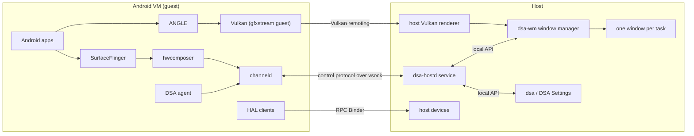

<div align="center">


# Desktop Subsystem for Android™

**让 Android 应用成为真正的桌面窗口，全部基于开源技术。**

[](https://github.com/thisisthepy/desktop-subsystem-for-android/actions/workflows/test.yml)
[](https://github.com/thisisthepy/desktop-subsystem-for-android/actions/workflows/test-installer.yml)
[](https://github.com/thisisthepy/desktop-subsystem-for-android/actions/workflows/test-image.yml)
[](https://github.com/thisisthepy/desktop-subsystem-for-android/actions/workflows/test-kernel.yml)
[](https://github.com/thisisthepy/desktop-subsystem-for-android/releases/latest)
[](https://github.com/thisisthepy/desktop-subsystem-for-android/blob/main/LICENSE)

[English](../../README.md) · [한국어](README_ko.md) · [日本語](README_ja.md) · **简体中文** · [繁體中文](README_zh-TW.md) · [Español](README_es.md) · [Français](README_fr.md) · [Deutsch](README_de.md) · [Português (Brasil)](README_pt-BR.md) · [Русский](README_ru.md) · [Italiano](README_it.md) · [Tiếng Việt](README_vi.md) · [Bahasa Indonesia](README_id.md) · [Türkçe](README_tr.md)

</div>

> DSA 是一个独立的开源项目。
> 它与 Microsoft 或 Google 没有关联，也未获得二者的认可或赞助。
> Android 是 Google LLC 的商标。
> Windows 是 Microsoft 集团公司的商标。

## 这是什么

DSA 在自己的轻量级虚拟机中运行 Android，
并把每个 Android 任务显示在一个原生桌面窗口中。
每个应用都有自己的任务栏按钮、开始菜单项、通知，
以及在已安装应用列表中的条目，
就像 Windows Subsystem for Android（WSA）那样。
Microsoft 已于 2025 年 3 月 5 日终止了 WSA。
DSA 的每个部分都是开源的，因此任何人都可以让它延续下去。

**状态。** DSA 可在 Windows 11 上运行，支持 x64 和 ARM64 电脑。
1.0 之前的版本都是预发布版本；
从 1.0 起，版本分为稳定渠道和预发布渠道
（参见[更新与发布渠道](#更新与发布渠道)）。
各项功能都在 CI 中测试，
在真实硬件上的手动检查会随每个版本持续进行，
所以请把您发现的问题告诉我们。
Linux 和 macOS 正在开发中，尚未发布
（参见[支持的平台](#支持的平台)）。

## 功能

**窗口与输入**

- 每个 Android 任务对应一个原生窗口，窗口就是应用本身。
  任务栏、Alt+Tab 和任务管理器中显示应用自己的程序名称和图标。
  没有显示整个屏幕的模拟器边框。
- 标题栏是应用的一部分：应用的颜色一直延伸到窗口顶部，
  Windows 11 的标题栏按钮位于其上，应用的图标和名称位于左侧。
  当应用可以返回时，图标会变成返回箭头。
  贴靠布局、拖动、双击最大化和窗口菜单（Alt+Space）
  都与其他 Windows 应用一样可用。
- 窗口菜单增加了 **Full screen**（全屏）、
  **New window**（新窗口，适用于允许多个窗口的应用）、
  **Screenshot**（截图）、**Aspect ratio**（宽高比）、
  **Open by default**（默认打开）和 **App info**（应用信息）。
- 实时调整窗口大小而无需重新创建应用，最大化时填满显示器的工作区。
- 应用的全屏请求（例如视频播放器的全屏按钮）会填满屏幕；
  指针碰到屏幕顶部边缘时会显示标题栏。
  只隐藏自身栏的应用（例如短视频信息流）则留在窗口中。
  这两种行为都可以在 DSA Settings 中为所有应用或单个应用设置，
  F11 始终可以切换全屏。
- 在每台显示器上都输出清晰的画面。
  应用会以其打开时所在显示器的缩放比例打开。
  当您把它移到缩放比例不同的显示器上时，
  松开鼠标后它会以新的比例重新绘制，
  或者由 DSA 缩放其窗口，您可以为每个应用分别选择。
  已知在运行中更改缩放比例会出问题的应用（例如 YouTube），
  默认由 DSA 缩放。
- 应用中的文字跟随 Windows 的文本大小设置。
- 鼠标（支持悬停）、最多十指的触控、
  触控笔（压感、橡皮擦、笔杆按钮），以及支持所有布局的键盘。
- 通过 Windows 文本服务框架（TSF）进行文本输入：
  您的 Windows 输入法（包括韩语输入法）
  会在 Android 编辑框中直接组字，候选窗口显示在光标旁边。
  重新转换、触摸键盘、语音输入（Win+H）、手写和表情符号面板
  都直接作用于编辑框自身的文本。
  没有 Android 键盘应用。
- 可以在文件资源管理器和应用窗口之间双向拖放文件。
- DSA 窗口处于前台时，关闭 Windows 11 的三指和四指触控手势
  （默认开启此行为），让应用接收这些手势。
- 每个应用的无障碍树都公开给 Windows UI Automation（界面自动化），
  供屏幕阅读器和自动化工具使用
  （参见 [UI Automation](#ui-automation) 和[无障碍](#无障碍)）。

**外壳集成**

- 每个 Android 应用都有开始菜单项，并可通过 Windows 搜索找到，
  即使 Android 已停止也是如此；
  应用列在“设置 > 应用 > 已安装的应用”下，可以在那里卸载。
- 桌面快捷方式，以及应用自己的快捷方式（例如聊天应用的“新建聊天”）
  会出现在其任务栏和开始菜单的跳转列表中。
  应用改名后，其开始菜单项、桌面快捷方式和任务栏固定项都会使用新名称。
- Android 通知以 Windows 通知的形式显示，带有各应用的名称和图标；
  选择通知会打开应用，关闭通知会在 Android 中将其关闭。
- 在后台运行的应用显示为通知区域图标；
  播放媒体的应用支持媒体键和 Windows 媒体控件。
- Android 小部件可以放在桌面上，每个小部件都有自己的窗口。
- 文本剪贴板双向共享，网页链接在 Windows 浏览器中打开，
  Windows 文件可以在 Android 应用中打开或分享给 Android 应用，
  您的 Windows 文件夹也可以与 Android 共享。
- Android 的文件显示在文件资源管理器导航窗格的 **Android** 下。
- 安装 APK 的方式包括：双击、使用上下文菜单、把文件拖到窗口上，
  或使用 `dsa install`。
  在 Android 启动之前，会有一个窗口显示该 APK 的信息。
- Android 分享面板中的“Share on PC”：
  文本、链接和文件会发送到 Windows 共享窗口，包括附近共享。

**媒体与设备**

- 音频使用 Windows 默认的输出和输入设备，
  每个应用在音量合成器中都有单独的一行。
- 视频通过 Media Foundation 在主机 GPU 上解码：
  支持 H.264、HEVC、VP9 和 AV1，最高 4096x2304。
  解码后的画面通过主机与虚拟机共享的一块内存区域到达 Android，
  而不是通过视频通道复制。
  GPU 无法解码的格式由 Android 进行软件解码。
- 在主机上进行 GPU 渲染：
  通过 gfxstream 进行 Vulkan 远程调用，
  并在其上通过 ANGLE 提供 OpenGL ES。
- 摄像头、麦克风、位置、传感器（加速度计、陀螺仪、方向、光线）和电源，
  每一项都同时受 Windows 隐私设置和 Android 权限的控制。
- Android 的网络位置由主机提供，无论是否安装 Google Play。
  没有 Google Play 时，地址查询（`Geocoder`）
  会在本机上根据 DSA 自带的行政区划边界数据给出答案：
  一个位置会被转换为所在的国家、省和城市，
  在韩国还会转换为区和洞。
  整个过程不涉及服务器，也不需要密钥，位置信息始终留在本机。
  不提供街道地址，也不提供从地址转换为位置的功能。
  安装 Google Play 后，由 Google 的地理编码服务回答。

**系统**

- 以 Android 的 Doze 作为空闲状态：
  最后一个 Android 窗口关闭或最小化 30 秒后，Android 进入 Doze。
  CPU 休息时通知仍会到达，
  Android 运行期间空闲内存会归还给 Windows。
  打开应用时会立即唤醒它，无需等待启动。
  冻结 Android 是一个可选项，默认关闭。
- 每个 Windows 用户都有自己的 Android 和数据磁盘，存放在各自的用户配置文件中。
- 类似 `sudo` 的 root 访问权限，默认关闭。
  由管理员开启后，可以把每个应用以及开发者模式下的 `adb shell`
  设置为每次询问。
  请求会以该应用自己的名称和图标显示 Windows 管理员提示（UAC），
  批准有效 15 分钟。
  未获允许的应用完全看不到 `su`。
  每个请求都会被记录。
- 把应用数据加密备份到您的用户文件夹，默认关闭。
- DSA Settings：应用及其窗口、后台应用、小部件、显示与 GPU、内存、
  网络、设备标识、更新、附加组件、root 访问权限、带 adb 的开发者模式、
  Android 实时日志和诊断。
  其中的每一项也都有对应的 `dsa` 命令。

**由您选择的附加组件**

DSA 不附带任何 Google 软件。
下面每一项都只在您要求时才从其来源下载，
下载前 DSA 会向您显示来源和条款，
下载后会放在 Android 旁边的附加组件磁盘上。
系统映像永远不会被修改，
每一项都可以通过 DSA Settings 或命令行再次删除。

- **Google Play。** 使用 `dsa gapps install`，
  或 DSA Settings 中的 **Advanced** > **Google Play**，
  下载适用于您 Android 版本的公开 LiteGapps Core 软件包
  （Google Play 服务、Play 商店和账号同步）。
  此 Android 未经 Google 认证，因此 Google 可能会要求您注册设备；
  DSA Settings 会显示 Android ID 和用于注册的页面。
  Google Play 绝不会妨碍 Android 启动。
  Google 的应用遵循 Google 的条款。
- **Widevine L3。** 使用 `dsa drm widevine install`，
  或 **Advanced** > **Protected content**，
  从适用于您 Android 版本的 Google Android 模拟器映像中
  原样取出 Google 的 Widevine 模块
  （下载约 2 GB，只保留 Widevine）。
  之后流媒体应用就可以播放受保护的视频。
  在 L3 安全级别下，流媒体服务最多只提供标清画质，
  因此请在 Windows 浏览器或应用中观看高清内容。
- **ARM 转译。** 在 x64 电脑上，仅为 ARM 构建的应用通过转译器运行。
  开源转译器 Digitalis 随 x64 映像提供，从第一次启动起就会使用。
  您可以把它换成 Google 的转译器（`dsa arm-translation fetch google`）
  或您自己的软件包。
  只有 64 位 ARM 应用（`arm64-v8a`）可以运行。
  在 ARM64 电脑上，Android 本身就能运行 ARM 应用。

**不附带：** Google Play 服务、应用商店或任何其他 Google 二进制文件
（它们的许可证决定了应由用户自行选择），
以及 Microsoft 的任何 WSA 二进制文件。

## UI Automation

DSA 把每个 Android 应用窗口中的用户界面
公开给 Windows UI Automation（UIA），也就是 Windows 应用使用的同一套接口。
屏幕阅读器、测试工具和其他 UIA 客户端
会把 Android 应用的按钮、列表和文本框看作其窗口中的元素，
而不是一张图片。

**工作原理。** 当某个 UIA 客户端第一次向 DSA 应用窗口请求其树时，
窗口会请 Android 中的 DSA 代理开始监视该任务。
代理只读取该任务的 Android 无障碍节点，并发送给主机：
先发送整棵树，之后只发送变化部分。
主机把这棵树保存在窗口进程中，
因此每次读取属性和每次导航调用都在本地回答，无需往返虚拟机。
如果 30 秒内没有 UIA 客户端监听，监视就会停止，Android 也会停止读取节点。
不使用任何 UIA 客户端的用户不会为此付出任何开销。

**每个元素携带的信息。**

- **Control type**（控件类型），根据 Android 视图类及其状态确定：
  按钮、复选框、单选按钮、编辑框、滑块、进度条、组合框、列表、列表项、
  选项卡、菜单、图像、文本、文档（用于 `WebView`）、工具栏和组。
  Android 的开关是带有 Toggle 模式的按钮，标题是文本。
- **Name**（名称）：内容描述；没有时使用文本；
  再没有时使用空编辑框的提示文字。
  没有自己名称的可点击元素会采用其子元素的名称。
- **AutomationId**：Android 视图的资源 ID，例如 `com.example:id/send`。
- **ClassName**：Android 视图类。**FrameworkId** 为 `Android`。
- **HelpText**（提示文字）、**ItemStatus**（Android 的状态描述）、
  **IsEnabled**、**IsKeyboardFocusable**、**HasKeyboardFocus**、
  **IsPassword**，以及屏幕坐标下的 **BoundingRectangle**。
- Android 报告为对用户不可见的元素不会出现在树中。
- 密码框的内容绝不会以文本形式离开 Android：每个字符都以圆点表示。

**模式及其在 Android 中的操作。**

| UIA 模式 | Android 操作 |
|---|---|
| Invoke | `ACTION_CLICK` |
| Value (`SetValue`) | `ACTION_SET_TEXT`，替换字段的全部文本 |
| Toggle | `ACTION_CLICK` |
| SelectionItem (`Select`) | `ACTION_SELECT`；节点没有选择操作时使用 `ACTION_CLICK` |
| Scroll | `ACTION_SCROLL_FORWARD` 和 `ACTION_SCROLL_BACKWARD`，按页滚动；不支持滚动百分比 |
| `SetFocus` | `ACTION_FOCUS`；节点无法获得输入焦点时使用 `ACTION_ACCESSIBILITY_FOCUS` |

这些操作直接作用于节点。它们不会移动鼠标，也不会注入触摸。

**事件。** 窗口会引发以下事件：
焦点变化（窗口位于前台时）；
子元素出现或消失时的结构变化；
名称、值、切换状态、选择、启用状态和边界矩形的属性变化。
只有在有客户端监听时才会引发事件。

**文本输入。** `SetValue` 一步设置字段的文本。
打字、组字和输入法则像人在键盘前操作一样，
通过 TSF 和应用的 `InputConnection` 进行。

**窗口本身。** 窗口的名称就是应用的名称。
标题栏按钮（最小化、最大化或还原、关闭）和标题栏上的返回箭头
都是树中带名称的按钮。

**在其他工具中使用。** 任何 UIA 客户端都可以使用，
例如 Inspect 和 Accessibility Insights for Windows，
或 FlaUI 等库。
先按名称找到应用的窗口，
再按 AutomationId、名称或控件类型找到其中的元素。
对于需要按下某个坐标点而不是某个元素的脚本，
`dsa tap <package> <x> <y>` 会在应用的任务内按下该点。

**尚未支持。** 目前没有 Text 模式，没有 RangeValue 或 ExpandCollapse 模式，
不能通过 UIA 长按，没有标题级别，
也没有通知或实时区域事件。
Android 的无障碍焦点不会导出，只导出输入焦点。
改进工作在议题
[#744](https://github.com/thisisthepy/desktop-subsystem-for-android/issues/744)
（未关闭）中跟踪。

## 无障碍

**屏幕阅读器。** NVDA 和讲述人（Narrator）
通过上面介绍的 UI Automation 树朗读 Android 应用：
控件有名称和角色，焦点跟随键盘，
按钮、开关、列表和文本框都可以不用鼠标操作。
JAWS 使用同一棵树；项目尚未对其进行检查，欢迎反馈。

**正在改进的内容。** 以下各项来自一位屏幕阅读器用户的报告，即议题
[#744](https://github.com/thisisthepy/desktop-subsystem-for-android/issues/744)。
每一项都尚未完成，并在该议题中跟踪：

- **更快的焦点。** 目前焦点变化会先在 Android 中等待，然后才到达 Windows，
  按键后大约需要 250 到 450 毫秒；
  按住方向键时，每秒大约移动四步。
  计划是立即发送焦点变化，只读取事件来源的任务，
  并且只在有 UIA 客户端监听时使用较短的时间间隔。
- **无障碍焦点。** 目前只导出输入焦点，
  因此 Android 无障碍焦点的移动不会引发焦点事件。
- **Text 模式。** 编辑框还没有 Text 模式，
  NVDA 需要用它按字符、单词和行来朗读和查看文本。
  编辑框的值可以读取和设置。

**DSA 自己的窗口。**

- **DSA Settings** 可以用键盘和屏幕阅读器操作：
  其导航、行和控件都是带名称的 UIA 元素。
- **APK Installer** 为其每个元素命名，
  其 **More** 链接可以通过 UIA 展开和折叠。
- **桌面上的小部件**可以获得键盘焦点。
  Enter、空格键、菜单键和 Shift+F10 会打开小部件的菜单。
- 小部件和通知区域图标的**菜单**是支持键盘导航的 UIA 菜单，
  **确认对话框**有访问键和默认按钮。
- **root 提示**就是 Windows 自己的管理员提示（UAC）。
- 在高对比度主题下，标题栏按钮使用系统颜色。

在 Linux 上，主机把同一棵树导出到 AT-SPI，
并支持按字符、单词和行读取文本，供 Orca 使用；
Linux 版本尚未发布。macOS 主机目前还不导出应用树。

**报告问题。** 请提交一个
[议题](https://github.com/thisisthepy/desktop-subsystem-for-android/issues/new)，
写明屏幕阅读器及其版本、应用、您做了什么、听到了什么以及期望听到什么。
附上由 `dsa logs collect -o diag.zip` 生成的诊断包会有帮助。
也欢迎到 [DSA Discord](https://discord.gg/MtpQnR4eQQ) 提问。

## 支持的平台

| 主机 | 状态 |
|---|---|
| Windows 11，x64 | 已发布，文件名为 `DSA-v<version>-win-x64-setup.exe` |
| Windows 11，ARM64 | 已发布，文件名为 `DSA-v<version>-win-arm64-setup.exe`。Android 同样是 ARM64，因此 ARM 应用无需转译即可运行 |
| Linux（x64、ARM64） | 开发中，尚未发布。KVM 主机、Wayland 合成器以及 `.deb` 和 `.rpm` 软件包已在 CI 中构建并运行 |
| macOS（Apple 芯片） | 开发中，尚未发布。基于 Apple Virtualization 框架的主机及其应用包已在 CI 中构建 |

### Android 版本

DSA 支持最新的两个 Android 主版本：目前是 Android 16 和 Android 17。
当再往后第二个更新的主版本发布时，旧版本就不再受支持，
因此 Android 16 会一直受支持到 Android 18 发布为止。
映像更新程序会把每个用户迁移到受支持的版本，
并且绝不会自行降到更低的主版本。
您可以在 DSA Settings 中或使用 `dsa android use`
选择任一受支持的版本；
切换到较旧的版本会清除 Android 数据，
因为 Android 无法读取较新版本写入的数据。

<p align="center">
  
</p>

今天之后的日期是预计日期，并非已发布版本。

## 安装

**您需要**一台运行 Windows 11 的 x64 或 ARM64 电脑，
并开启 Windows 功能 **虚拟机平台**（Virtual Machine Platform）。
安装程序会检查该功能，如果未开启，会停止并给出操作说明。

1. 开启**虚拟机平台**：
   “设置 > 系统 > 可选功能 > 更多 Windows 功能”，
   或在管理员终端中运行
   `dism /online /enable-feature /featurename:VirtualMachinePlatform /all`。
   然后重启电脑。
2. 从[最新版本](https://github.com/thisisthepy/desktop-subsystem-for-android/releases/latest)
   下载 `DSA-v<version>-win-x64-setup.exe`
   （ARM64 电脑请下载 `DSA-v<version>-win-arm64-setup.exe`），
   并用 `SHA256SUMS.txt` 进行校验。
3. 运行它。安装程序会安装 `DsaHost` 服务、`dsa` 命令、DSA Settings、
   APK Installer 和第一个 Android 映像
   （如果安装程序未包含映像，则会下载）。
   Android 会在您登录时启动，所以您打开的第一个应用无需等待启动。

无需自行编译内核，也不会更改您的 WSL 设置：
DSA 自带内核和虚拟机。
卸载会删除 DSA 写入的所有内容，只保留每个用户的 Android 磁盘。

## 更新与发布渠道

DSA 会更新自身和 Android 映像。
两者都经过签名，签名、大小或哈希值不匹配的内容一律不会应用。

- **DSA 本身。** 服务会检查一份签名的版本列表，
  并在没有任何用户的 Android 运行时安装更新的版本；
  否则会等待，而 `dsa update` 会立即安装。
  更新前后都会通知您。更新绝不会把 DSA 降到更低的版本。
- **渠道。** 从 1.0 起有两个渠道：
  **stable**（稳定版），以及用于尚在完善中的版本的 **pre-release**（预发布版）。
  预发布渠道会取两者中较新的那个版本。
  您的渠道取决于您使用的安装程序，升级时保持不变。
  可以在 DSA Settings 的 **Updates** 页面上用
  **Get pre-release versions** 更改，
  或使用 `dsa settings set prerelease-updates on|off`（需要管理员）。
  退出预发布渠道绝不会让 DSA 回退：它会等待更新的稳定版本。
  1.0 之前的每个版本都是预发布版本。
- **Android 映像。** 映像更新与渠道无关。
  无法启动的映像会被替换为上一个正常的映像，`dsa status` 会提示这一点。
  开启 **Restart Android into updates by itself** 后，
  当没有打开任何应用窗口时，Android 会重启并进入已下载的更新。
- **关闭更新。** 管理员可以在 **Updates** 页面上关闭
  **Update DSA automatically** 和
  **Update the Android image automatically**。

稳定版本只从 `main` 经过审查后发布。
`develop` 的构建是预发布版本或供贡献者使用的测试构建。

## 快速入门

从开始菜单打开 Android 应用，或使用 `dsa` 命令：

```
dsa status                          # Android 的状态以及待安装的更新
dsa install app.apk                 # 安装 APK 或拆分 APK 包（.xapk、.apks、.apkm）
dsa apps list                       # 已安装的应用
dsa launch com.android.settings     # 在单独的窗口中打开应用
dsa settings set clipboard off      # 更改设置（DSA Settings 中有相同的开关）
dsa logcat -d -b all *:W            # Android 的日志，警告及以上级别
dsa logs collect -o diag.zip        # 问题报告所需的全部内容，打包为一个 zip
```

不带参数运行 `dsa` 会列出所有命令。
Android 的日志保存在内存中，只有在有程序读取时才会传到主机。
请把 `diag.zip` 附在问题报告中。

## 限制

以下是目前的情况：

- 只发布了 Windows 版本。Linux 和 macOS 正在开发中。
- DSA Settings 只有英语和韩语界面。
- 只能运行 64 位应用：`arm64-v8a`，以及在 x64 上的 `x86_64`。32 位应用无法运行。
- Widevine 为 L3 级别，因此受保护的视频流最多以标清播放。
- Google Play 在 DSA 上未经 Google 认证；Google 可能会要求您注册设备。
- 剪贴板只共享文本。
- 缩放选项 **System (forced)** 尚不可用，其效果与 **System** 相同。
- UI Automation 导出存在 [UI Automation](#ui-automation) 一节中列出的不足。
- 没有 Google Play 时，地址查询给出的是区域
  （从国家到城市，在韩国则到区），而不是街道地址。

## 用户指南

分步指南涵盖安装、应用与窗口、APK、文件、Android 版本、
设置、内存、开发者模式、故障排除和卸载：
[docs/guides](../guides/zh-CN/README.md)。
[介绍页面](../guides/intro/index.html)为初次接触的用户介绍本项目。

## 架构



- **客户机。** 一个使用平台签名的代理把显示设为自由窗口模式，
  并报告任务、应用、通知和无障碍树。
  hwcomposer 把每个任务的图层作为单独的显示交给主机。
  HAL 客户端通过 RPC Binder 访问主机设备。
  客户机中没有启动器、状态栏或键盘应用：主机就是外壳。
- **协议。** 只有一个定义 `dsa/protocol/control.proto`，
  并为 Rust、Java 和 C++ 生成编解码器。
  每个连接都会检查协议版本、架构哈希和每次启动生成的密钥。
- **主机。** `dsa/host/core/` 与平台无关：会话、应用注册表和生命周期策略。
  每个操作系统在 `dsa/host/platform/<os>/` 下
  添加虚拟机、传输层和窗口系统。
  在 Windows 上，虚拟机通过 Host Compute System 创建，
  画面通过 Direct3D 11 和 DirectComposition 从 GPU 送到每个窗口，
  从不经过 CPU。

## 从源代码构建

Rust crate 在 `dsa/` 中组成一个工作区：

```
cd dsa
cargo test --workspace
cargo build -p dsa-host-windows --release
```

其他部分有各自的构建方式，说明放在它们旁边：

- 安装程序：`dsa/host/platform/windows/installer/README.md`
- Windows 主机：`dsa/host/platform/windows/README.md`
- 客户机内核：`dsa/kernel/`
- Android 映像和客户机组件：`dsa/guest/`
- 图形路径：`dsa/graphics/`

上游项目（AOSP、gfxstream、内核）不会被直接收录到本仓库中：
脚本会获取固定的修订版本，并应用这里保存的补丁。
Python 工具使用 `uv run` 运行。

## 仓库结构

| 路径 | 内容 |
|---|---|
| `dsa/protocol/` | 客户机与主机之间的控制协议及其代码生成器 |
| `dsa/host/core/` | 与平台无关的主机 |
| `dsa/host/cli/` | `dsa` 命令 |
| `dsa/host/platform/windows/` | Windows 主机、窗口管理器、安装程序和 DSA Settings |
| `dsa/host/platform/linux/`、`macos/`、`unix/` | Linux 和 macOS 主机及其共享部分 |
| `dsa/graphics/` | Vulkan 远程调用，以 gfxstream 为基础 |
| `dsa/guest/` | 代理、hwcomposer、HAL 服务和映像配置 |
| `dsa/kernel/` | 客户机内核配置和构建 |
| `scripts/tests/` | 仓库检查 |
| `.github/` | CI 工作流、发布脚本和 README 使用的资源 |

## 参与贡献

DSA 还很年轻，仍在不断稳定中，
所以无论您手上是否有修复方案，每一份报告都有帮助。

<p>
  <a href="https://github.com/thisisthepy/desktop-subsystem-for-android/issues/new"></a>
  <a href="https://discord.gg/MtpQnR4eQQ"></a>
</p>

- **发现了错误或有新想法？**
  [提交议题](https://github.com/thisisthepy/desktop-subsystem-for-android/issues/new)。
  请说明您做了什么、发生了什么，
  并附上您的 Windows 版本号（`winver`）以及 DSA 和 Android 的版本（`dsa status`）。
  附上由 `dsa logs collect -o diag.zip` 生成的诊断包，会让错误更容易排查。
- **想先问问或只是聊聊？** 欢迎来
  [DSA Discord](https://discord.gg/MtpQnR4eQQ)。
  问题、您想运行的应用以及早期反馈，在那里都很受欢迎。
- **要提交修改？** 开发在 `develop` 分支上进行；`main` 由它发布而来。
  请向 `develop` 提交拉取请求，每个提交只包含一个逻辑修改，
  每项行为变化都要附带测试。
  生成的协议代码绝不手动编辑。
  请不要在文本中使用破折号（em dash）：仓库检查会拒绝它们。

## 许可证

[Apache-2.0](https://github.com/thisisthepy/desktop-subsystem-for-android/blob/main/LICENSE)。
随附的每个第三方组件都保留其自己的许可证，并在安装程序中列出。

## 商标

Android 是 Google LLC 的商标。
Windows 是 Microsoft 集团公司的商标。
DSA 与 Microsoft 或 Google 没有关联，也未获得二者的认可或赞助。

## Star 历史

<a href="https://www.star-history.com/#thisisthepy/desktop-subsystem-for-android&Date">
  <picture>
    <source media="(prefers-color-scheme: dark)" srcset="https://api.star-history.com/svg?repos=thisisthepy/desktop-subsystem-for-android&type=Date&theme=dark" />
    <source media="(prefers-color-scheme: light)" srcset="https://api.star-history.com/svg?repos=thisisthepy/desktop-subsystem-for-android&type=Date" />
    
  </picture>
</a>
