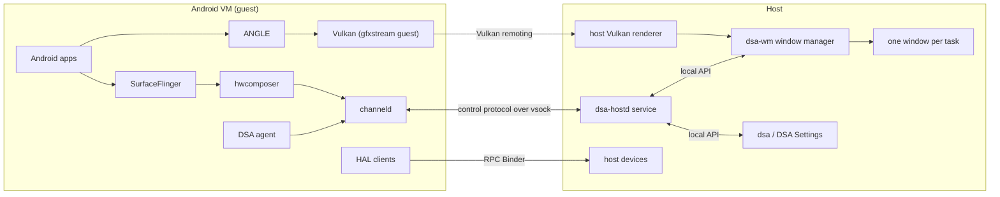

<div align="center">


# Desktop Subsystem for Android™

**讓 Android 應用程式成為真正的桌面視窗，全部建立在開放原始碼之上。**

[](https://github.com/thisisthepy/desktop-subsystem-for-android/actions/workflows/test.yml)
[](https://github.com/thisisthepy/desktop-subsystem-for-android/actions/workflows/test-installer.yml)
[](https://github.com/thisisthepy/desktop-subsystem-for-android/actions/workflows/test-image.yml)
[](https://github.com/thisisthepy/desktop-subsystem-for-android/actions/workflows/test-kernel.yml)
[](https://github.com/thisisthepy/desktop-subsystem-for-android/releases/latest)
[](https://github.com/thisisthepy/desktop-subsystem-for-android/blob/main/LICENSE)

[English](../../README.md) · [한국어](README_ko.md) · [日本語](README_ja.md) · [简体中文](README_zh-CN.md) · **繁體中文** · [Español](README_es.md) · [Français](README_fr.md) · [Deutsch](README_de.md) · [Português (Brasil)](README_pt-BR.md) · [Русский](README_ru.md) · [Italiano](README_it.md) · [Tiếng Việt](README_vi.md) · [Bahasa Indonesia](README_id.md) · [Türkçe](README_tr.md)

</div>

> DSA 是獨立的開放原始碼專案。
> DSA 與 Microsoft 或 Google 沒有任何關聯，也未獲得其背書或贊助。
> Android 是 Google LLC 的商標。
> Windows 是 Microsoft 集團旗下公司的商標。

## 簡介

DSA 在自己專屬的輕量 VM 中執行 Android，並將每個 Android 工作顯示在一個原生的桌面視窗中。
每個應用程式都有自己的工作列按鈕、開始功能表項目、通知，以及已安裝應用程式清單中的項目。
這與 Microsoft 已於 2025 年 3 月 5 日終止的 Windows Subsystem for Android（WSA）相同。
DSA 的每個部分都是開放原始碼，因此任何人都能延續它。

**狀態。** DSA 可在 Windows 11 的 x64 與 ARM64 電腦上執行。
1.0 之前的版本都是預先發行版。
從 1.0 起，版本分為穩定通道與預先發行通道（請參閱[更新與發行通道](#更新與發行通道)）。
各項功能都在 CI 中測試，而每次發行時也持續在實際硬體上手動檢查，因此歡迎回報您發現的問題。
Linux 與 macOS 仍在開發中，尚未發行（請參閱[支援平台](#支援平台)）。

## 功能

**視窗與輸入**

- 每個 Android 工作一個原生視窗，呈現的就是應用程式本身。
  工作列、Alt+Tab 與工作管理員中會顯示應用程式自己的程式名稱與圖示。
  沒有顯示整個畫面的模擬器外框。
- 標題列是應用程式的一部分：應用程式的色彩延伸到視窗頂端，Windows 11 的標題列按鈕疊在上方，應用程式的圖示與名稱位於左側。
  當應用程式可以返回時，圖示會變成返回箭頭。
  貼齊版面配置、拖曳、按兩下最大化，以及視窗功能表（Alt+Space）都與一般 Windows 應用程式相同。
- 視窗功能表另外提供 **Full screen**（全螢幕）、**New window**（新視窗，適用於允許開啟多個視窗的應用程式）、**Screenshot**（螢幕擷取畫面）、**Aspect ratio**（長寬比）、**Open by default**（預設開啟）與 **App info**（應用程式資訊）。
- 即時調整大小，不必重新建立應用程式；最大化時會填滿螢幕的工作區域。
- 應用程式的全螢幕要求（例如影片播放器的全螢幕按鈕）會填滿整個螢幕；指標碰觸頂端邊緣時會顯示標題列。
  只隱藏自身列的應用程式（例如短影片動態）則留在自己的視窗中。
  這兩者都可以在 DSA Settings 中為所有應用程式或個別應用程式選擇，而 F11 隨時都能切換全螢幕。
- 每台螢幕上的輸出都很清晰。
  應用程式會以開啟時所在螢幕的縮放比例開啟。
  移到縮放比例不同的螢幕時，可以為每個應用程式選擇：放開後以新的縮放比例重新繪製，或改由 DSA 縮放其視窗。
  已知執行中變更縮放比例就會出問題的應用程式（例如 YouTube），預設由 DSA 縮放。
- 應用程式中的文字會遵循 Windows 的文字大小設定。
- 滑鼠（含停留）、最多十指的觸控、手寫筆（壓力、橡皮擦、筆身按鈕），以及支援所有配置的鍵盤。
- 透過 Windows 文字服務架構（TSF）輸入文字：您的 Windows 輸入法（包括韓文）會直接在 Android 編輯器中組字，選字視窗就在游標旁邊。
  重新選字、觸控式鍵盤、語音輸入（Win+H）、手寫與表情符號面板都能作用於編輯器本身的文字。
  沒有 Android 鍵盤應用程式。
- 在檔案總管與應用程式視窗之間雙向拖曳檔案。
- DSA 視窗位於前景時，會關閉 Windows 11 的三指與四指觸控手勢（預設開啟此功能），讓應用程式能接收這些手勢。
- 每個應用程式的協助工具樹狀結構都會提供給 Windows UI Automation，供螢幕閱讀程式與自動化工具使用（請參閱 [UI Automation](#ui-automation) 與[無障礙功能](#無障礙功能)）。

**殼層整合**

- 每個 Android 應用程式都有開始功能表項目，也能用 Windows 搜尋找到，即使 Android 已停止也一樣；應用程式列在「設定 > 應用程式 > 已安裝的應用程式」中，可以在那裡解除安裝。
- 桌面捷徑，以及應用程式自己的捷徑（例如通訊軟體的新聊天）會出現在工作列與開始功能表的跳躍清單中。
  應用程式改名時，其開始功能表項目、桌面捷徑與工作列釘選都會跟著改用新名稱。
- Android 通知會以各應用程式的名稱與圖示顯示為 Windows 通知；選取通知會開啟應用程式，關閉通知也會在 Android 中將其關閉。
- 在背景執行的應用程式會顯示為通知區域圖示；播放媒體的應用程式也支援媒體鍵與 Windows 媒體控制項。
- 可將 Android 小工具放在桌面上，每個小工具都有自己的視窗。
- 文字剪貼簿雙向共用，網頁連結在 Windows 瀏覽器中開啟，Windows 檔案可在 Android 應用程式中開啟或分享給它，您的 Windows 資料夾也會與 Android 共用。
- Android 的檔案顯示在檔案總管瀏覽窗格的 **Android** 下。
- 可按兩下 APK、從右鍵功能表、將檔案拖放到視窗上，或使用 `dsa install` 來安裝 APK，並在 Android 啟動前用一個視窗顯示該 APK 的內容。
- Android 分享表單中的「Share on PC」：文字、連結與檔案會送到 Windows 的分享視窗，也包括鄰近分享。

**媒體與裝置**

- 音訊透過 Windows 預設的輸出與輸入裝置，音量混合程式中每個應用程式各有一列。
- 影片透過 Media Foundation 在主機 GPU 上解碼：H.264、HEVC、VP9 與 AV1，最高 4096x2304。
  解碼後的畫面透過主機與 VM 共用的記憶體區域傳給 Android，而不是經由視訊通道複製。
  GPU 不支援解碼的格式會在 Android 中以軟體解碼。
- 在主機上進行 GPU 繪製：透過 gfxstream 進行 Vulkan 遠端處理，並在其上透過 ANGLE 提供 OpenGL ES。
- 相機、麥克風、位置、感應器（加速度計、陀螺儀、方向、光線）與電源，每一項都同時受 Windows 隱私權設定與 Android 權限管控。
- Android 的網路定位由主機回應，無論是否安裝 Google Play。
  沒有 Google Play 時，地址查詢（`Geocoder`）會在電腦上以 DSA 隨附的行政區界資料回應：位置會轉換為國家、省（州）與城市，在韓國則包括區與洞。
  過程中不使用任何伺服器或金鑰，位置也不會離開電腦。
  不提供街道地址，也不提供從地址轉換為位置的功能。
  安裝 Google Play 時，由 Google 的地理編碼器回應。

**系統**

- 以 Android 的 Doze 作為閒置狀態：最後一個 Android 視窗關閉或最小化 30 秒後，Android 會進入 Doze，CPU 休息時通知仍持續送達，而閒置的記憶體會在 Android 執行期間歸還給 Windows。
  開啟應用程式會立即喚醒 Android，不必等待開機。
  凍結 Android 是一個選項，預設為關閉。
- 每位 Windows 使用者都有自己的 Android 與資料磁碟，存放在自己的設定檔中。
- 類似 `sudo` 的 root 存取權，預設為關閉。
  由系統管理員開啟後，可將每個應用程式，以及開發人員模式下的 `adb shell`，設為每次詢問。
  要求會以應用程式自己的名稱與圖示顯示 Windows 系統管理員提示（UAC），核准的效力持續 15 分鐘。
  未獲允許的應用程式完全看不到 `su`。
  每一次要求都會記錄下來。
- 將應用程式資料加密備份到您的使用者資料夾，預設為關閉。
- DSA Settings：應用程式與其視窗、背景應用程式、小工具、顯示與 GPU、記憶體、網路、裝置識別、更新、附加元件、root 存取權、含 adb 的開發人員模式、Android 的即時記錄與診斷。
  其中的每一項也都有對應的 `dsa` 指令。

**由您選擇的附加元件**

DSA 不隨附任何 Google 軟體。
以下每一項都只在您要求時才從其來源下載，下載前 DSA 會先向您顯示來源與條款，並放在 Android 旁的附加元件磁碟上。
系統映像永遠不會被修改，而且每一項都可以再從 DSA Settings 或命令列移除。

- **Google Play。** 執行 `dsa gapps install`，或在 DSA Settings 中選擇 **Advanced**（進階）> **Google Play**，即可為您的 Android 版本下載公開的 LiteGapps Core 套件（Google Play 服務、Play 商店與帳戶同步）。
  此 Android 未經 Google 認證，因此 Google 可能會要求您註冊裝置；DSA Settings 會顯示 Android ID 與註冊頁面。
  Google Play 絕不會妨礙 Android 啟動。
  Google 的應用程式遵循 Google 的條款。
- **Widevine L3。** 執行 `dsa drm widevine install`，或選擇 **Advanced** > **Protected content**（受保護的內容），即可從適用於您 Android 版本的 Google Android 模擬器映像中取出未經修改的 Google Widevine 模組（下載約 2 GB；只保留 Widevine）。
  之後串流應用程式就能播放受保護的影片。
  在安全性等級 L3 下，串流服務最多只提供標準畫質，因此若要觀看高畫質內容，請使用 Windows 的瀏覽器或應用程式。
- **ARM 轉譯。** 在 x64 電腦上，僅為 ARM 建置的應用程式會透過轉譯器執行。
  開放原始碼轉譯器 Digitalis 隨附於 x64 映像中，從第一次啟動就會使用。
  您可以改用 Google 的轉譯器（`dsa arm-translation fetch google`）或您自己的套件。
  只能執行 64 位元 ARM 應用程式（`arm64-v8a`）。
  在 ARM64 電腦上，Android 會自行執行 ARM 應用程式。

**不隨附：** Google Play 服務、應用程式商店或任何其他 Google 二進位檔（其授權使它們只能由使用者自行選擇），以及任何 Microsoft 的 WSA 二進位檔。

## UI Automation

DSA 會將每個 Android 應用程式視窗內的使用者介面提供給 Windows UI Automation（UIA，使用者介面自動化），也就是 Windows 應用程式所使用的同一套介面。
螢幕閱讀程式、測試工具與其他 UIA 用戶端看到的 Android 應用程式按鈕、清單與文字欄位，都是其視窗中的元素，而不是一張圖片。

**運作方式。** 當 UIA 用戶端第一次向 DSA 應用程式視窗要求其樹狀結構時，視窗會請 Android 中的 DSA 代理程式監看該工作。
代理程式只讀取該工作的 Android 協助工具節點，並傳送給主機：先傳送整個樹狀結構，之後再傳送變更。
主機將樹狀結構保存在視窗處理程序中，因此每次讀取屬性與每次巡覽呼叫都在本機回應，不需往返 VM。
當 30 秒內沒有任何 UIA 用戶端在接聽時，監看就會停止，Android 也會停止讀取節點。
不使用任何 UIA 用戶端的使用者不需為此付出任何代價。

**每個元素包含的內容。**

- **控制項類型**，依 Android 檢視類別及其狀態決定：按鈕、核取方塊、選項按鈕、編輯、滑桿、進度列、下拉式方塊、清單、清單項目、索引標籤、功能表、影像、文字、文件（適用於 `WebView`）、工具列與群組。
  Android 的開關是具有 Toggle 模式的按鈕，標題則是文字。
- **Name**：內容說明，若無則為文字，再無則為空白編輯欄位的提示。
  沒有自身名稱的可點選元素會採用其子元素的名稱。
- **AutomationId**：Android 檢視的資源 ID，例如 `com.example:id/send`。
- **ClassName**：Android 檢視類別。**FrameworkId** 為 `Android`。
- **HelpText**（提示）、**ItemStatus**（Android 的狀態說明）、**IsEnabled**、**IsKeyboardFocusable**、**HasKeyboardFocus**、**IsPassword**，以及以螢幕座標表示的 **BoundingRectangle**。
- Android 回報為使用者看不到的元素不會出現在樹狀結構中。
- 密碼欄位的內容絕不會以文字形式離開 Android：每個字元都會以圓點送達。

**模式及其在 Android 中的動作。**

| UIA 模式 | Android 動作 |
|---|---|
| Invoke | `ACTION_CLICK` |
| Value（`SetValue`） | `ACTION_SET_TEXT`，會取代欄位的全部文字 |
| Toggle | `ACTION_CLICK` |
| SelectionItem（`Select`） | `ACTION_SELECT`；節點沒有選取動作時為 `ACTION_CLICK` |
| Scroll | `ACTION_SCROLL_FORWARD` 與 `ACTION_SCROLL_BACKWARD`，以頁為單位；沒有捲動百分比 |
| `SetFocus` | `ACTION_FOCUS`；節點無法取得輸入焦點時為 `ACTION_ACCESSIBILITY_FOCUS` |

這些動作會直接傳給節點。
它們不會移動滑鼠，也不會注入觸控。

**事件。** 視窗會引發焦點變更（位於前景時）、子元素出現或消失時的結構變更，以及名稱、值、切換狀態、選取、啟用狀態與周框矩形的屬性變更。
只有在用戶端接聽時才會引發事件。

**文字輸入。** `SetValue` 一次設定欄位的文字。
打字、組字與輸入法則與坐在鍵盤前的人一樣，透過 TSF 與應用程式的 `InputConnection` 進行。

**視窗本身。** 視窗的名稱就是應用程式的名稱。
標題列按鈕（最小化、最大化或還原、關閉）與標題列的返回箭頭，在樹狀結構中都是具名的按鈕。

**從其他工具使用。** 任何 UIA 用戶端都能使用，例如 Inspect 與 Accessibility Insights for Windows，或 FlaUI 等程式庫。
先依名稱找到應用程式的視窗，再依 AutomationId、名稱或控制項類型找到其元素。
若指令碼需要按下某個位置而不是某個元素，`dsa tap <package> <x> <y>` 會在應用程式的工作內按下。

**尚未支援。** 沒有 Text 模式，沒有 RangeValue 或 ExpandCollapse 模式，無法透過 UIA 長按，沒有標題層級，也沒有通知或即時區域事件。
Android 的協助工具焦點不會匯出，只匯出輸入焦點。
改善項目在 issue [#744](https://github.com/thisisthepy/desktop-subsystem-for-android/issues/744)（開啟中）中追蹤。

## 無障礙功能

**螢幕閱讀程式。** NVDA 與朗讀程式（Narrator）會透過上述的 UI Automation 樹狀結構朗讀 Android 應用程式：控制項有名稱與角色，焦點跟隨鍵盤，而按鈕、開關、清單與文字欄位都能在不用滑鼠的情況下操作。
JAWS 使用相同的樹狀結構；本專案尚未檢查，因此歡迎回報。

**正在改善的項目。** 以下來自一位螢幕閱讀程式使用者的回報，即 issue [#744](https://github.com/thisisthepy/desktop-subsystem-for-android/issues/744)。
每一項都仍在開啟中，並在該處追蹤：

- **更快的焦點。** 目前焦點變更會先在 Android 中等待，才傳到 Windows，大約是按鍵後 250 到 450 毫秒，而按住方向鍵時每秒約移動四步。
  計畫是立即傳送焦點變更、只讀取事件來源的那個工作，並只在 UIA 用戶端接聽時才使用較短的時間間隔。
- **協助工具焦點。** 目前只匯出輸入焦點，因此 Android 協助工具焦點的移動不會引發焦點事件。
- **Text 模式。** 編輯欄位尚未提供 Text 模式，NVDA 用它來逐字元、逐詞與逐行閱讀和檢視文字。
  欄位的值可以讀取與設定。

**DSA 自己的視窗。**

- **DSA Settings** 可搭配鍵盤與螢幕閱讀程式使用：其巡覽、各列與控制項都是具名的 UIA 元素。
- **APK Installer** 為其每個元素命名，其 **More**（更多）連結可透過 UIA 展開與摺疊。
- **桌面上的小工具**可取得鍵盤焦點。
  Enter、空白鍵、功能表鍵與 Shift+F10 會開啟小工具的功能表。
- 小工具與通知區域圖示的**功能表**是支援鍵盤巡覽的 UIA 功能表，而**確認對話方塊**有便捷鍵與預設按鈕。
- **root 提示**就是 Windows 本身的系統管理員提示（UAC）。
- 在高對比佈景主題下，標題列按鈕會使用系統色彩。

在 Linux 上，主機會將相同的樹狀結構匯出至 AT-SPI，並提供逐字元、逐詞與逐行的文字，供 Orca 使用；Linux 尚未發行。
macOS 主機目前還不會匯出應用程式樹狀結構。

**回報問題。** 請開啟一個 [issue](https://github.com/thisisthepy/desktop-subsystem-for-android/issues/new)，附上螢幕閱讀程式及其版本、應用程式、您做了什麼、聽到什麼，以及您原本預期的結果。
附上 `dsa logs collect -o diag.zip` 產生的診斷套件會很有幫助。
[DSA Discord](https://discord.gg/MtpQnR4eQQ) 也歡迎您前來提問。

## 支援平台

| 主機 | 狀態 |
|---|---|
| Windows 11，x64 | 以 `DSA-v<version>-win-x64-setup.exe` 發行 |
| Windows 11，ARM64 | 以 `DSA-v<version>-win-arm64-setup.exe` 發行。Android 也是 ARM64，因此 ARM 應用程式不需轉譯即可執行 |
| Linux（x64、ARM64） | 開發中，尚未發行。KVM 主機、Wayland 合成器，以及 `.deb` 與 `.rpm` 套件都能在 CI 中建置與執行 |
| macOS（Apple 晶片） | 開發中，尚未發行。以 Apple Virtualization 架構為基礎的主機及其應用程式套件組合都能在 CI 中建置 |

### Android 版本

DSA 支援最新的兩個 Android 主要版本：目前是 Android 16 與 Android 17。
當再新兩代的主要版本推出時，該版本就會結束支援，因此 Android 16 的支援會持續到 Android 18 發行為止。
映像更新程式會將每位使用者移到受支援的版本，而且絕不會自行降到較低的主要版本。
您可以在 DSA Settings 中或使用 `dsa android use` 選擇任一受支援的版本；改用較舊的版本會清除 Android 資料，因為 Android 無法讀取較新版本寫入的資料。

<p align="center">
  
</p>

晚於今天的日期是預計日期，並非已發行的版本。

## 安裝

**您需要** 一台搭載 Windows 11 的 x64 或 ARM64 電腦，並開啟 Windows 功能「虛擬機器平台」。
安裝程式會檢查此功能，若未開啟就會停止並顯示說明。

1. 開啟「虛擬機器平台」：前往「設定 > 系統 > 選用功能 > 更多 Windows 功能」，或在系統管理員終端機中執行 `dism /online /enable-feature /featurename:VirtualMachinePlatform /all`。
   然後重新啟動。
2. 從[最新版本](https://github.com/thisisthepy/desktop-subsystem-for-android/releases/latest)下載 `DSA-v<version>-win-x64-setup.exe`（ARM64 電腦則下載 `DSA-v<version>-win-arm64-setup.exe`），並以 `SHA256SUMS.txt` 核對。
3. 執行該檔案。
   安裝程式會安裝 `DsaHost` 服務、`dsa` 指令、DSA Settings、APK Installer，以及第一個 Android 映像（安裝程式未內含映像時會另行下載）。
   Android 會在您登入時啟動，因此您開啟的第一個應用程式不必等待開機。

不必建置核心，也不會變更您的 WSL 設定：DSA 隨附自己的核心與自己的 VM。
解除安裝會移除 DSA 寫入的所有內容，但保留每位使用者的 Android 磁碟。

## 更新與發行通道

DSA 會更新自身與 Android 映像。
兩者都經過簽署，簽章、大小或雜湊值不符的內容一律不會套用。

- **DSA 本身。** 服務會檢查一份已簽署的版本清單，並在沒有任何使用者的 Android 正在執行時安裝較新的版本；否則會等待，而 `dsa update` 會立即安裝。
  安裝前後都會通知您。
  更新絕不會將 DSA 降到較低的版本。
- **通道。** 從 1.0 起有兩個通道：**stable**（穩定），以及供仍在完成中的版本使用的 **pre-release**（預先發行）。
  預先發行通道會取兩者中較新的版本。
  您的通道取決於您使用的安裝程式，升級時會保留。
  可在 DSA Settings 的 **Updates**（更新）頁面上以 **Get pre-release versions**（取得預先發行版本）變更，或執行 `dsa settings set prerelease-updates on|off`（系統管理員）。
  離開預先發行通道絕不會讓 DSA 退回舊版：它會等待更新的穩定版本。
  1.0 之前的每個版本都是預先發行版。
- **Android 映像。** 映像更新與通道無關。
  無法開機的映像會由上一個正常的映像取代，`dsa status` 也會說明這一點。
  開啟 **Restart Android into updates by itself**（自動重新啟動 Android 以套用更新）時，Android 會在沒有任何應用程式視窗開啟時重新啟動，以套用已下載的更新。
- **關閉更新。** 系統管理員可以在 **Updates** 頁面上關閉 **Update DSA automatically**（自動更新 DSA）與 **Update the Android image automatically**（自動更新 Android 映像）。

穩定版本只從 `main` 經過審查後產生。
`develop` 的建置是預先發行版，或供貢獻者使用的測試建置。

## 快速入門

從開始功能表開啟 Android 應用程式，或使用 `dsa` 指令：

```
dsa status                          # Android 的狀態與任何待處理的更新
dsa install app.apk                 # 安裝 APK 或分割 APK 套件組合（.xapk、.apks、.apkm）
dsa apps list                       # 已安裝的應用程式
dsa launch com.android.settings     # 在應用程式自己的視窗中開啟它
dsa settings set clipboard off      # 變更設定（DSA Settings 中有相同的開關）
dsa logcat -d -b all *:W            # Android 的記錄，警告以上層級
dsa logs collect -o diag.zip        # 問題回報所需的一切，打包成一個 zip
```

不加引數執行 `dsa` 會列出所有指令。
Android 的記錄保存在記憶體中，只在有程式讀取時才傳到主機。
請將 `diag.zip` 附加到問題回報中。

## 限制

以下是目前的情況：

- 只有 Windows 版已發行。Linux 與 macOS 仍在開發中。
- DSA Settings 只提供英文與韓文介面。
- 只能執行 64 位元應用程式：`arm64-v8a`，以及在 x64 上的 `x86_64`。32 位元應用程式無法執行。
- Widevine 為 L3，因此受保護的串流最多只能以標準畫質播放。
- Google Play 在 DSA 上未經 Google 認證；Google 可能會要求您註冊裝置。
- 剪貼簿只共用文字。
- **System (forced)** 縮放選項尚未提供，目前的運作方式與 **System** 相同。
- UI Automation 匯出有 [UI Automation](#ui-automation) 一節所列的不足之處。
- 沒有 Google Play 時的地址查詢只會提供地區（從國家到城市，在韓國則到區），不提供街道地址。

## 使用指南

逐步指南涵蓋安裝、應用程式與視窗、APK、檔案、Android 版本、設定、記憶體、開發人員模式、疑難排解與解除安裝：[docs/guides](../guides/zh-TW/README.md)。
[簡介頁面](../guides/intro/index.html)為初次接觸的人說明本專案。

## 架構



- **客體。** 以平台金鑰簽署的代理程式會將顯示設為自由形式，並回報工作、應用程式、通知與協助工具樹狀結構。
  hwcomposer 將每個工作的圖層作為獨立的顯示交給主機。
  HAL 用戶端透過 RPC Binder 存取主機裝置。
  沒有啟動器、狀態列或鍵盤應用程式：主機就是殼層。
- **通訊協定。** 只有一份定義 `dsa/protocol/control.proto`，並為 Rust、Java 與 C++ 產生編解碼器。
  每個連線都會檢查通訊協定版本、結構描述雜湊值，以及每次開機產生的密鑰。
- **主機。** `dsa/host/core/` 與平台無關：工作階段、應用程式登錄與生命週期原則。
  每個作業系統在 `dsa/host/platform/<os>/` 下加入 VM、傳輸層與視窗系統。
  在 Windows 上，VM 透過 Host Compute System 建立，畫面則經由 Direct3D 11 與 DirectComposition 從 GPU 送到每個視窗，絕不經過 CPU。

## 從原始碼建置

Rust crate 在 `dsa/` 中組成一個工作區：

```
cd dsa
cargo test --workspace
cargo build -p dsa-host-windows --release
```

其他部分有各自的建置方式，說明放在各部分旁邊：

- 安裝程式：`dsa/host/platform/windows/installer/README.md`
- Windows 主機：`dsa/host/platform/windows/README.md`
- 客體核心：`dsa/kernel/`
- Android 映像與客體元件：`dsa/guest/`
- 圖形路徑：`dsa/graphics/`

上游專案（AOSP、gfxstream、核心）不會收錄到本存放庫中：指令碼會擷取釘選的修訂版本，並套用這裡保存的修補程式。
Python 工具以 `uv run` 執行。

## 存放庫結構

| 路徑 | 內容 |
|---|---|
| `dsa/protocol/` | 客體與主機之間的控制通訊協定及其程式碼產生器 |
| `dsa/host/core/` | 與平台無關的主機 |
| `dsa/host/cli/` | `dsa` 指令 |
| `dsa/host/platform/windows/` | Windows 主機、視窗管理員、安裝程式與 DSA Settings |
| `dsa/host/platform/linux/`、`macos/`、`unix/` | Linux 與 macOS 主機，以及兩者共用的部分 |
| `dsa/graphics/` | 從 gfxstream 出發的 Vulkan 遠端處理 |
| `dsa/guest/` | 代理程式、hwcomposer、HAL 服務與映像設定 |
| `dsa/kernel/` | 客體核心的設定與建置 |
| `scripts/tests/` | 存放庫檢查 |
| `.github/` | CI 工作流程、發行指令碼與 README 的素材 |

## 參與貢獻

DSA 還很年輕，仍在穩定化階段，因此每一份回報都有幫助，無論您手上是否有修正方法。

<p>
  <a href="https://github.com/thisisthepy/desktop-subsystem-for-android/issues/new"></a>
  <a href="https://discord.gg/MtpQnR4eQQ"></a>
</p>

- **發現錯誤或有想法嗎？** 請[開啟 issue](https://github.com/thisisthepy/desktop-subsystem-for-android/issues/new)。
  說明您做了什麼、發生了什麼，並附上您的 Windows 組建（`winver`）以及 DSA 與 Android 的版本（`dsa status`）。
  附上 `dsa logs collect -o diag.zip` 產生的診斷套件，能讓錯誤更容易追查。
- **想先問問看，或只是想討論一下？** 歡迎來到 [DSA Discord](https://discord.gg/MtpQnR4eQQ)。
  不論是問題、您想執行的東西，還是初步的意見回饋，都很歡迎。
- **要送出變更嗎？** 開發工作在 `develop` 分支上進行；`main` 是從它發布的。
  請針對 `develop` 開啟提取要求，每個認可只包含一項邏輯變更，並為每項行為變更附上測試。
  產生的通訊協定程式碼絕不手動編輯。
  請不要在文字中使用 em dash：存放庫檢查會拒絕它。

## 授權

[Apache-2.0](https://github.com/thisisthepy/desktop-subsystem-for-android/blob/main/LICENSE)。
隨附的每個第三方元件都保有各自的授權，列於安裝程式中。

## 商標

Android 是 Google LLC 的商標。
Windows 是 Microsoft 集團旗下公司的商標。
DSA 與 Microsoft 或 Google 沒有任何關聯，也未獲得其背書或贊助。

## Star 歷史

<a href="https://www.star-history.com/#thisisthepy/desktop-subsystem-for-android&Date">
  <picture>
    <source media="(prefers-color-scheme: dark)" srcset="https://api.star-history.com/svg?repos=thisisthepy/desktop-subsystem-for-android&type=Date&theme=dark" />
    <source media="(prefers-color-scheme: light)" srcset="https://api.star-history.com/svg?repos=thisisthepy/desktop-subsystem-for-android&type=Date" />
    
  </picture>
</a>
